# Architektur – Pitch Coach (Live-Präsentationstrainer)

> Grafische Darstellung des Projekts als Mermaid-Diagramme.
> Generiert aus der Codeanalyse: `frontend/`, `backend/`, `api/`, `compose.yaml`.

## Code-Einstieg für die Jury

Die Anwendung ist ein modularer Python-Service mit einem separaten Worker.
Die Verzeichnisse `speech`, `transcription`, `sources`, `factcheck`, `questions`
und `review` trennen Fachlogik, Router und Datenverträge. Sie sind keine eigenen
Microservices. Gemeinsame Infrastruktur liegt in `connections.py`, `jobs.py`
und `job_storage.py`; Fachmodule hängen für Job-Speicherung nicht von `speech` ab.

| Dienst | Aufgabe und Grund |
| --- | --- |
| `frontend` | Next.js-Standalone-Server mit statischen Assets; Kamera, Pose und Wiedergabe laufen im Browser |
| `backend` | FastAPI: validiert Requests, liefert Status und stellt Jobs in die Queue |
| `worker` | Führt ASR, Embeddings und Quellenprüfung aus, ohne HTTP-Requests zu blockieren |
| `beat` | Ein einzelner Scheduler für die tägliche Retention; nutzt dasselbe Backend-Image |
| `redis` | Celery-Broker, kurzlebige Ergebnisse und begrenzte Fragerunden |
| `postgres` | Strukturierte Daten und Quellen-Chunks mit pgvector; zusätzliche persistente Review-/Progress-API |
| `storage` | SeaweedFS: Quellen-Originale, temporäre Analyse-Uploads, Job-Requests und Ergebnisse; aktiv benötigt |

**Datenfluss im aktuellen Web:** `features/live/recorder.ts` →
`transport.ts` → `/speech/analyze` → Worker → Review-Adapter.
`LiveSessionProvider.tsx` und `recording-storage.ts` speichern das lokale Video
und die Ergebnisse in IndexedDB. Quellen und Quellenprüfung sind angebunden.
Neue Web-Aufnahmen schreiben noch nicht in die persistente Session-/Take-API;
`/progress` bleibt eine separate API- und Beispielansicht ohne diese Verbindung.
Ein lokales Löschen entfernt deshalb keine separaten Backend-Daten.

**Jury-Betrieb:** Alle Anwendungskomponenten laufen aus gebauten Images, ohne
Source-Mounts oder Hot Reload. Nach Backend-Änderungen API, Worker und Beat
zusammen neu bauen. Der Frontend-Healthcheck prüft `/` und die API-Bereitschaft;
`npm run test:smoke` prüft zusätzlich Produktrouten, Stage und Medien-Assets.
`/stage` nutzt standardmäßig eine lokale Aufnahme ohne Medien-Upload.

**Lesereihenfolge:** [Produktumfang](01-product.md) →
[Integration](04-integration.md) → diese Diagramme →
[Grenzen und offene Abnahme](14-open-todos.md).
Research-Dokumente 07–09 beschreiben auch untersuchte Alternativen; der
implementierte Dialog steht in [Review und Agent](07-review-and-agent.md).

## 1. Systemübersicht

```mermaid
flowchart TB
    subgraph Clients["Clients"]
        WEB["Web-Frontend<br/>Next.js 16 / React 19 / TS<br/>Port 3000"]
    end

    subgraph ClientAI["KI im Client (lokal, kein Upload)"]
        MP_W["MediaPipe Pose: Lite / Heavy<br/>VIDEO (Standard) / IMAGE<br/>GPU-first, CPU-Fallback; max. 10 Hz"]
        MR["MediaRecorder<br/>Video + Audio"]
    end

    WEB -->|"LiveSessionProvider: abgeschlossene Takes und Review-Updates"| IDB["Browser IndexedDB<br/>Video, Pose-Log, Transkript, Feedback,<br/>Fragen, Antworten, Gespräch"]
    IDB -->|"Nach Reload: Blob-URLs neu erzeugen"| WEB

    subgraph API["api/ - Geteilter API-Vertrag"]
        OAS["openapi.json + schema.d.ts<br/>generiert aus FastAPI"]
    end

    subgraph Backend["backend/ - FastAPI (Python 3.12) Port 8000"]
        MAIN["FastAPI App<br/>Health, CORS, Router"]
        SP["Speech-Router<br/>POST /speech/analyze<br/>GET /speech/jobs/id<br/>WS /speech/live, /speech/feedback"]
        TR["Transcription-Router<br/>POST /transcription/analyze-words"]
        SO["Sources-Router<br/>/sources CRUD + /sources/search"]
        FC["Factcheck-Router<br/>POST /factcheck<br/>GET /factcheck/jobs/id, /settings"]
        QR["Questions-Router<br/>POST /questions, /questions/answers,<br/>/questions/answers/voice<br/>GET /questions/jobs/id, /questions/answers/id"]
        RV["Review-Router (additiv)<br/>/sessions, /takes, /jobs<br/>Idempotency-Key, camelCase<br/>verknüpft: X-Profile-Token"]
        PR["Progress-Router (additiv)<br/>/profiles, /progress, /goals<br/>X-Profile-Token, Idempotency-Key"]
        CEL["Celery App + Jobs"]
        TASKS["Celery Tasks<br/>analyze_speech, ingest_source,<br/>fact_check, generate_questions,<br/>review_answer, review_voice_answer,<br/>prepare_agent, run_take_job,<br/>recompute_progress, retention_sweep,<br/>worker_probe (Smoke)"]
    end

    subgraph Pipelines["Analyse-Pipelines (Worker)"]
        SIG["Signal-Analyse<br/>FFmpeg, RMS, YIN-Pitch, Silero VAD<br/>3 s stimmhafte Sprache, adaptive Referenz"]
        WORDS["Wort-Analyse<br/>Füller, Pausen, Tempo"]
        INGEST["RAG-Ingest<br/>Extrakt, Chunk, Embed"]
        EMB["Lokale Embeddings<br/>jina-embeddings-v2-base-de<br/>FastEmbed/ONNX"]
        FACT["Fact-Check<br/>Aussagen extrahieren, RAG zuerst,<br/>Web optional (Standard aus), Zitat-Check"]
        QUEST["Frage-Simulator / Voice-Agent<br/>Rolle: Student oder Professor/Tutor,<br/>Fragen aus Funden + Quellen,<br/>gesprochene Antwort -> ASR,<br/>Antwort-Abgleich mit Zitat-Check"]
        REVIEW["Take-Review<br/>Probe + Timestamp-Offset, Merge,<br/>Coverage, Evidence Cards,<br/>Template oder LLM + Code-Verifier<br/>Beobachtung, Erklärung, Übung + belegte Stärken"]
        PROG["Progress-Projektion<br/>take_quality -> take_metrics<br/>-> snapshots/change-points<br/>Theil-Sen, Mann-Kendall, CUSUM"]
    end

    subgraph Infra["Infrastruktur (Docker Compose)"]
        PG[("PostgreSQL 18<br/>+ pgvector<br/>Sessions, Progress-Profile,<br/>Metriken, Chunks")]
        RD[("Redis 8<br/>Broker DB0 / Results DB1<br/>Fragerunden mit fester TTL")]
        S3[("SeaweedFS<br/>S3-kompatibel<br/>Port 8333")]
    end

    EXT["ASR lokal: faster-whisper small<br/>CPU/int8, Deutsch<br/>Deepgram nur explizit optional"]
    LLM["LLM: Gemini (Cloud)<br/>3.1 Flash Lite / 3.8 Flash<br/>JSON-Modus, austauschbarer Adapter"]
    ELEVEN["ElevenLabs Agent, optional<br/>Live-Audio + Gespräch; serverseitiger Schlüssel"]
    WEBS["Websuche (Zweitquelle)<br/>Wikipedia-API oder Tavily"]
    ELEVEN -->|"search_web bei unzureichenden Upload-Auszügen<br/>Secret im ElevenLabs-Konto"| TAVILY["Tavily Search API<br/>Titel, URLs, Auszüge"]

    WEB -- "Kamera/Mikro" --> MP_W
    WEB -- "Aufnahme" --> MR
    WEB --> PCM["AudioWorklet: 16 kHz mono Int16<br/>Live-Sprechfeedback im normalen Studio; Stage lokal ohne Stream"]
    PCM -- "WS /api/speech/live: PCM" --> SP
    FLAGS["FeatureFlags pro Take<br/>Modell, Modus, Pose Lab,<br/>Sprachfeedback pro Typ"] --> MP_W
    MP_W -. "Track fingers, bis 5 Hz" .-> HAND["Hand Landmarker: 21 Punkte pro Hand<br/>auch ohne Torso, kein Upload"]
    HAND -. "Pose Lab" .-> LAB["T1–T12, lokale Diagnose<br/>6 zusätzliche Live-Regeln mit Events"]

    SP -- "finale Wörter + Text; vorher vorläufiger Text" --> WEB
    SP -- "nur bei provider=deepgram; PCM, serverseitiger Schlüssel" --> DG["Deepgram EU Nova-3<br/>Deutsch, live + Wort-Timestamps"]
    DG -- "vorläufig/final, CloseStream-Abschluss" --> SP
    PCM -- "WS /api/speech/feedback: PCM" --> SP
    SP --> LIVE_SIG["API-Thread: gleiche Signalregeln je ≥5 s neues PCM<br/>Adaptive Referenz ab stimmhafter Sprache<br/>max. 5 min, ein Slot; PCM nur im RAM"]
    LIVE_SIG -- "feedback: position_ms + alle qualifizierenden Events" --> WEB
    WEB --> HINT_FILTER["Client: ein Hinweis gleichzeitig,<br/>15-s-Cooldown pro Typ, 10-s-Frische"]
    MP_W --> RULES["PoseEvaluator: Neutralstellung, Geometrie, Mindestdauer<br/>posture/gesture-Events; lokale Evidenz"]

    WEB -- "fetch: /speech, /sources,<br/>/transcription, /factcheck,<br/>/questions, /profiles, /health" --> MAIN
    WEB -. "Typen" .-> OAS
    OAS -. "Quelle der Wahrheit" .-> MAIN

    MAIN --> SP
    MAIN --> TR
    MAIN --> SO
    MAIN --> FC
    MAIN --> QR
    QR -->|"GET /questions/pitch; PITCH_MODE"| FIXED["Feste Jury-Frage + vorbereitete Referenz<br/>kein Retrieval, kein geprüftes Quellenzitat"]
    MAIN --> RV
    MAIN --> PR
    RV -- "Session/Take/Event/Review/Job" --> PG
    RV -- "nur temporärer Analyse-Upload" --> S3
    RV -- "enqueue: nur Job-ID" --> CEL
    BEAT["Celery Beat: 03:15 UTC"] -->|"retention_sweep"| CEL
    TASKS --> RETENTION["Retention: begrenzte Batches,<br/>Profil nur entkoppeln,<br/>Blob-Outbox nach Commit leeren"]
    RETENTION -->|"retention_runs, blob_deletions"| PG
    RETENTION -->|"S3 Delete; Fehler mit Backoff"| S3
    QR -->|"kanonische Frage, reservierte Turns,<br/>Review-Cache, TTL ohne Verlängerung"| RD
    QUEST -->|"kurzer Runden-Lock; kein Modellaufruf im Lock"| RD
    PR -- "Profil, Qualität, Metriken, Ziele" --> PG
    PR -- "deterministische Projektion" --> PROG
    PR -- "Recompute: nur Run-ID, 202 + Status-URL" --> CEL
    PROG -- "Snapshots + Change-Points" --> PG

    SP -- "S3-Upload, Enqueue" --> S3
    SP -- "enqueue" --> CEL
    SO -- "S3-Upload, Enqueue" --> S3
    SO -- "enqueue" --> CEL
    FC -- "Request in S3" --> S3
    FC -- "enqueue" --> CEL
    QR -- "Request in S3" --> S3
    QR -- "enqueue" --> CEL

    CEL --> RD
    RD --> TASKS
    TASKS --> SIG
    TASKS --> WORDS
    TASKS --> INGEST
    TASKS --> FACT
    TASKS --> QUEST
    TASKS --> REVIEW
    TASKS -- "progress_runs: persistent, wiederholbar" --> PROG
    REVIEW --> PG
    REVIEW -- "Audio laden und löschen; keine Wiedergabe-Medien" --> S3
    REVIEW -. "nur geprüfte Karten, keine Tools" .-> LLM
    QUEST -- "Auszüge für Lücken<br/>und Antwort-Abgleich" --> PG
    QUEST -. "Sätze, Funde, Auszüge,<br/>getippte Antwort" .-> LLM
    QUEST -- "Ergebnis, Request löschen" --> S3
    TASKS --> AC["prepare_agent: Modus + Transkript<br/>Hybrid-Retrieval aus gespeicherter Collection"]
    AC --> PG
    AC --> S3
    QR -- "Signed URL anfordern" --> ELEVEN
    WEB -- "Signed WebSocket: Mikrofon + Kontext" --> ELEVEN
    FACT -- "Hybrid-Suche je Aussage" --> PG
    FACT -. "Transkript-Sätze, Auszüge" .-> LLM
    FACT -. "Suchanfragen, nur wenn<br/>Quellen nichts belegen" .-> WEBS
    FACT -- "Ergebnis, Request löschen" --> S3
    INGEST --> EMB
    WORDS -. "nur ohne finales live_transcript; transcribe=true" .-> EXT
    SIG --> S3
    WORDS --> S3
    INGEST --> PG
    INGEST --> S3
    SO -- "Hybrid-Suche<br/>Vektor + Keyword" --> PG
    MAIN -- "Health: Query, Ping, Bucket" --> PG
    MAIN -- "Health: Ping" --> RD
    MAIN -- "Health: Bucket" --> S3
```

## 2. Docker-Compose-Deployment

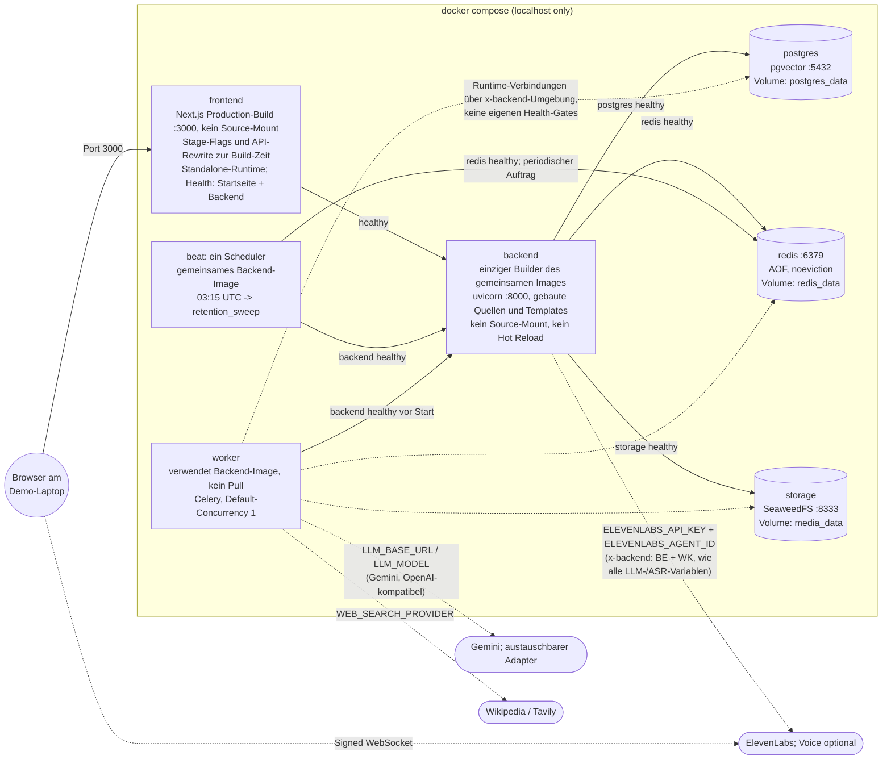

## 3. Datenfluss: Sprechanalyse (Live-Studio)

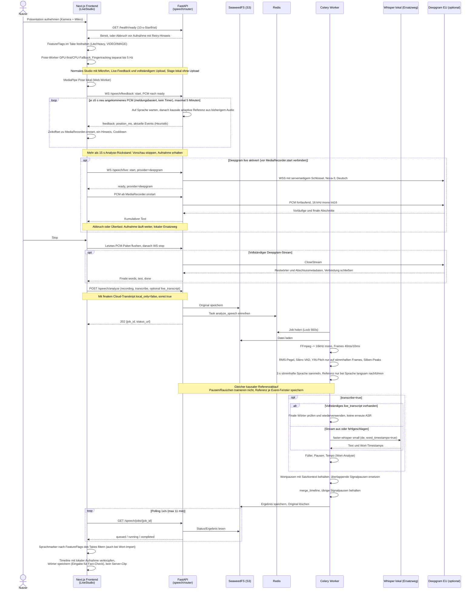

### 3b. Persistente Take-Review (Backend implementiert, Client-Anbindung separat)

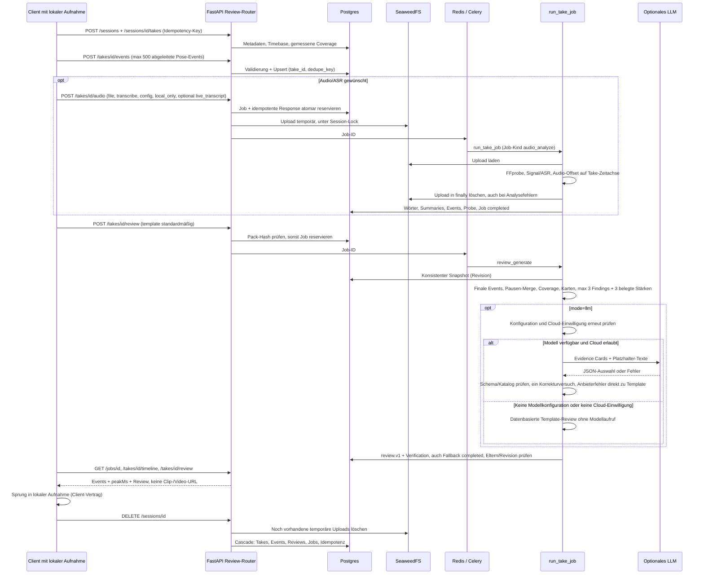

## 4. RAG-Pipeline: Quellen-Ingest, Suche und Fact-Check

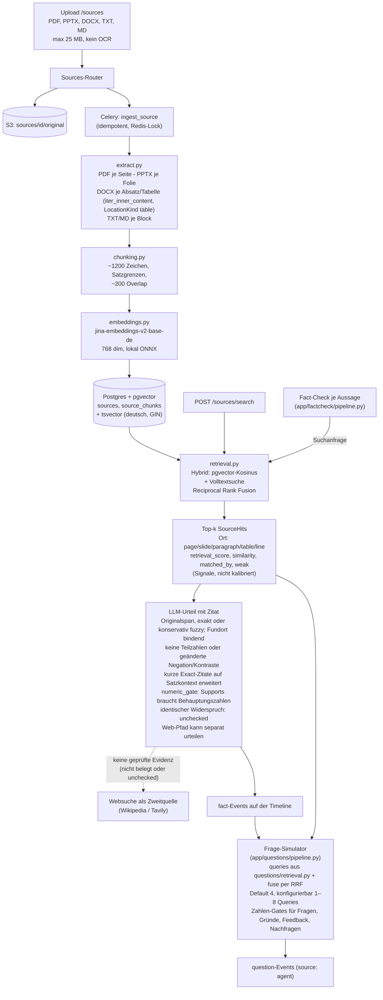

## 5. Datenfluss: Fact-Check

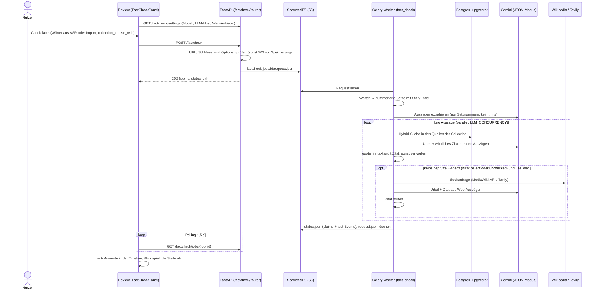

`FactCheckPanel` nutzt `evidenceHint` für `quote_verified`, `similarity`
und `weak`. Der Hinweis benennt auch
ungeprüfte Alt-Zitate und möglichen Kontext bei Kurz-Zitaten. Diese Angaben sind
keine Konfidenz- oder Wahrscheinlichkeitsanzeige; `retrieval_score` bleibt ein
Ordnungssignal. Der Web-Fragepfad bleibt der ElevenLabs-Sprachdialog.

## 5b. Datenfluss: Frage-Simulator und Voice-Agent

Der Web-Review hat zwei Ansichten: **Review moments** (begrenzte Wiedergabe-
Fenster im lokalen Video, zeitgenaue Anmerkungen) und **Practice questions**.
Auf `/sources` wird `presentationMode` (school/thesis) neben dem Upload
gewählt und im Browser gespeichert. Vor der Aufnahme werden Modus und
`sourceCollectionId` im Take eingefroren. Im Web-Sprachdialog und der
Fragen-API steuert derselbe Modus die fachlichen Schwerpunkte und die automatische Rolle:
Schul- oder Hochschullehrkraft; ohne Noten für gesprochene Antworten.
Im Web-Sprachdialog ist zusätzlich `voice_role` wählbar: Student, Professor
oder Lehrkraft ersetzen nur die Rolle, nicht den Präsentationskontext.
`null` erhält die automatische Rolle. `conversationRole` bleibt mit dem
Gespräch lokal in IndexedDB gespeichert; kein neues Postgres-Feld.
`startup` und `nonprofit` bleiben für alte Aufnahmen kompatibel, sind aber
nicht mehr auswählbar. Nach der
beendeten Sprachrunde zeigt der Client zusätzlich eine
Auswertung mit transparentem Heuristik-Score aus gemessenen Events; siehe
`docs/07-review-and-agent.md`.

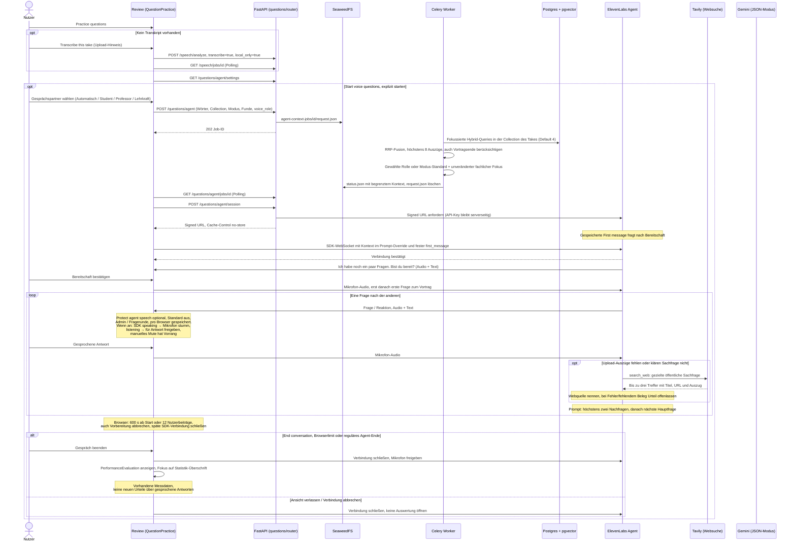

ElevenLabs-Antworten sind Modellvorschläge; sie durchlaufen nicht den
serverseitigen Zitat-Check der getippten Antworten. Der Kontext enthält nur
bis zu acht passende Auszüge, nicht die gesamte Bibliothek. Ohne konfigurierte
Zugangsdaten bleibt die Sprachfunktion sichtbar als nicht verfügbar. Der
bestehende `/questions/answers/voice`-Endpunkt mit ASR bleibt für API-Clients
kompatibel; der neue Web-Review verwendet den direkten ElevenLabs-Dialog.

Der kompatible API-Pfad hat einen eigenen, serverseitig begrenzten Ablauf:

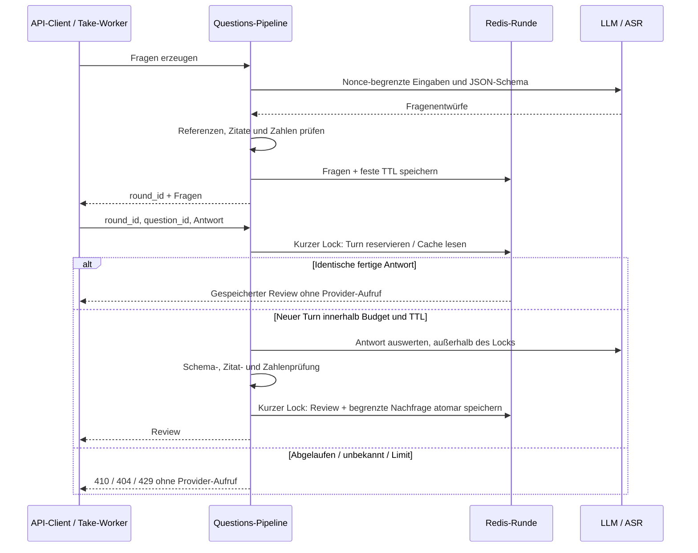

## 6. Frontend-Navigation (Web)

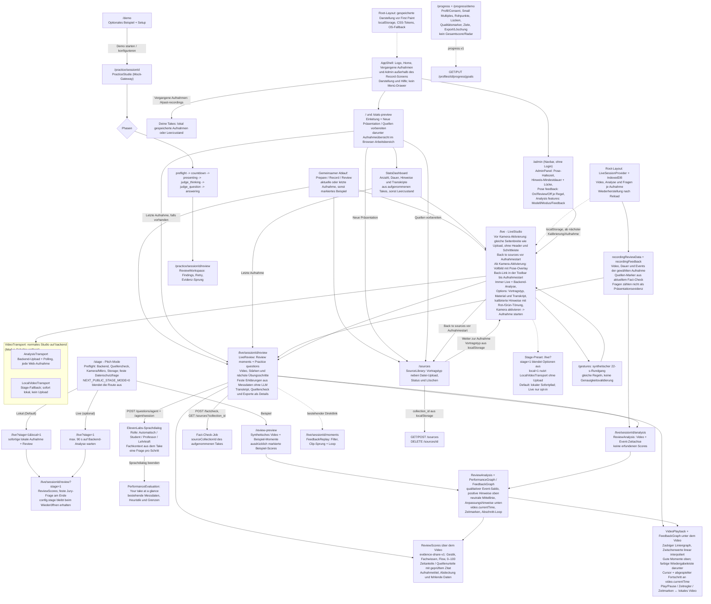

### Pitch Mode / Stage (25.10.2026)

`/stage` ist die schlanke Jury-Oberfläche. Sie ist standardmäßig über
`NEXT_PUBLIC_STAGE_MODE` aktiv und wird nur mit `0` ausgeblendet. Der Preflight
prüft Backend, Quellencheck, Kamera/Mikrofon und IndexedDB, ohne
Berechtigungen vorab anzufragen.

Der Stage-Pfad startet standardmäßig **lokal** (`/live?stage=1&local=1`): Der
`LocalVideoTransport` speichert die Aufnahme sofort in IndexedDB, das Review
öffnet ohne Backend-Wartezeit. Der Live-Pfad (`/live?stage=1`) bleibt parallel
verfügbar und ist opt-in; die Stage beendet nach 90 s das Warten auf Analyse.
Früher Review und Timeout behalten Video, Pose-Log und Live-Ereignisse.
Bereits eingereihte Backend-Jobs können weiterlaufen. Der normale `/live`-Pfad
bleibt unverändert.

`GET /questions/pitch` liefert die feste Datenschutzfrage und den Agent-Kontext
aus `backend/app/questions/pitch.py`, ohne LLM, Redis, Quellenabruf oder
Anbieter. `PITCH_MODE=0` deaktiviert den Endpunkt. Die Stage-Review zeigt genau
diese eine Frage mit 90-s-Antwortfenster und blendet die Auswertung nach der
Fragerunde aus; das getrennte `evidence-count-heuristic.v1`-System bleibt damit
außerhalb der Bühne. Die normale Review bleibt unverändert.

## 7. Demo-Plattform

Die native Mobile-App wurde auf Nutzerwunsch entfernt. Die Präsentation und
der Demo-Pfad verwenden ausschließlich die Web-App auf dem Laptop.

## 8. Datenmodell (Postgres)

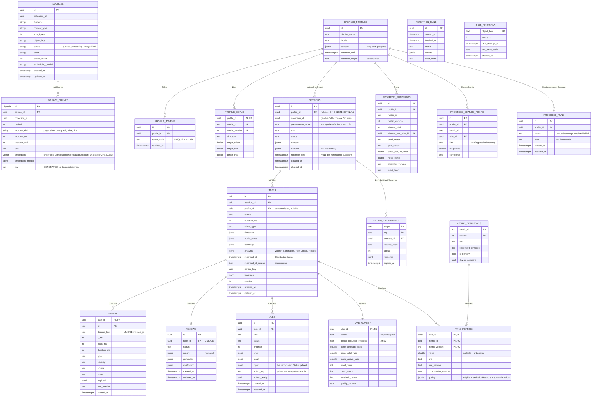

Zusätzlich gelten Constraints: `events.peak_ms` liegt innerhalb
`[t_ms, t_ms + duration_ms]`, `t_ms + duration_ms` ist auf 24 h begrenzt;
`source_chunks` hat `UNIQUE (source_id, ordinal)`; ein aktiver Job je
`(take_id, kind)` über partiellem Unique-Index (`queued`/`running`).
Die Embedding-Spalte ist bewusst dimensionsfrei, damit das Modell
ausgetauscht werden kann; Abfragen vergleichen nur Vektoren desselben
`embedding_model`.

`source_chunks.location_kind` ist `text NOT NULL` ohne CHECK-Constraint; der neue Wert `table` braucht deshalb keine Migration. Bestehende DOCX-Chunks behalten ihre alte Numerierung und sollten für konsistente Orte neu ingestiert werden.

Zusätzlich (außerhalb Postgres):

| Speicher | Inhalt |
| --- | --- |
| SeaweedFS `sources/{id}/original` | Original-Uploads |
| SeaweedFS `review-audio/{session}/{take}/{job}/upload` | nur temporär für Take-Analyse; vor erfolgreichem Job-Abschluss oder bei Analysefehler löschen, Cleanup-Fehler erneut versuchen |
| SeaweedFS `speech-jobs/{job_id}/` | Job-Konfig, Status, Analyse-Ergebnis (Original wird nach Abschluss gelöscht) |
| SeaweedFS `factcheck-jobs/{job_id}/` | Status und Fact-Check-Ergebnis; `request.json` (Transkript) wird nach Abschluss gelöscht |
| SeaweedFS `question-jobs/{job_id}/`, `answer-jobs/{job_id}/` | Status mit Fragen bzw. Antwort-Abgleich (bei Sprache mit Transkript der Antwort); `request.json` (Transkript, Antworttext) und `recording` (gesprochene Antwort) werden nach Abschluss gelöscht |
| SeaweedFS `agent-context-jobs/{job_id}/` | Vorbereiteter Prompt mit gekürztem Transkript und Quellenauszügen; Request wird gelöscht, Ergebnis bleibt wie andere Jobs gespeichert, noch kein TTL-Cleanup |
| Redis DB0 / DB1 | Celery-Broker / Result-Backend, Locks; `question-round:{id}` enthält kanonische Fragen, reservierte Turns und fertige Reviews bis zur festen TTL (Standard 600 s). Das kann Transkript-/Quellenauszüge enthalten. |
| Browser `sessionStorage` | Practice-Session-State (`pitch-coach:v1:<id>`) |
| Browser `localStorage` | Quellen-Collection-ID (`pitchcoach.sourceCollection`), optional Profil-ID/Token (`pp_…`) und zufälliger `deviceKey`; Token ist XSS-exponiert |
| Browser IndexedDB `presentation-recordings`, Store `recordings` | Abgeschlossene Live-Takes inklusive Video-/Pose-Log-Blobs, Config mit FeatureFlags/presentationMode/sourceCollectionId, ElevenLabs-Gespräch, Wörter, Pose-Events, Fact-Check, Fragen und Antworten; pro Take gespeichert, nach Reload wiederhergestellt. Objekt-URLs nur im Arbeitsspeicher. Löschen im Review entfernt den lokalen Take, keine Backend-Daten/Quellen. |

## 9. Event-Modell: gemeinsame Timeline

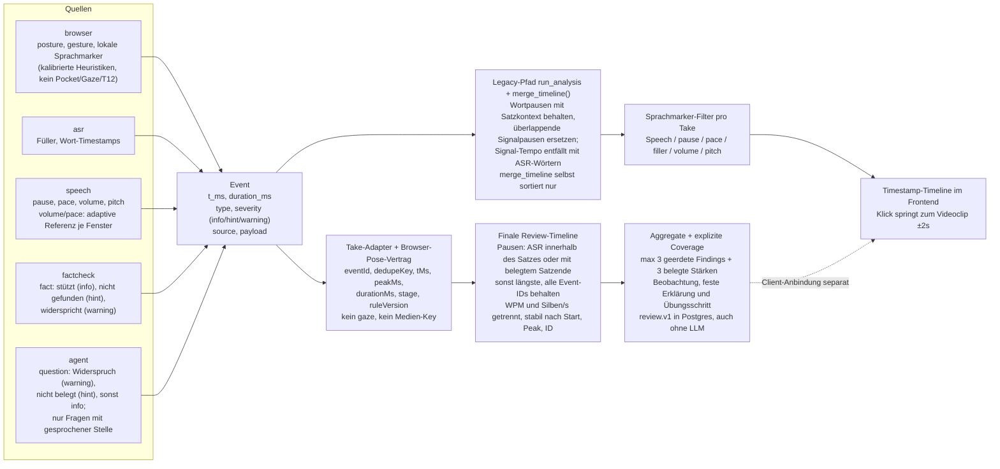

Pose-Event-Payload und JSONL tragen optional `runtime` mit Modell, Modus und
tatsächlichem Delegate; synthetische Fixtures haben keine erfundene Laufzeit.
Hand-/Lab-Ergebnisse fließen nicht in das gemeinsame Event-Modell.
Das lokale Browser-Modell typisiert Kopfregeln (`head_turned`, `head_down`)
als `gaze`; der persistente Vertrag kennt kein `gaze` — Kategorie ist dort
`head` (`head-lateral`, `head-orientation`), die Legacy-Anzeige mappt `gaze`
zu `gesture`. Lokale Sprachmarker tragen Start/Ende ab `MediaRecorder.onstart`
im Feedback-Vertrag. Bei überlappenden Typen ersetzt die vollständige
Backend-Analyse den Live-Marker im Review. Ein fehlender neutraler Handwert im
Pose-Payload ist `null`; die Haltungsreferenz benötigt keine ruhigen oder
sichtbaren Hände.

Alle Kennwerte sind Messwerte ohne Notenbewertung ("Measured values only; no score or grade").

## 10. API-Endpunkte im Überblick

```mermaid
flowchart LR
    subgraph API["Presentation Trainer API v0.1.0 (FastAPI)"]
        H1["GET /health/live"]
        H2["GET /health/ready"]
        S1["POST /speech/analyze"]
        S2["GET /speech/jobs/{job_id}"]
        S3LIVE["WS /speech/live: start, PCM, stop<br/>ready, words, text, done/error"]
        S4LIVE["WS /speech/feedback: start, PCM, stop<br/>ready, feedback, done/error; kein Whisper"]
        T1["POST /transcription/analyze-words"]
        R1["POST /sources"]
        R2["GET /sources?collection_id"]
        R3["GET /sources/{source_id}"]
        R4["DELETE /sources/{source_id}"]
        R5["POST /sources/search"]
        F1["GET /factcheck/settings"]
        F2["POST /factcheck"]
        F3["GET /factcheck/jobs/{job_id}"]
        Q1["POST /questions<br/>liefert round_id"]
        Q2["GET /questions/jobs/{job_id}"]
        Q3["POST /questions/answers<br/>round_id + question_id"]
        Q4["GET /questions/answers/{job_id}"]
        Q5["POST /questions/answers/voice<br/>round_id + question_id"]
        Q6["GET /questions/agent/settings"]
        Q7["POST /questions/agent (202)<br/>AgentRequest mit optionaler voice_role"]
        Q8["GET /questions/agent/jobs/{job_id}"]
        Q9["POST /questions/agent/session"]
        Q10["GET /questions/pitch<br/>feste Jury-Frage + Agent-Kontext<br/>ohne LLM, Redis oder Provider"]
        V1["POST /sessions<br/>GET / DELETE /sessions/id"]
        V2["POST /sessions/id/takes<br/>GET /takes/id"]
        V3["POST /takes/id/events<br/>POST /takes/id/audio"]
        V4["POST /takes/id/review<br/>GET /takes/id/review<br/>GET /takes/id/timeline"]
        V5["GET /jobs/id<br/>GET /takes/id/evaluation"]
        V6["POST /takes/id/factcheck<br/>POST / GET /takes/id/questions<br/>POST /takes/id/questions/answers"]
        P1["POST /profiles<br/>GET/PATCH/DELETE /profiles/id<br/>POST /profiles/id/rotate-token"]
        P2["GET /profiles/id/progress<br/>GET /profiles/id/progress/metricId<br/>POST /profiles/id/progress/recompute: 202<br/>GET /profiles/id/progress/runs/runId"]
        P3["GET/PUT/DELETE /profiles/id/goals/metricId<br/>GET /profiles/id/takes<br/>GET /profiles/id/export"]
    end

    WEBF["Web-Frontend"] --> H2 & S1 & S2 & S3LIVE & S4LIVE & T1 & R1 & R2 & R3 & R4 & R5 & F1 & F2 & F3 & Q1 & Q2 & Q3 & Q4 & Q5 & Q6 & Q7 & Q8 & Q9 & Q10
    CLIENT["Neuer Take-Client-Vertrag<br/>Frontend-Integration separat"] -.-> V1 & V2 & V3 & V4 & V5 & V6
    PROGRESS["Progress-Client<br/>X-Profile-Token"] -.-> P1 & P2 & P3
```

Der Vertrag wird über `npm run api:generate` aus dem FastAPI-Code generiert (`api/openapi.json` -> `api/schema.d.ts`) und ist damit immer synchron zum Backend.

Die Progress-Endpunkte sind serverseitig implementiert (`backend/app/progress/`),
aber noch nicht in der Web-Navigation verdrahtet. `POST /sessions` akzeptiert
optional `profileId` und verlangt dann `X-Profile-Token`;
alle verknüpften Session-/Take-/Job-Routen prüfen diesen Token, auch beim Lesen,
Upload, Löschen und bei Idempotenz-Retries. Abgelaufene Profile liefern `410`,
Löschen bleibt erlaubt. Sessions ohne Profil bleiben unverändert.
Explizites Recompute läuft über Celery und `progress_runs`; normale Reads
extrahieren nur geänderte Takes und schreiben das tatsächlich angefragte Fenster.
Die Profil-Löschung entkoppelt
Sessions/Takes (`ON DELETE SET NULL`) und entfernt nur die abgeleiteten
Progress-Daten. Verknüpfte Sessions haben keine automatische Session-Frist,
auch nach Entkopplung. Anonyme Sessions haben eine unabhängige Standardfrist
von 365 Tagen. `DELETE /profiles/{id}?deleteSessions=true` ist ein expliziter
zusätzlicher Löschauftrag für verknüpfte Session-Daten; lokale Videos bleiben
separat. Der tägliche Sweep löscht Profile, abgelaufene anonyme Sessions,
alte Take-Jobs und Idempotenzdaten in begrenzten Batches. S3-Löschungen stehen
vor dem Metadaten-Commit in `blob_deletions`; Fehler bleiben wiederholbar.
Quellen und Legacy-S3-Ergebnispräfixe werden nicht automatisch gescannt.

## Deep Research (24.10.2026)

Die Progress-Auswertung ist zusätzlich in
`docs/12-long-term-progress-data-design.md` §2.3 gegen NIST/USGS,
Theil–Sen, RCI/MDC, Regression-to-the-Mean, Benjamini–Hochberg und die
PostgreSQL-Partitionierungsdokumentation geprüft. Wichtig: p-Werte sind
diagnostisch, CUSUM liefert separate Change-Points, und mehrere Takes derselben
Session werden als abhängig markiert (Confidence `low`).

Die geplante inkrementelle LLM-/TTS-Pipeline ist in
`docs/11-deep-research-validation.md` gegen Forschung und offizielle
API-Dokumentation geprüft. Ihre Umsetzung ist noch offen. Drei Vorgaben:
Live-Analyse soll **ereignisgetrieben auf finalisierten ASR-Segmenten** laufen
(nicht auf einem festen 20–30-s-Takt), der finale Fact-Check ist
**quellengebunden, aber nicht autoritativ** (keine Live-Urteile,
„nicht gefunden“ ≠ „falsch“), und das Gespräch soll **harte Grenzen** haben
(3–5 Hauptfragen, ein Follow-up, 10 Minuten Hard Stop). Die separate
LLM-/TTS-Pipeline wurde nicht übernommen. Aktuell begrenzt die Fragen-API
Runden über Redis-TTL, reservierte Turns und ein globales Follow-up-Budget;
der ElevenLabs-Browserdialog endet nach 600 s oder 12 Nutzerbeiträgen.
Anbieter-Limits bleiben separat. Gemini ist Cloud ohne EU-Region-Pinning;
für den Prototyp nur synthetische Demo-Daten verwenden.
