# Architektur – Pitch Coach (Live-Präsentationstrainer)

> Grafische Darstellung des Projekts als Mermaid-Diagramme.
> Generiert aus der Codeanalyse: `frontend/`, `backend/`, `mobile/`, `api/`, `compose.yaml`.

## 1. Systemübersicht

```mermaid
flowchart TB
    subgraph Clients["Clients"]
        WEB["Web-Frontend<br/>Next.js 16 / React 19 / TS<br/>Port 3000"]
        MOB["Mobile App<br/>Expo / React Native"]
    end

    subgraph ClientAI["KI im Client (lokal, kein Upload)"]
        MP_W["MediaPipe Pose: Lite / Heavy<br/>VIDEO (Standard) / IMAGE<br/>GPU-first, CPU-Fallback; max. 10 Hz"]
        MP_M["react-native-mediapipe<br/>Pose Landmarker Lite"]
        MR["MediaRecorder / Vision Camera<br/>Video + Audio"]
    end

    subgraph API["api/ - Geteilter API-Vertrag"]
        OAS["openapi.json + schema.d.ts<br/>generiert aus FastAPI"]
    end

    subgraph Backend["backend/ - FastAPI (Python 3.12) Port 8000"]
        MAIN["FastAPI App<br/>Health, CORS, Router"]
        SP["Speech-Router<br/>POST /speech/analyze<br/>GET /speech/jobs/id<br/>WS /speech/live, /speech/feedback"]
        TR["Transcription-Router<br/>POST /transcription/analyze-words"]
        SO["Sources-Router<br/>/sources CRUD + /sources/search"]
        FC["Factcheck-Router<br/>POST /factcheck<br/>GET /factcheck/jobs/id, /settings"]
        QR["Questions-Router<br/>POST /questions, /questions/answers,<br/>/questions/answers/voice<br/>GET /questions/jobs/id, /questions/answers/id"]
        RV["Review-Router (additiv)<br/>/sessions, /takes, /jobs<br/>Idempotency-Key, camelCase"]
        CEL["Celery App + Jobs"]
        TASKS["Celery Tasks<br/>analyze_speech, ingest_source,<br/>fact_check, generate_questions,<br/>review_answer, review_voice_answer,<br/>prepare_agent, run_take_job"]
    end

    subgraph Pipelines["Analyse-Pipelines (Worker)"]
        SIG["Signal-Analyse<br/>FFmpeg, RMS, YIN-Pitch, Silero VAD<br/>3 s stimmhafte Sprache, adaptive Referenz"]
        WORDS["Wort-Analyse<br/>Füller, Pausen, Tempo"]
        INGEST["RAG-Ingest<br/>Extrakt, Chunk, Embed"]
        EMB["Lokale Embeddings<br/>jina-embeddings-v2-base-de<br/>FastEmbed/ONNX"]
        FACT["Fact-Check<br/>Aussagen extrahieren, RAG zuerst,<br/>Web optional (Standard aus), Zitat-Check"]
        QUEST["Frage-Simulator / Voice-Agent<br/>Rolle: Student oder Professor/Tutor,<br/>Fragen aus Funden + Quellen,<br/>gesprochene Antwort -> ASR,<br/>Antwort-Abgleich mit Zitat-Check"]
        REVIEW["Take-Review<br/>Probe + Timestamp-Offset, Merge,<br/>Coverage, Evidence Cards,<br/>Template oder LLM + Code-Verifier"]
    end

    subgraph Infra["Infrastruktur (Docker Compose)"]
        PG[("PostgreSQL 18<br/>+ pgvector<br/>Port 5432")]
        RD[("Redis 8<br/>Broker DB0 / Results DB1")]
        S3[("SeaweedFS<br/>S3-kompatibel<br/>Port 8333")]
    end

    EXT["ASR lokal: faster-whisper small<br/>CPU/int8, Deutsch<br/>Deepgram nur explizit optional"]
    LLM["LLM: Gemini (Cloud)<br/>3.1 Flash Lite / 3.8 Flash<br/>JSON-Modus, austauschbarer Adapter"]
    ELEVEN["ElevenLabs Agent, optional<br/>Live-Audio + Gespräch; serverseitiger Schlüssel"]
    WEBS["Websuche (Zweitquelle)<br/>Wikipedia-API oder Tavily"]

    WEB -- "Kamera/Mikro" --> MP_W
    WEB -- "Aufnahme" --> MR
    WEB --> PCM["AudioWorklet: 16 kHz mono Int16<br/>Live-Sprechfeedback im Backend-Modus"]
    PCM -- "WS /api/speech/live: PCM" --> SP
    FLAGS["FeatureFlags pro Take<br/>Modell, Modus, Pose Lab,<br/>Sprachfeedback pro Typ"] --> MP_W
    MP_W -. "Track fingers, bis 5 Hz" .-> HAND["Hand Landmarker: 21 Punkte pro Hand<br/>auch ohne Torso, kein Upload"]
    HAND -. "Pose Lab" .-> LAB["T1–T12, Pocket<br/>lokale Diagnose, keine Events"]
    WEB --> DSP["AudioWorklet lokal: RMS/YIN<br/>Energiehüllkurven-Tempo-Proxy"]
    DSP --> LOCAL_SPEECH["SpeechEvaluator: 3 s stimmhafte Sprache<br/>Referenz langsam nachführen, Stille zählt nicht<br/>Pausen, Pegel, Pitch, Rhythmus + Review-Marker"]
    LOCAL_SPEECH --> WEB

    SP -- "finale Wörter + Text; vorher vorläufiger Text" --> WEB
    SP -- "nur bei provider=deepgram; PCM, serverseitiger Schlüssel" --> DG["Deepgram EU Nova-3<br/>Deutsch, live + Wort-Timestamps"]
    DG -- "vorläufig/final, CloseStream-Abschluss" --> SP
    PCM -- "WS /api/speech/feedback: PCM" --> SP
    SP --> LIVE_SIG["API-Thread: gleiche Signalregeln alle 5 s<br/>Adaptive Referenz ab stimmhafter Sprache<br/>max. 5 min, ein Slot; PCM nur im RAM"]
    LIVE_SIG -- "feedback: position_ms + Events<br/>ein Hinweis, 15-s-Cooldown pro Typ" --> WEB
    MP_W --> RULES["PoseEvaluator: Neutralstellung, Geometrie, Mindestdauer<br/>posture/gesture-Events; lokale Evidenz"]
    MOB -- "Kamera" --> MP_M

    WEB -- "fetch: /speech, /sources,<br/>/transcription, /factcheck,<br/>/questions, /health" --> MAIN
    MOB -- "Upload + Job-Polling" --> MAIN
    WEB -. "Typen" .-> OAS
    OAS -. "Quelle der Wahrheit" .-> MAIN

    MAIN --> SP
    MAIN --> TR
    MAIN --> SO
    MAIN --> FC
    MAIN --> QR
    MAIN --> RV
    RV -- "Session/Take/Event/Review/Job" --> PG
    RV -- "nur temporärer Analyse-Upload" --> S3
    RV -- "enqueue: nur Job-ID" --> CEL

    SP -- "S3-Upload, Enqueue" --> S3
    SP -- "enqueue" --> CEL
    SO -- "S3-Upload, Enqueue" --> S3
    SO -- "enqueue" --> CEL
    FC -- "Request in S3" --> S3
    FC -- "enqueue" --> CEL
    QR -- "Request in S3" --> S3
    QR -- "enqueue" --> CEL

    CEL --> RD
    RD --> TASKS
    TASKS --> SIG
    TASKS --> WORDS
    TASKS --> INGEST
    TASKS --> FACT
    TASKS --> QUEST
    TASKS --> REVIEW
    REVIEW --> PG
    REVIEW -- "Audio laden und löschen; keine Wiedergabe-Medien" --> S3
    REVIEW -. "nur geprüfte Karten, keine Tools" .-> LLM
    QUEST -- "Auszüge für Lücken<br/>und Antwort-Abgleich" --> PG
    QUEST -. "Sätze, Funde, Auszüge,<br/>getippte Antwort" .-> LLM
    QUEST -- "Ergebnis, Request löschen" --> S3
    TASKS --> AC["prepare_agent: Modus + Transkript<br/>Hybrid-Retrieval aus gespeicherter Collection"]
    AC --> PG
    AC --> S3
    QR -- "Signed URL anfordern" --> ELEVEN
    WEB -- "Signed WebSocket: Mikrofon + Kontext" --> ELEVEN
    FACT -- "Hybrid-Suche je Aussage" --> PG
    FACT -. "Transkript-Sätze, Auszüge" .-> LLM
    FACT -. "Suchanfragen, nur wenn<br/>Quellen nichts belegen" .-> WEBS
    FACT -- "Ergebnis, Request löschen" --> S3
    INGEST --> EMB
    WORDS -. "nur ohne finales live_transcript; transcribe=true" .-> EXT
    SIG --> S3
    WORDS --> S3
    INGEST --> PG
    INGEST --> S3
    SO -- "Hybrid-Suche<br/>Vektor + Keyword" --> PG
    MAIN -- "Health: Query, Ping, Bucket" --> PG
    MAIN -- "Health: Ping" --> RD
    MAIN -- "Health: Bucket" --> S3
```

## 2. Docker-Compose-Deployment

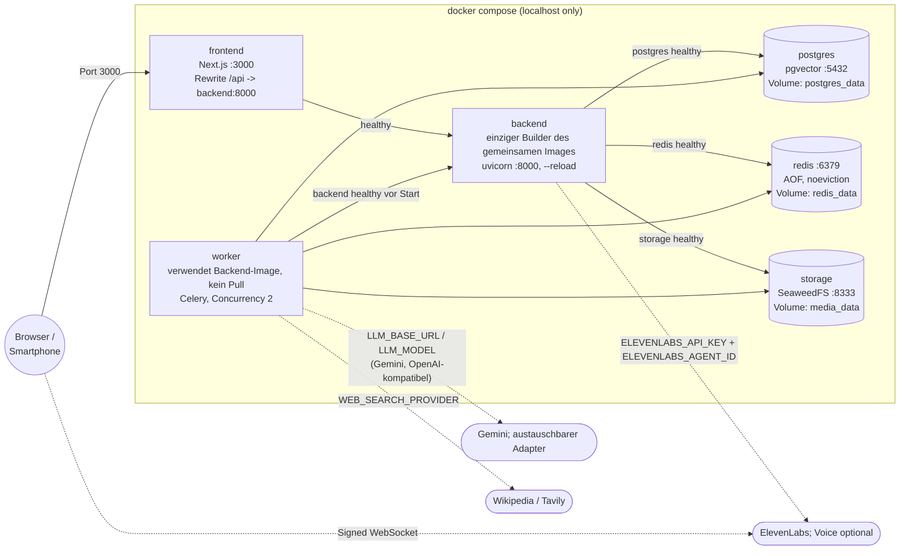

## 3. Datenfluss: Sprechanalyse (Live-Studio)

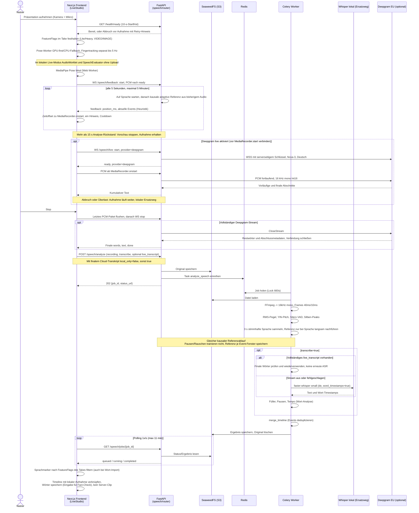

### 3b. Persistente Take-Review (Backend implementiert, Client-Anbindung separat)

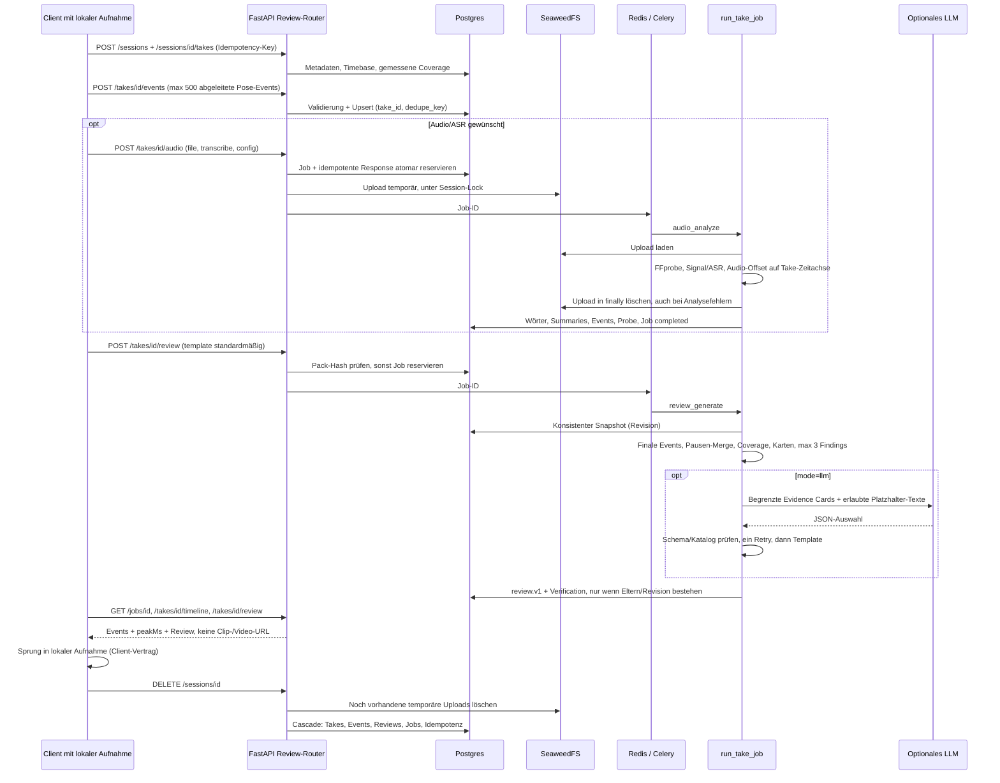

## 4. RAG-Pipeline: Quellen-Ingest, Suche und Fact-Check

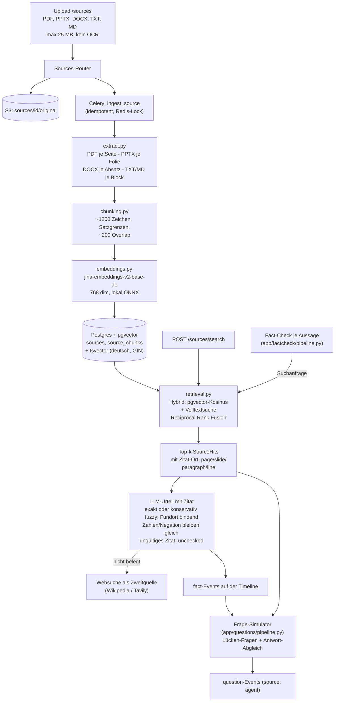

## 5. Datenfluss: Fact-Check

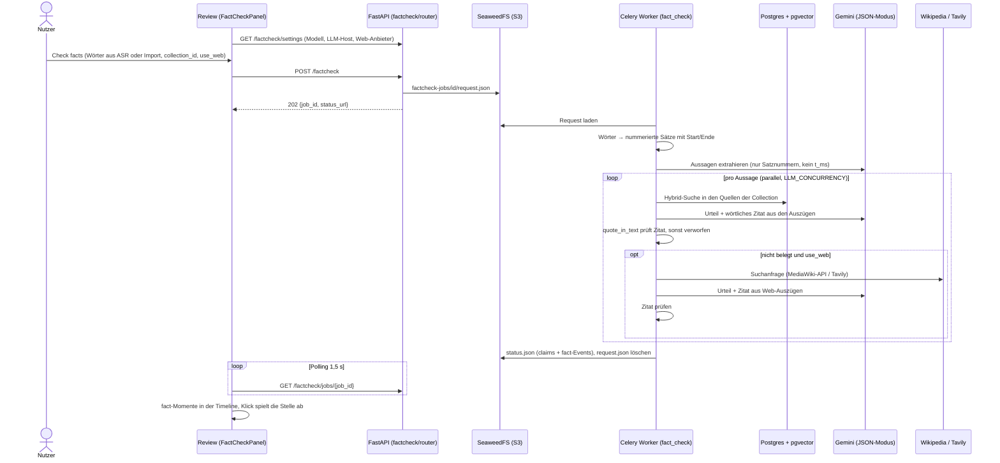

## 5b. Datenfluss: Frage-Simulator und Voice-Agent

Der Web-Review hat zwei Ansichten: **Review moments** (begrenzte Wiedergabe-
Fenster im lokalen Video, zeitgenaue Anmerkungen) und **Practice questions**.
Vor der Aufnahme werden `presentationMode` (startup/thesis/school/nonprofit)
und `sourceCollectionId` im Take eingefroren. Der Modus steuert fachliche
Schwerpunkte in beiden Fragepfaden, keine Scores oder Noten.

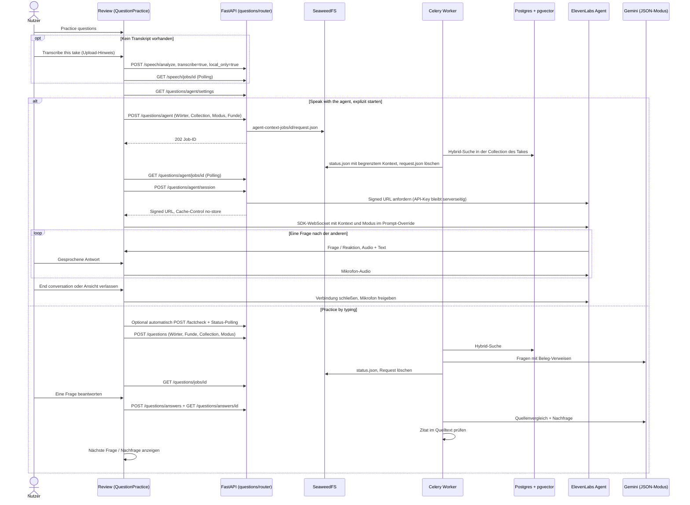

ElevenLabs-Antworten sind Modellvorschläge; sie durchlaufen nicht den
serverseitigen Zitat-Check der getippten Antworten. Der Kontext enthält nur
bis zu acht passende Auszüge, nicht die gesamte Bibliothek. Ohne konfigurierte
Zugangsdaten bleibt die Sprachfunktion sichtbar als nicht verfügbar. Der
bestehende `/questions/answers/voice`-Endpunkt mit ASR bleibt für API-Clients
kompatibel; der neue Web-Review verwendet den direkten ElevenLabs-Dialog.

## 6. Frontend-Navigation (Web)

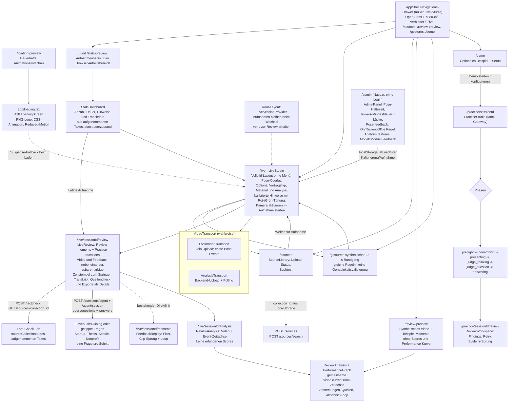

## 7. Mobile-App (Expo) Screens

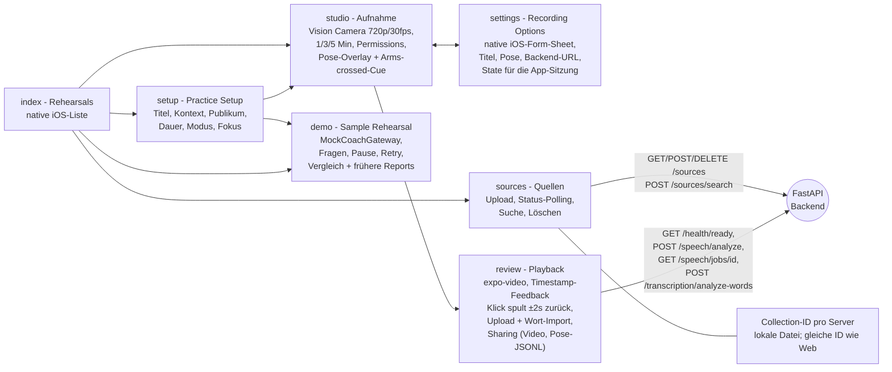

## 8. Datenmodell (Postgres)

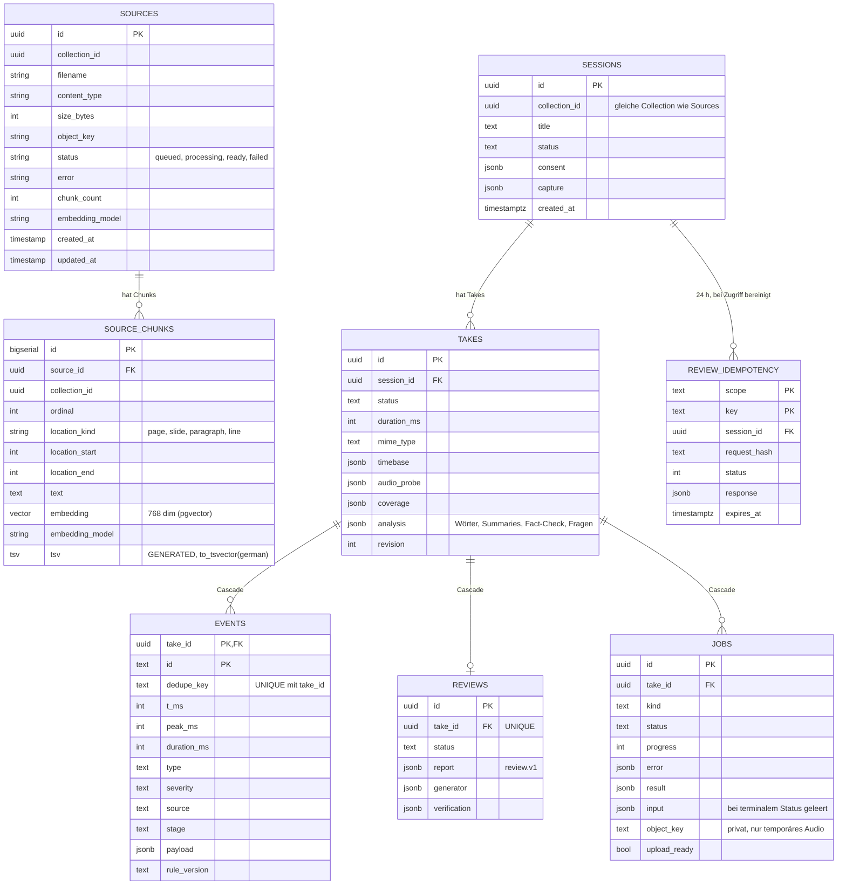

Zusätzlich (außerhalb Postgres):

| Speicher | Inhalt |
| --- | --- |
| SeaweedFS `sources/{id}/original` | Original-Uploads |
| SeaweedFS `review-audio/{session}/{take}/{job}/upload` | nur temporär für Take-Analyse; vor erfolgreichem Job-Abschluss oder bei Analysefehler löschen, Cleanup-Fehler erneut versuchen |
| SeaweedFS `speech-jobs/{job_id}/` | Job-Konfig, Status, Analyse-Ergebnis (Original wird nach Abschluss gelöscht) |
| SeaweedFS `factcheck-jobs/{job_id}/` | Status und Fact-Check-Ergebnis; `request.json` (Transkript) wird nach Abschluss gelöscht |
| SeaweedFS `question-jobs/{job_id}/`, `answer-jobs/{job_id}/` | Status mit Fragen bzw. Antwort-Abgleich (bei Sprache mit Transkript der Antwort); `request.json` (Transkript, Antworttext) und `recording` (gesprochene Antwort) werden nach Abschluss gelöscht |
| SeaweedFS `agent-context-jobs/{job_id}/` | Vorbereiteter Prompt mit gekürztem Transkript und Quellenauszügen; Request wird gelöscht, Ergebnis bleibt wie andere Jobs gespeichert, noch kein TTL-Cleanup |
| Redis DB0 / DB1 | Celery-Broker / Result-Backend, Locks |
| Browser `sessionStorage` | Practice-Session-State (`pitch-coach:v1:<id>`) |
| Browser `localStorage` | Quellen-Collection-ID (`pitchcoach.sourceCollection`), auch vom Fact-Check genutzt |
| Browser-Speicher (Live-Workspace) | FeatureFlags, presentationMode und sourceCollectionId pro Take, ElevenLabs-Gespräch, Wörter, Pose-Events mit runtime, Fact-Check-Ergebnis, Fragen und Antworten; nur bis zum Neuladen |

## 9. Event-Modell: gemeinsame Timeline

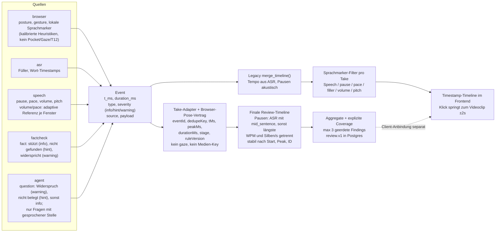

Pose-Event-Payload und JSONL tragen optional `runtime` mit Modell, Modus und
tatsächlichem Delegate; synthetische Fixtures haben keine erfundene Laufzeit.
Hand-/Lab-Ergebnisse fließen nicht in das gemeinsame Event-Modell.
Lokale Sprachmarker tragen Start/Ende ab `MediaRecorder.onstart` im Feedback-
Vertrag. Bei überlappenden Typen ersetzt die vollständige Backend-Analyse den
Live-Marker im Review. Ein fehlender neutraler Handwert im Pose-Payload ist
`null`; die Haltungsreferenz benötigt keine ruhigen oder sichtbaren Hände.

Alle Kennwerte sind Messwerte ohne Notenbewertung ("Measured values only; no score or grade").

## 10. API-Endpunkte im Überblick

```mermaid
flowchart LR
    subgraph API["Presentation Trainer API v0.1.0 (FastAPI)"]
        H1["GET /health/live"]
        H2["GET /health/ready"]
        S1["POST /speech/analyze"]
        S2["GET /speech/jobs/{job_id}"]
        S3LIVE["WS /speech/live: start, PCM, stop<br/>ready, words, text, done/error"]
        S4LIVE["WS /speech/feedback: start, PCM, stop<br/>ready, feedback, done/error; kein Whisper"]
        T1["POST /transcription/analyze-words"]
        R1["POST /sources"]
        R2["GET /sources?collection_id"]
        R3["GET /sources/{source_id}"]
        R4["DELETE /sources/{source_id}"]
        R5["POST /sources/search"]
        F1["GET /factcheck/settings"]
        F2["POST /factcheck"]
        F3["GET /factcheck/jobs/{job_id}"]
        Q1["POST /questions"]
        Q2["GET /questions/jobs/{job_id}"]
        Q3["POST /questions/answers"]
        Q4["GET /questions/answers/{job_id}"]
        Q5["POST /questions/answers/voice"]
        Q6["GET /questions/agent/settings"]
        Q7["POST /questions/agent (202)"]
        Q8["GET /questions/agent/jobs/{job_id}"]
        Q9["POST /questions/agent/session"]
        V1["POST /sessions<br/>GET / DELETE /sessions/id"]
        V2["POST /sessions/id/takes<br/>GET /takes/id"]
        V3["POST /takes/id/events<br/>POST /takes/id/audio"]
        V4["POST /takes/id/review<br/>GET /takes/id/review<br/>GET /takes/id/timeline"]
        V5["GET /jobs/id<br/>GET /takes/id/evaluation"]
        V6["POST /takes/id/factcheck<br/>POST / GET /takes/id/questions<br/>POST /takes/id/questions/answers"]
    end

    WEBF["Web-Frontend"] --> H2 & S1 & S2 & S3LIVE & S4LIVE & T1 & R1 & R2 & R3 & R4 & R5 & F1 & F2 & F3 & Q1 & Q2 & Q3 & Q4 & Q5 & Q6 & Q7 & Q8 & Q9
    MOB["Mobile App"] --> H2 & S1 & S2 & T1 & R1 & R2 & R4 & R5
    CLIENT["Neuer Take-Client-Vertrag<br/>Frontend-Integration separat"] -.-> V1 & V2 & V3 & V4 & V5 & V6
```

Der Vertrag wird über `npm run api:generate` aus dem FastAPI-Code generiert (`api/openapi.json` -> `api/schema.d.ts`) und ist damit immer synchron zum Backend.

## Deep Research (24.10.2026)

Die Architektur ist in `docs/11-deep-research-validation.md` gegen Forschung
und offizielle API-Dokumentation geprüft. Drei Korrekturen sind bindend:
Live-Analyse läuft **ereignisgetrieben auf finalisierten ASR-Segmenten**
(nicht auf einem festen 20–30-s-Takt), der finale Fact-Check ist
**quellengebunden, aber nicht autoritativ** (keine Live-Urteile,
„nicht gefunden“ ≠ „falsch“), und das Gespräch hat **harte Grenzen**
(3–5 Hauptfragen, ein Follow-up, 10 Minuten Hard Stop). Gemini ist Cloud ohne
EU-Region-Pinning; nur synthetische Demo-Daten oder Vertex AI mit EU-Region.
