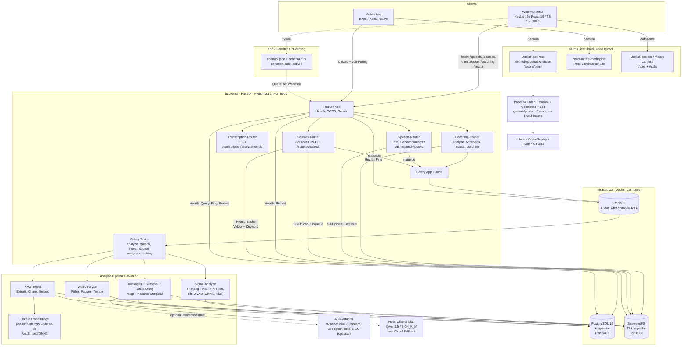
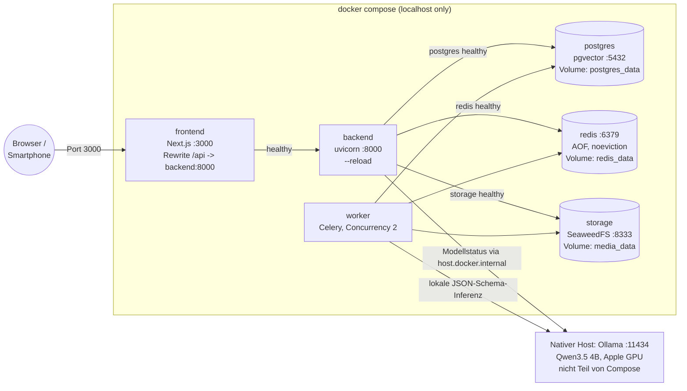
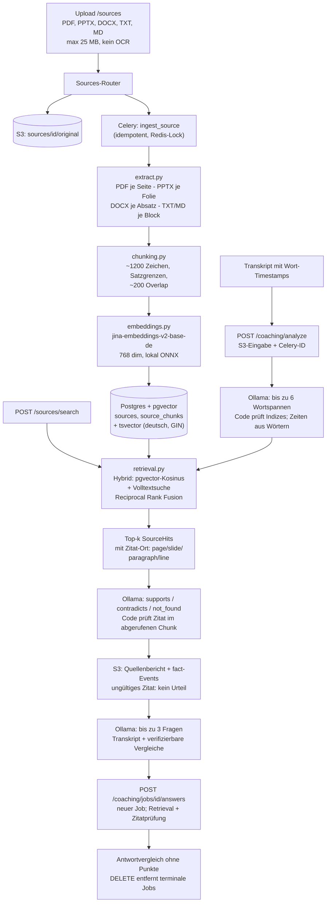
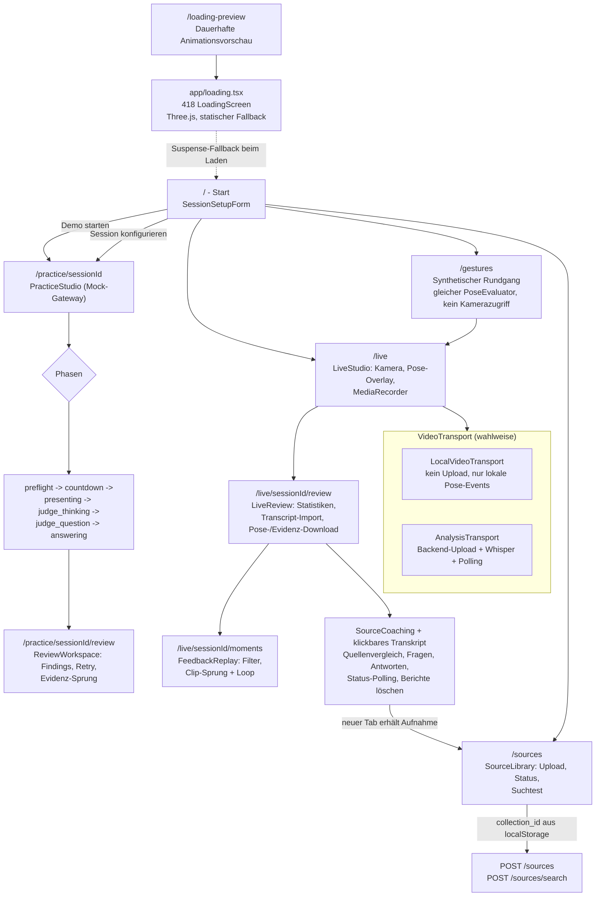
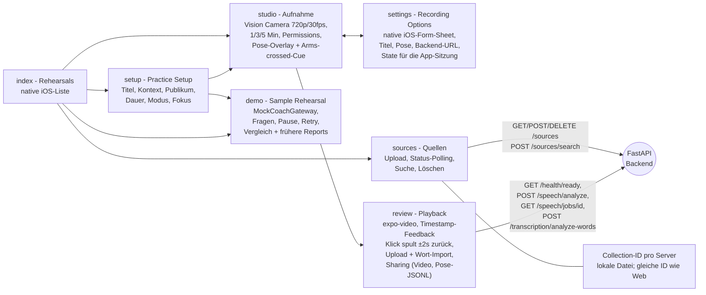
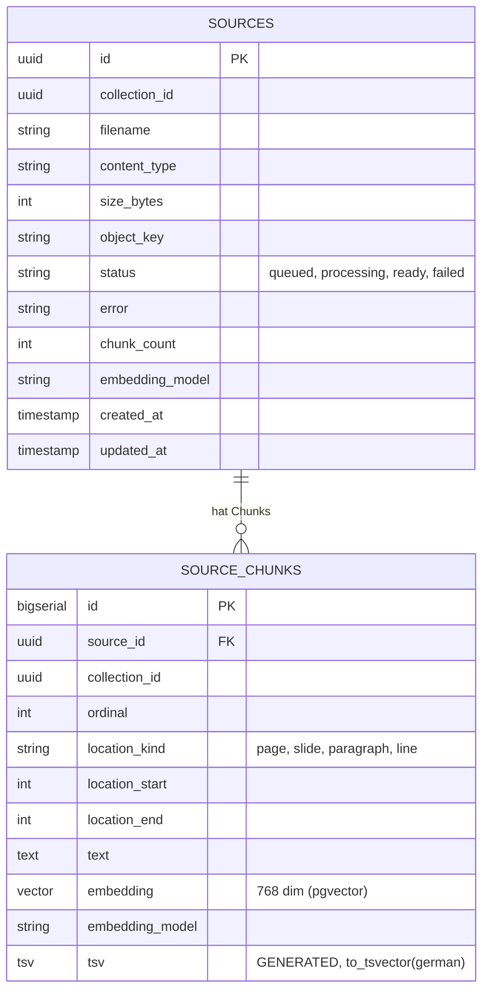
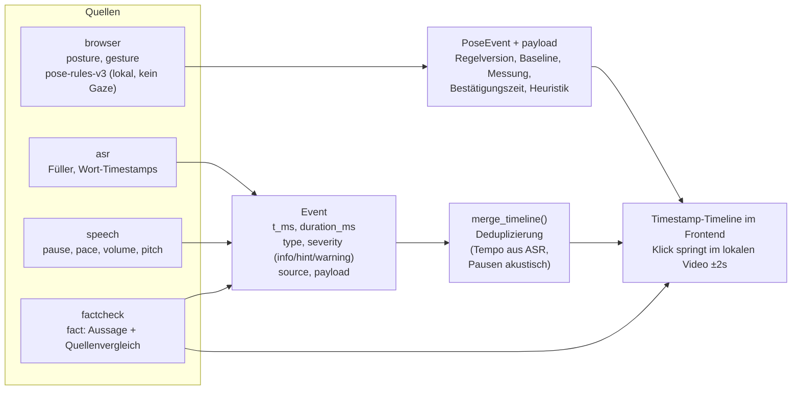
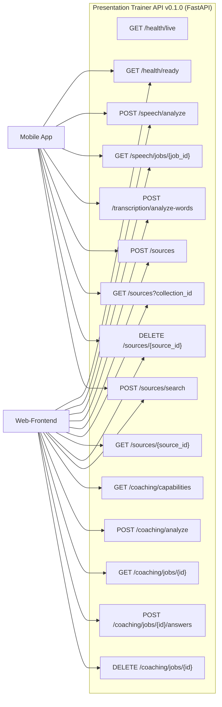

# Architektur – Pitch Coach (Live-Präsentationstrainer)

> Grafische Darstellung des Projekts als Mermaid-Diagramme.
> Generiert aus der Codeanalyse: `frontend/`, `backend/`, `mobile/`, `api/`, `compose.yaml`.

## 1. Systemübersicht



## 2. Docker-Compose-Deployment



## 3. Datenfluss: Sprechanalyse (Live-Studio)

```mermaid
sequenceDiagram
    actor U as Nutzer
    participant FE as Next.js Frontend<br/>(LiveStudio)
    participant BE as FastAPI<br/>(speech/router)
    participant S3 as SeaweedFS (S3)
    participant R as Redis
    participant W as Celery Worker
    participant ASR as ASR<br/>(Whisper lokal / Deepgram optional)

    U->>FE: Präsentation aufnehmen (Kamera + Mikro)
    FE->>FE: MediaPipe Pose lokal (Web Worker)
    FE->>FE: onstart: neue Baseline und gemeinsame Event-Zeitachse
    U->>FE: Stop
    FE->>BE: POST /speech/analyze (recording, transcribe=Checkbox, local_only=true)
    Note over FE,BE: Whisper standardmäßig an; Cloud/JSON bei local_only abgewiesen
    BE->>S3: Original speichern
    BE->>R: Task analyze_speech einreihen
    BE-->>FE: 202 {job_id, status_url}

    W->>R: Job holen (Lock 660s)
    W->>S3: Datei laden
    W->>W: FFmpeg -> 16kHz mono, Frames 40ms/10ms
    W->>W: RMS-Pegel, YIN-Pitch, Silero VAD, Silben-Peaks
    opt transcribe=true
        W->>ASR: Whisper lokal (de)
        ASR-->>W: Wort-Timestamps, Text
        W->>W: Füller, Pausen, Tempo (Wort-Analyse)
    end
    W->>W: merge_timeline (Events deduplizieren)
    W->>S3: Ergebnis speichern, Original löschen

    loop Polling 1x/s (max 11 min)
        FE->>BE: GET /speech/jobs/{job_id}
        BE->>S3: Status/Ergebnis lesen
        BE-->>FE: queued / running / completed
    end
    FE->>FE: Lokale Pose-Events + Audio-Events im Review zusammenführen
    FE->>FE: Wort-Timestamps anzeigen; Quellenvergleich explizit starten
    FE->>FE: Vollvideo im Browser bei Event abspielen (±2s, keine Server-Clips)
```

## 4. RAG-Pipeline: Quellen-Ingest und Suche



## 5. Frontend-Navigation (Web)



## 6. Mobile-App (Expo) Screens



## 7. Datenmodell (Postgres)



Zusätzlich (außerhalb Postgres):

| Speicher | Inhalt |
| --- | --- |
| SeaweedFS `sources/{id}/original` | Original-Uploads |
| SeaweedFS `speech-jobs/{job_id}/` | Job-Konfig, Status, Analyse-Ergebnis (Original wird nach Abschluss gelöscht) |
| SeaweedFS `coaching-jobs/{job_id}/` | `request.json` + `status.json`: Transkript/Antwort, Quellenbericht und Fragen; explizite Löschung, kein TTL |
| Redis DB0 / DB1 | Celery-Broker / Result-Backend, Locks |
| Browser `sessionStorage` | Practice-Session-State (`pitch-coach:v1:<id>`) |
| Browser-Arbeitsspeicher | Lokales Vollvideo, Roh-Pose-JSONL, Pose-Events, Transkript, Coaching-Job-IDs/Ergebnisse; gehen beim Verlassen/Neuladen verloren |
| Browser `localStorage` | Quellen-Collection-ID (`pitchcoach.sourceCollection`) |

## 8. Event-Modell: gemeinsame Timeline



Alle Kennwerte sind Messwerte ohne Notenbewertung ("Measured values only; no score or grade").

## 9. API-Endpunkte im Überblick



Der Vertrag wird über `npm run api:generate` aus dem FastAPI-Code generiert (`api/openapi.json` -> `api/schema.d.ts`) und ist damit immer synchron zum Backend.
