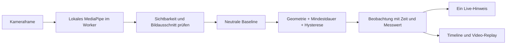

# Gesten und Haltung: Was wir beobachten und warum

Stand: 24.10.2026. **Prototyp, keine validierte Beurteilung.**
Implementierung: `frontend/src/features/pose/evaluation.ts` (`pose-rules-v7`).
Kamera: `/live`. Synthetischer, reproduzierbarer Rundgang: `/gestures`.
Diese Regeln beschreiben den Web-Pfad. Die native App verwendet weiterhin
ihren separaten `CrossArmsCue`-Adapter; dessen bisherige Release-Zeiten wurden
bei der Team-Integration erhalten, nicht als Web-Verhalten übernommen.

## Entscheidung nach Recherche

Wir trennen **Landmark-Erkennung** (ML-Modell), **Bewegungsbeobachtung**
(nachvollziehbare Geometrie und Zeitregeln) und **Reflexion** (Mensch schaut die
Stelle an). Eine erkannte Geste beweist weder Qualität noch Absicht. Es gibt
keinen Gesamtwert, keine Note und keine Emotions- oder Persönlichkeitsinferenz.

| Option | Was sie liefert | Entscheidung für diesen Prototyp |
| --- | --- | --- |
| MediaPipe Pose Landmarker Lite / Heavy | Körperlandmarks; bereits lokal im Browser eingebunden | Lite als Standard, Heavy per Feature-Schalter. Beide liefern die benötigten Körperpunkte; kein gemessener Qualitätsvergleich. |
| MediaPipe Gesture Recognizer | Vordefinierte Handformen, etwa offene Hand, Faust, Daumen hoch; Handlandmarks | Gute Wahl für explizite Handzeichen. Nicht gewählt: diese Kategorien bewerten keine Vortragsgestik; kleine oder verdeckte Hände benötigen eigene Tests. Ein Daumen-hoch wäre keine positive Vortragsbewertung. |
| MediaPipe Hand Landmarker | 21 Punkte pro Hand | Nur im Pose Lab für Pocket/Self-Touch und Hand-Overlay. Im normalen Aufnahmepfad nicht geladen. |
| MoveNet Lightning / Thunder | 17 Körperpunkte; zwei Varianten mit unterschiedlichem Latenz-/Qualitätsziel | Technisch plausible Alternative. Kein eigener Vergleich auf unseren Geräten durchgeführt; deshalb kein behaupteter Genauigkeitsgewinner und kein unbegründeter Modellwechsel. |
| Face-/Iris-Landmarks | Gesichts- bzw. Irisgeometrie | Für tatsächlichen Blickkontakt nicht ausreichend. Keine Blickkontakt-Events aus `eyes_forward=false`; fehlende Augenpunkte sind keine Abwendung. |
| Eigener zeitlicher Gestenklassifikator | Könnte Bewegungsfolgen statt statischer Handformen unterscheiden | Erst mit geeigneten, annotierten Sequenzen, unabhängigen Testpersonen und klarer Gestentaxonomie sinnvoll. Solche Daten liegen nicht vor. |

Die Auswahl ist eine **Engineering-Entscheidung für unseren Anwendungsfall**,
kein experimentell belegtes Ranking der Modelle.

Primärquellen, am 24.10.2026 abgerufen:

1. [MediaPipe Pose Landmarker für Web](https://developers.google.com/edge/mediapipe/solutions/vision/pose_landmarker/web_js): API, Betriebsarten, Konfidenzoptionen; synchrone Inferenz blockiert den aufrufenden Thread, daher unser Worker.
2. [MediaPipe Gesture Recognizer](https://developers.google.com/edge/mediapipe/solutions/vision/gesture_recognizer): unterstützte Handformen und Ausgaben; keine Aussage über Präsentationsqualität.
3. [MediaPipe Hand Landmarker](https://developers.google.com/edge/mediapipe/solutions/vision/hand_landmarker): Handgeometrie und 21 Landmark-Punkte.
4. [MoveNet, offizielles TensorFlow-Tutorial](https://www.tensorflow.org/hub/tutorials/movenet): 17 Punkte, Lightning und Thunder. Veröffentlichte Modellbenchmarks werden nicht als Genauigkeit unserer App übernommen.
5. [Google Research: MediaPipe Iris](https://research.google/blog/mediapipe-iris-real-time-iris-tracking-depth-estimation/): Iris-Tracking allein bestimmt nicht, wohin eine Person schaut.

## Signalkette

`@mediapipe/tasks-vision`, Lite und Heavy werden lokal ausgeliefert. Frames
und Landmarks gehen nicht an einen KI-Anbieter. Maximal ein Frame gleichzeitig,
höchstens 10 Hz. Nutzerentscheidung: **VIDEO als Standard**, IMAGE per Schalter.
VIDEO nutzt zeitliches Tracking und Modell-Glättung, IMAGE unabhängige Bilder.
Das Log enthält die unveränderten Modell-Ausgaben, in VIDEO also bereits
zeitlich geglättet, plus Modell/Modus/Delegate als `runtime`. GPU-first mit
CPU-Fallback ohne Modellwechsel. Ein Geräte-/Qualitätsvergleich ist noch offen.

X/Y werden vor geometrischen Berechnungen in Pixel umgerechnet. Abstände werden
durch die aktuelle Schulterbreite geteilt. Das reduziert Abhängigkeit von
Auflösung und Körpergröße im Bild. Es korrigiert weder Perspektive noch starke
Drehungen. Modell-z wird für diese Regeln nicht gebraucht. Das Video ist
zur Orientierung gespiegelt; die Daten sind ungespiegelt.

## Die Beobachtungen

| Beobachtung | Messung / Vergleich | Warum zeigen wir sie? | Was bedeutet sie ausdrücklich nicht? |
| --- | --- | --- | --- |
| **Hand above shoulder** | Größere Handgelenkhöhe relativ zur eigenen Schulter, geteilt durch Schulterbreite; sichtbar über Schulter und gegenüber neutral angehoben | Deutliche, leicht nachstellbare Bewegung. Nutzer kann prüfen, ob sie den gesprochenen Punkt unterstützt. | Keine Bewertung von Offenheit, Engagement, Selbstvertrauen oder Fingerform. |
| **Hands held together** | Abstand beider Handgelenke im Schulter-Hüft-Band, geteilt durch Schulterbreite; deutlich kleiner als bei neutral getrennten Händen | Zeigt eine gehaltene Handposition zum Rückblick. | Kein Nachweis von Verschränken, Berührung, Nervosität oder „geschlossener Körpersprache“. |
| **Sideways lean** | Absoluter Unterschied des Torso-Bildwinkels zur persönlichen Neutralstellung | Sichtbarer Vergleich mit der eigenen Ausgangslage; auch sitzend möglich. | Keine medizinische Haltungsbewertung, kein Vor-/Zurücklehnen, keine Aussage über Sicherheit. |
| **Sideways position change** | Horizontale Änderung des Mittelpunkts der beiden Schultern und Hüften, geteilt durch die neutrale Schulterbreite | Erfasst auch eine seitliche Versetzung des ganzen Körpers ohne Torso-Neigung; aus dem Nutzer-Test ergänzt. | Kein Nachweis von Unruhe oder schlechter Position; eine Kamerabewegung kann dasselbe Bildsignal erzeugen. |
| **Arms crossed in front of torso** | Handgelenke an/nahe der Körpermitte, im Rumpfbereich, Ellbogen gebeugt, Unterarme grob parallel zur Schulterlinie | Macht die vorhandene Team-Regel auch timestamp-genau zurückspulbar. | Keine Aussage über Abwehr, Gefühle oder Persönlichkeit; verdeckte Handgelenke bleiben unbekannt. |
| **Head turned to the side** | Lage der Nase zwischen den Ohren im Bild: (Abstand zum einen Ohr − Abstand zum anderen) / Summe, 0 = mittig, ±1 = an/hinter einem Ohr; Betrag der Änderung zur Neutralstellung | Längeres Abwenden, z. B. zum Ablesen der Folien, wird zurückspulbar. Kopforientierung als Proxy. | Kein Blick-/Eye-Contact-Tracking, keine Aussage über Aufmerksamkeit oder Publikum; kurze Blicke in den Raum bleiben unmarkiert. |
| **Head tilted down** | Nase unter der Ohrlinie, geteilt durch Schulterbreite; nur Zunahme gegenüber neutral | Längeres Senken des Kopfes, z. B. Ablesen von Notizen. | Kein Blick-Tracking; Hochschauen wird nicht markiert; keine Aussage über Unsicherheit. |

Beine sind für diese Regeln nicht erforderlich. Ein leicht schiefer, aber
stabiler neutraler Torso ist eine gültige Referenz. Nicht bequeme Bewegungen
überspringen. Wer die benötigten Punkte nicht ins Bild bringen kann, kann Video
und synthetischen Ablauf nutzen; fehlende Daten erzeugen keine Negativbewertung.

## Konfiguration und Begründung

**Alle Zahlen unten sind offen ausgewiesene Prototyp-Einstellungen.** Sie sind
weder aus einer Publikation abgeleitete Grenzwerte für gutes Präsentieren noch
empirisch auf Personen validiert. Die Quellen begründen die verfügbaren
Messverfahren, nicht diese Regelparameter. Änderungen brauchen eine neue
Regelversion, Tests und erneute Prüfung vor Ort.

| Einstellung | Wert | Technischer Zweck |
| --- | --- | --- |
| Landmark visibility / optionale presence | mindestens 0,5, im Bild, endlich | An bestehende MediaPipe-Prototypkonfiguration anschließen; nicht als 50 % Genauigkeit interpretieren. |
| Framing | Sichtbare, sichere Schultern/Hüften, nicht degenerierte Schulterlinie; Schulter-Hüft-Höhe ≥ 12 % der Bildhöhe | Die frühere pauschale Schulterbreite von 12 % verwarf im Nutzer-Test gute Landmarks und entfällt in v5. Keine Entfernungsangabe in Metern. |
| Kalibrierung | 3 s zusammenhängend, mindestens 15 Samples | Eine kurze stabile Referenz statt eines einzelnen Ausreißers. Median für die Baseline. |
| Neutrale Hände | Optional: Höhe ≤ −0,15 Schulterbreiten, Abstand ≥ 0,65 Schulterbreiten; im Torso-Band | Mindestens 15 geeignete Samples für eine Handreferenz. Sonst `null`; Handhöhe/-abstand nutzen die bestehende Schultergeometrie-Schwelle. Hände blockieren keine Haltungsreferenz. |
| Stabilität der Kalibrierung | Spannweite Torso ≤ 6°; seitliche Position ≤ 0,3 Schulterbreiten | Handbewegungen setzen die Haltungsreferenz nicht zurück. Körperbewegung startet die Kalibrierung neu. |
| Maximaler Sample-Abstand | 350 ms | Lücken nicht als gehaltene Bewegung zählen. Sehr langsame Geräte können so nicht kalibrieren. |
| Hand hoch | Eintritt max(0,15; neutrale Höhe + 0,5); Austritt 0,1 darunter | Klar über der Schulter; Hysterese reduziert Flackern an der Grenze. |
| Hände zusammen | Eintritt min(0,35; neutraler Abstand / 2); Austritt 0,15 darüber | Deutlich näher als neutral, nur im Torso-Band. |
| Seitlicher Torso | Eintritt 12° Veränderung; Austritt 8° | Nur größere Bildwinkeländerungen markieren. |
| Seitliche Position | Eintritt 0,35 neutrale Schulterbreiten; Austritt 0,2 | Erkennt den vom Nutzer getesteten seitlichen Körperversatz. Bei ≥ 8° Torsoänderung wird die Position nicht zusätzlich markiert; dafür gilt die Neigungsregel. |
| Arme verschränkt | Beide Wrist-Cross-Werte ≥ −0,25; Höhen in [−1,3; 0,2]; Ellbogen ≤ 120°; Unterarme ≤ 40° | Übernimmt die Team-Geometrie. Im gemeinsamen Evaluator: unbekannte Frames (verdeckte Handgelenke) überbrückt bis 1,5 s während der Haltezeit, fehlende Person beendet sie; 20 s Cooldown. Pose lab nutzt dieselbe 1,5-s-Überbrückung. Zusätzlich einseitig: Ein Arm erfüllt alle Kriterien und kreuzt die Körpermitte (≥ 0), die andere Hand ist verdeckt oder mit gebeugtem Ellbogen auf Brusthöhe, Handgelenke ≥ 0,35 Schulterbreiten auseinander. Grund (Kameratest 24.10.2026): Die unter dem Arm verdeckte Hand wird von MediaPipe nahe dem eigenen Ellbogen geschätzt. Nahe Hände, deren Wrist-Cross-Werte beide negativ sind, bleiben Hände-zusammen; bestehende Abstandsschwelle und Hysterese gelten. Keine gleichzeitigen gegensätzlichen Marker. |
| Kopfrichtung | Seitlich: Eintritt 0,5 Änderung, Austritt 0,35; unten: Eintritt 0,1 Schulterbreiten, Austritt 0,06; Nase und beide Ohren im Bild mit visibility ≥ 0,2 | Ein verdecktes fernes Ohr senkt die visibility; daher lockerer als 0,5. Neutrale Kopfreferenz = Median aller Kalibrierungs-Frames mit messbarem Kopf (≥ 15), sonst seitlich 0 und keine Unten-Regel. Bei stärkerer Drehung kann das ferne Ohr wegfallen; dann pausiert die Regel. Event-Typ `gaze`, Kategorie „Head“. |
| Haltezeit (`stabilizeHoldMs`) | 2 s für jede Regel | Nutzerentscheidung (24.10.2026): eine einheitliche Haltezeit statt 0,8–2 s je Regel; kurze Bewegungen und Blicke erzeugen weder Event noch Hinweis. |
| Live-Hinweis-Takt (`minDisplayMs`, `minDisplayGapMs`) | Mindestens 3 s sichtbar; danach 2 s leere Blase; 0 = direkter Wechsel | Gilt für Haltungs- und Stimmhinweise in derselben Blase (`frontend/src/features/live/cue-pacing.ts`), damit nicht mehrere Hinweise kurz hintereinander erscheinen. Während der Lücke übersprungene Hinweise bleiben als Events in der Timeline. Werte stehen in `POSE_RULES` und sind für ein späteres Admin-Panel vorgesehen. |
| Pose-lab-Lob (`praiseAfterMs`) | 10 s ohne gehaltenen oder anstehenden Korrekturhinweis, dann einmal für `minDisplayMs` | Nur Dev-Werkzeug Pose lab (Coach-Ansicht); verhindert ein dauerhaft sichtbares „Nice, open posture.“. Ohne Hinweis bleibt die Blase leer. Status-Ansicht zeigt weiterhin jeden Frame. |
| Admin-Schalter je Regel | On / Review only / Off; Pose-lab-Tests an/aus | Off: Regel wird nicht beobachtet. Review only: Event in der Timeline, kein Live-Hinweis. Abgeschaltete Pose-lab-Tests melden „off“. Gilt ab nächster Kalibrierung oder Aufnahme. |
| Cooldown | 5 s (Arme verschränkt: 20 s) nach Ende der letzten bestätigten Beobachtung dieses Typs | Eine gehaltene Bewegung bleibt ein Event. Rückkehr/Lücke plus erneute Mindestdauer nötig. |
| Kameraframe wird alt | nach 700 ms Overlay/aktuellen Hinweis ausblenden; nach 5 s hängender Inferenz Fehler | Keine eingefrorene Erkennung als aktuellen Zustand zeigen. |

Jede Aufnahme kalibriert neu. Der Button zur Rekalibrierung ist vor der Aufnahme
verfügbar. Kamera, Abstand oder Sitzposition danach nicht ändern. Das Modell ist
für eine Person konfiguriert; mehrere Personen werden **nicht zuverlässig
auseinandergehalten**. Die Baseline identifiziert niemanden. Bei Personenwechsel
neu kalibrieren/aufnehmen.

## Zeit, Feedback und Export

- Aufnahmestart ist `MediaRecorder.onstart`, nicht der Klick auf Start.
- Noch laufende Frames aus der Vorschau werden an dieser Grenze verworfen.
- `t_ms` ist der erste Frame der zusammenhängenden Bewegung; das Event erscheint
  erst nach der Mindestdauer. `confirmed_at_ms` macht diese Verzögerung sichtbar.
- `duration_ms` wächst nur bei beobachteten Frames. Verlust schließt die Spanne
  am letzten gültigen Frame; es wird nicht über Lücken interpoliert.
- Dasselbe Event wird aktualisiert statt pro Frame neu gezählt. Höchstens ein
  aktueller Hinweis wird angezeigt; Hinweise sind abschaltbar, Review bleibt.
- Das gemeinsame Event-Schema enthält `session_id`, `id`, `t_ms`, `duration_ms`,
  `type`, `severity`, `source=browser`, `payload` mit Regelversion, Messwert,
  Baseline, Auslöseschwelle und Bestätigungszeit. `initial_measurement` hält den
  Wert bei Bestätigung fest; `measurement` ist der zuletzt beobachtete Wert. Keine erfundenen Modell-Scores.
- Review: Klick auf einen Marker spielt die lokale Aufnahme mit bis zu 2 s
  Kontext vor/nach der Beobachtung. „How was this observed?“ erklärt die Regel.
- JSONL enthält Roh-Landmarks; „Download gesture evidence JSON“ enthält die
  Beobachtungen. Lokale Daten gehen beim Verlassen/Neuladen verloren.
- Backend-Audiomodus ergänzt nach dem Stoppen echte Audioergebnisse; ein Fehler
  dort ersetzt die Kamera-Beobachtungen nicht durch Beispieldaten.

## Wie wir Qualität prüfen

Drei getrennte Nachweise, die nicht miteinander verwechselt werden dürfen:

1. **Regelkorrektheit:** synthetische Landmark-Sequenzen mit bekannten Bewegungen.
   Testfälle für Kalibrierung, Mindestdauer, fehlende Daten, Lücken, Cooldown,
   Hysterese, Spiegelung, Skalierung, persönliche Neutralstellung und kurze
   Störbewegungen. Erwartung: eindeutige Events und richtige Zeiten, keine
   Beobachtung aus unbekannten Daten.
2. **Produktintegration:** Browser-Test mit synthetischer Kamera und kontrollierten
   Worker-Ergebnissen. Aufnahme → Kalibrierung → Beobachtung → Stop → Marker →
   Replay → Export; Desktop und schmaler Viewport, Fehler/Fallback und Reset.
   Separater Test lädt das echte lokale Modell auf synthetischen Kameraframes.
   Dieser Asset-/Laufzeittest beweist keine Erkennung menschlicher Gesten.
3. **Erkennungsqualität am Veranstaltungsgerät:** Einwilligende Teammitglieder
   führen die Bewegungen vor der echten Kamera aus; die Anleitung und das
   Ergebnisprotokoll stehen in `docs/05-jury-demo.md`. Ein erster Nutzerbericht
   bestätigt Hand hoch, Hände zusammen und seitliche Position; eine systematische
   Geräte-/Personenprüfung mit gezählten Versuchen bleibt offen.

Für spätere Datensätze: Clips manuell mit Gestentyp, Beginn/Ende und „nicht
beurteilbar“ annotieren; Personen und Aufnahmen zwischen Entwicklung und Test
trennen. Pro Regel TP/FP/FN, Precision/Recall, Fehlalarme pro Minute, beobachtbare
Zeit, Zeit bis Bestätigung und Zeitfehler berichten. Unbrauchbare Kameraabschnitte
separat berichten statt als „keine Geste“ zu zählen. Bei null Beispielen keine
Prozentzahl berechnen. Ein perfekter synthetischer Test ist keine gemessene
Genauigkeit auf Menschen. Hauttöne, Kleidung, Licht, Kameras, sitzende/stehende
Positionen, Bewegungseinschränkungen und verdeckte Hände gehören in die
Stichprobe; bislang gibt es dafür keine repräsentativen Ergebnisse.

## Rückmeldung aus dem ersten lokalen Kamera-Versuch

Der Nutzer berichtete am 24.10.2026: Hand hoch und Hände zusammen funktionierten;
seitwärts zunächst nicht. Auf Nachfrage war es ein **Versetzen des ganzen
Körpers**, keine Neigung relativ zur Hüfte. Das erklärte die Lücke der bisherigen
Winkelregel. Version 2 ergänzt deshalb eine separate positionsbasierte
Beobachtung, ohne die Neigungsgrenze pauschal zu senken. Die Anleitung und der
synthetische Rundgang zeigen nun diese Bewegung. „Pose debug“ zeigt Winkel- und
Positionsänderung samt Trigger. Dieser einzelne Nutzerbericht ist ein Hinweis
zur Bedienbarkeit, kein quantifizierter Genauigkeitstest. Der Nutzer bestätigte
anschließend auch die seitliche Positionsregel, empfand sie aber als verzögert.

Version 3 verkürzt nur deren Mindestdauer von 1,5 auf 0,8 s. Dazu kommen der
Abtasttakt und die tatsächliche Frame-Verarbeitung. „Pose debug“ zeigt jetzt
**Frame latency** (Frame-Anforderung bis Worker-Antwort), **model** (Dauer von
`detect`) und **Sampling** (letzte bis zu 20 Samples). Die Frame-Zeit umfasst
Bitmap-Erzeugung, Worker-Transport und Inferenz; Kamera-Sensorlatenz und
Bildschirmdarstellung werden nicht gemessen. Es liegt kein Vergleich Safari
gegen andere Browser vor, daher keine browserbezogene Ursache behaupten.
Erneute subjektive Geschwindigkeitsprüfung, Neigung und Kreuzungsregel am echten
Gerät bleiben offen.
