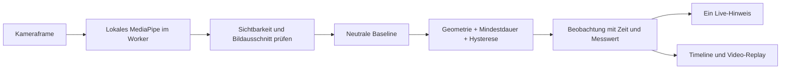

# Gesten und Haltung: Was wir beobachten und warum

Stand: 24.10.2026. **Prototyp, keine validierte Beurteilung.**
Implementierung: `frontend/src/features/pose/evaluation.ts` (`pose-rules-v1`).
Kamera: `/live`. Synthetischer, reproduzierbarer Rundgang: `/gestures`.

## Entscheidung nach Recherche

Wir trennen **Landmark-Erkennung** (ML-Modell), **Bewegungsbeobachtung**
(nachvollziehbare Geometrie und Zeitregeln) und **Reflexion** (Mensch schaut die
Stelle an). Eine erkannte Geste beweist weder Qualität noch Absicht. Es gibt
keinen Gesamtwert, keine Note und keine Emotions- oder Persönlichkeitsinferenz.

| Option | Was sie liefert | Entscheidung für diesen Prototyp |
| --- | --- | --- |
| MediaPipe Pose Landmarker Lite | Körperlandmarks; bereits lokal im Browser eingebunden | Verwenden: Schultern, Hüften, Ellbogen und Handgelenke reichen für die drei groben Beobachtungen. Keine neue Modellkette für diese Aufgabe nötig. |
| MediaPipe Gesture Recognizer | Vordefinierte Handformen, etwa offene Hand, Faust, Daumen hoch; Handlandmarks | Gute Wahl für explizite Handzeichen. Nicht gewählt: diese Kategorien bewerten keine Vortragsgestik; kleine oder verdeckte Hände benötigen eigene Tests. Ein Daumen-hoch wäre keine positive Vortragsbewertung. |
| MediaPipe Hand Landmarker | 21 Punkte pro Hand | Sinnvoll, falls Fingergeometrie tatsächlich gebraucht wird. Aktuell kein zusätzlicher Nutzen für Handhöhe, Handabstand oder Torsoachse. |
| MoveNet Lightning / Thunder | 17 Körperpunkte; zwei Varianten mit unterschiedlichem Latenz-/Qualitätsziel | Technisch plausible Alternative. Kein eigener Vergleich auf unseren Geräten durchgeführt; deshalb kein behaupteter Genauigkeitsgewinner und kein unbegründeter Modellwechsel. |
| Face-/Iris-Landmarks | Gesichts- bzw. Irisgeometrie | Für tatsächlichen Blickkontakt nicht ausreichend. Keine Blickkontakt-Events aus `eyes_forward=false`; fehlende Augenpunkte sind keine Abwendung. |
| Eigener zeitlicher Gestenklassifikator | Könnte Bewegungsfolgen statt statischer Handformen unterscheiden | Erst mit geeigneten, annotierten Sequenzen, unabhängigen Testpersonen und klarer Gestentaxonomie sinnvoll. Solche Daten liegen nicht vor. |

Die Auswahl ist eine **Engineering-Entscheidung für unseren Anwendungsfall**,
kein experimentell belegtes Ranking der Modelle.

Primärquellen, am 24.10.2026 abgerufen:

1. [MediaPipe Pose Landmarker für Web](https://developers.google.com/edge/mediapipe/solutions/vision/pose_landmarker/web_js): API, Betriebsarten, Konfidenzoptionen; synchrone Inferenz blockiert den aufrufenden Thread, daher unser Worker.
2. [MediaPipe Gesture Recognizer](https://developers.google.com/edge/mediapipe/solutions/vision/gesture_recognizer): unterstützte Handformen und Ausgaben; keine Aussage über Präsentationsqualität.
3. [MediaPipe Hand Landmarker](https://developers.google.com/edge/mediapipe/solutions/vision/hand_landmarker): Handgeometrie und 21 Landmark-Punkte.
4. [MoveNet, offizielles TensorFlow-Tutorial](https://www.tensorflow.org/hub/tutorials/movenet): 17 Punkte, Lightning und Thunder. Veröffentlichte Modellbenchmarks werden nicht als Genauigkeit unserer App übernommen.
5. [Google Research: MediaPipe Iris](https://research.google/blog/mediapipe-iris-real-time-iris-tracking-depth-estimation/): Iris-Tracking allein bestimmt nicht, wohin eine Person schaut.

## Signalkette

`@mediapipe/tasks-vision` und das Lite-Modell sind lokal ausgeliefert. Frames und
Landmarks gehen nicht an einen KI-Anbieter. Maximal ein Frame gleichzeitig,
Zieltakt höchstens 10 Hz. Der bestehende IMAGE-Modus bleibt erhalten, damit der
Roh-Export keine zusätzliche zeitliche Glättung bekommt. VIDEO-Tracking kann
Rechenzeit sparen; ein Wechsel muss Rohdatenvertrag und Latenz gemeinsam prüfen.
Wir behaupten nicht, IMAGE sei generell besser. Unsere Zeitregeln ersetzen keine
Erkennungsqualität und verändern den Roh-Log nicht.

X/Y werden vor geometrischen Berechnungen in Pixel umgerechnet. Abstände werden
durch die aktuelle Schulterbreite geteilt. Das reduziert Abhängigkeit von
Auflösung und Körpergröße im Bild. Es korrigiert weder Perspektive noch starke
Drehungen. Modell-z wird für diese drei Regeln nicht gebraucht. Das Video ist
zur Orientierung gespiegelt; die Daten sind ungespiegelt.

## Die drei Beobachtungen

| Beobachtung | Messung / Vergleich | Warum zeigen wir sie? | Was bedeutet sie ausdrücklich nicht? |
| --- | --- | --- | --- |
| **Hand above shoulder** | Größere Handgelenkhöhe relativ zur eigenen Schulter, geteilt durch Schulterbreite; sichtbar über Schulter und gegenüber neutral angehoben | Deutliche, leicht nachstellbare Bewegung. Nutzer kann prüfen, ob sie den gesprochenen Punkt unterstützt. | Keine Bewertung von Offenheit, Engagement, Selbstvertrauen oder Fingerform. |
| **Hands held together** | Abstand beider Handgelenke im Schulter-Hüft-Band, geteilt durch Schulterbreite; deutlich kleiner als bei neutral getrennten Händen | Zeigt eine gehaltene Handposition zum Rückblick. | Kein Nachweis von Verschränken, Berührung, Nervosität oder „geschlossener Körpersprache“. |
| **Sideways posture change** | Absoluter Unterschied des Torso-Bildwinkels zur persönlichen Neutralstellung | Sichtbarer Vergleich mit der eigenen Ausgangslage; auch sitzend möglich. | Keine medizinische Haltungsbewertung, kein Vor-/Zurücklehnen, keine Aussage über Sicherheit. |

Beine sind für diese Regeln nicht erforderlich. Ein leicht schiefer, aber
stabiler neutraler Torso ist eine gültige Referenz. Nicht bequeme Bewegungen
überspringen. Wer die benötigten Punkte nicht ins Bild bringen kann, kann Video
und synthetischen Ablauf nutzen; fehlende Daten erzeugen keine Negativbewertung.

## Konfiguration und Begründung

**Alle Zahlen unten sind offen ausgewiesene Prototyp-Einstellungen.** Sie sind
weder aus einer Publikation abgeleitete Grenzwerte für gutes Präsentieren noch
empirisch auf Personen validiert. Die Quellen begründen die verfügbaren
Messverfahren, nicht diese Regelparameter. Änderungen brauchen eine neue
Regelversion, Tests und erneute Prüfung vor Ort.

| Einstellung | Wert | Technischer Zweck |
| --- | --- | --- |
| Landmark visibility / optionale presence | mindestens 0,5, im Bild, endlich | An bestehende MediaPipe-Prototypkonfiguration anschließen; nicht als 50 % Genauigkeit interpretieren. |
| Framing | Schulterbreite ≥ 12 % der Bildbreite; Schulter-Hüft-Höhe ≥ 12 % der Bildhöhe | Winzige/degenerierte Geometrie nicht auswerten. Keine Entfernungsangabe in Metern. |
| Kalibrierung | 3 s zusammenhängend, mindestens 15 Samples | Eine kurze stabile Referenz statt eines einzelnen Ausreißers. Median für die Baseline. |
| Neutrale Hände | Höhe ≤ −0,15 Schulterbreiten, Abstand ≥ 0,65 Schulterbreiten; im Torso-Band | Neutrale getrennte Hände als verständliche Referenz. UI erklärt die Pose. |
| Stabilität der Kalibrierung | Spannweite Torso ≤ 6°; Höhe/Abstand jeweils ≤ 0,3 Schulterbreiten | Während Bewegung keine scheinbar neutrale Baseline übernehmen; Kalibrierung beginnt neu. |
| Maximaler Sample-Abstand | 350 ms | Lücken nicht als gehaltene Bewegung zählen. Sehr langsame Geräte können so nicht kalibrieren. |
| Hand hoch | Eintritt max(0,15; neutrale Höhe + 0,5); Austritt 0,1 darunter | Klar über der Schulter; Hysterese reduziert Flackern an der Grenze. 0,8 s halten. |
| Hände zusammen | Eintritt min(0,35; neutraler Abstand / 2); Austritt 0,15 darüber | Deutlich näher als neutral. 1,2 s halten, nur im Torso-Band. |
| Seitlicher Torso | Eintritt 12° Veränderung; Austritt 8° | Nur größere Bildwinkeländerungen markieren. 1,5 s halten. |
| Cooldown | 5 s nach Ende der letzten bestätigten Beobachtung dieses Typs | Eine gehaltene Bewegung bleibt ein Event. Rückkehr/Lücke plus erneute Mindestdauer nötig. |
| Kameraframe wird alt | nach 700 ms Overlay/aktuellen Hinweis ausblenden; nach 5 s hängender Inferenz Fehler | Keine eingefrorene Erkennung als aktuellen Zustand zeigen. |

Jede Aufnahme kalibriert neu. Der Button zur Rekalibrierung ist vor der Aufnahme
verfügbar. Kamera, Abstand oder Sitzposition danach nicht ändern. Das Modell ist
für eine Person konfiguriert; mehrere Personen werden **nicht zuverlässig
auseinandergehalten**. Die Baseline identifiziert niemanden. Bei Personenwechsel
neu kalibrieren/aufnehmen.

## Zeit, Feedback und Export

- Aufnahmestart ist `MediaRecorder.onstart`, nicht der Klick auf Start.
- Noch laufende Frames aus der Vorschau werden an dieser Grenze verworfen.
- `t_ms` ist der erste Frame der zusammenhängenden Bewegung; das Event erscheint
  erst nach der Mindestdauer. `confirmed_at_ms` macht diese Verzögerung sichtbar.
- `duration_ms` wächst nur bei beobachteten Frames. Verlust schließt die Spanne
  am letzten gültigen Frame; es wird nicht über Lücken interpoliert.
- Dasselbe Event wird aktualisiert statt pro Frame neu gezählt. Höchstens ein
  aktueller Hinweis wird angezeigt; Hinweise sind abschaltbar, Review bleibt.
- Das gemeinsame Event-Schema enthält `session_id`, `id`, `t_ms`, `duration_ms`,
  `type`, `severity`, `source=browser`, `payload` mit Regelversion, Messwert,
  Baseline, Auslöseschwelle und Bestätigungszeit. Keine erfundenen Modell-Scores.
- Review: Klick auf einen Marker spielt die lokale Aufnahme mit bis zu 2 s
  Kontext vor/nach der Beobachtung. „How was this observed?“ erklärt die Regel.
- JSONL enthält Roh-Landmarks; „Download gesture evidence JSON“ enthält die
  Beobachtungen. Lokale Daten gehen beim Verlassen/Neuladen verloren.
- Backend-Audiomodus ergänzt nach dem Stoppen echte Audioergebnisse; ein Fehler
  dort ersetzt die Kamera-Beobachtungen nicht durch Beispieldaten.

## Wie wir Qualität prüfen

Drei getrennte Nachweise, die nicht miteinander verwechselt werden dürfen:

1. **Regelkorrektheit:** synthetische Landmark-Sequenzen mit bekannten Bewegungen.
   Testfälle für Kalibrierung, Mindestdauer, fehlende Daten, Lücken, Cooldown,
   Hysterese, Spiegelung, Skalierung, persönliche Neutralstellung und kurze
   Störbewegungen. Erwartung: eindeutige Events und richtige Zeiten, keine
   Beobachtung aus unbekannten Daten.
2. **Produktintegration:** Browser-Test mit synthetischer Kamera und kontrollierten
   Worker-Ergebnissen. Aufnahme → Kalibrierung → Beobachtung → Stop → Marker →
   Replay → Export; Desktop und schmaler Viewport, Fehler/Fallback und Reset.
   Separater Test lädt das echte lokale Modell auf synthetischen Kameraframes.
   Dieser Asset-/Laufzeittest beweist keine Erkennung menschlicher Gesten.
3. **Erkennungsqualität am Veranstaltungsgerät:** Einwilligende Teammitglieder
   führen die Bewegungen vor der echten Kamera aus; die Anleitung und das
   Ergebnisprotokoll stehen in `docs/05-jury-demo.md`. Dieser Nachweis ist noch
   offen, bis er tatsächlich ausgeführt und protokolliert wurde.

Für spätere Datensätze: Clips manuell mit Gestentyp, Beginn/Ende und „nicht
beurteilbar“ annotieren; Personen und Aufnahmen zwischen Entwicklung und Test
trennen. Pro Regel TP/FP/FN, Precision/Recall, Fehlalarme pro Minute, beobachtbare
Zeit, Zeit bis Bestätigung und Zeitfehler berichten. Unbrauchbare Kameraabschnitte
separat berichten statt als „keine Geste“ zu zählen. Bei null Beispielen keine
Prozentzahl berechnen. Ein perfekter synthetischer Test ist keine gemessene
Genauigkeit auf Menschen. Hauttöne, Kleidung, Licht, Kameras, sitzende/stehende
Positionen, Bewegungseinschränkungen und verdeckte Hände gehören in die
Stichprobe; bislang gibt es dafür keine repräsentativen Ergebnisse.
