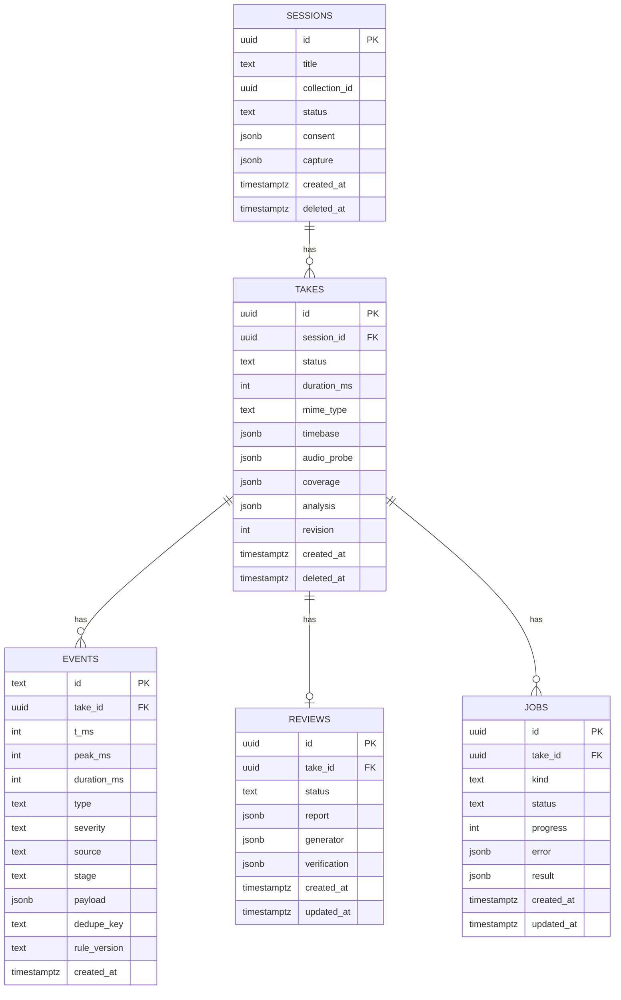

# Backend — Review-API, Timestamps und Event-Persistenz

Status: Backend-P0 und technische P1/P2-Anbindung implementiert (24.10.2026).
Frontend-Anbindung bleibt ein separater Team-Change. Menschlich gelabelte
Evaluation und Geräte-/Browser-Abnahme stehen aus; Prüfumfang in §13.
Bezug: `docs/03-architecture.md`, `docs/04-pose-tracking-requirements.md`, `docs/05-frontend-review-ux.md`, `AGENTS.md`.

## 1. Scope und Non-Goals

### 1.1 Scope

Das Backend ist die Quelle für:

- Session-/Take-Metadaten,
- Analyse-Events mit Timestamps,
- Aggregates und Coverage,
- den geerdeten Review-Text,
- Job-Status und Löschung.

Es nimmt optional Audio für ASR/Sprechanalyse entgegen und speichert ausschließlich abgeleitete Timestamp-Daten.

### 1.2 Non-Goals

Das Backend speichert **keine** Videos, **keine** Video-Clips und **keine** Snapshots.

Konkret gibt es nicht:

- keine `clips`-Tabelle,
- keine `clip_key`-/`snapshot_key`-Felder,
- keine `clip_url`-/`snapshot_url`-Felder in API-Responses,
- keinen FFmpeg-Clip-Job,
- keine Video-Objekte in S3/SeaweedFS,
- keine serverseitige Wiedergabe der Aufnahme.

Das Video bleibt im Browser (IndexedDB). Der Server liefert `t_ms`, `peak_ms` und `duration_ms`; das Frontend springt damit im lokalen Video.

### 1.3 Audio-Ausnahme

Für Speech/ASR darf die Audiospur (oder die komplette Aufnahme, aus der Audio extrahiert wird) **temporär** hochgeladen werden. Sie wird nach Abschluss des Jobs gelöscht. Persistiert werden nur:

- `audio_probe` (Stream-Startzeiten, Dauer),
- Wörter mit Timestamps (Eingabe für Quellenvergleich und Fragerunde),
- Speech-/ASR-Events,
- WPM/Pausen/Füller-Metriken.

Wenn kein Audio-Upload gewünscht ist, bleibt die Pose-Review lokal und das Backend erzeugt nur den Pose-Teil.

## 2. Grundprinzipien

1. **Eine Medienzeitachse.** `t_ms` ist relativ zum Beginn des Takes, den der Browser abspielt. Nicht `Date.now()`, nicht Audio-Sample-Index, nicht Frame-Zähler.
2. **`peak_ms` ist das Sprungziel.** `t_ms` ist der Beginn der Bedingung; `duration_ms` ist die Dauer der Bedingung.
3. **Idempotenz.** Jeder POST ist mit `Idempotency-Key` wiederholbar. Events werden per `dedupe_key` upserted.
4. **Closed-World-Review.** Der Review-Writer bekommt nur ausgewählte Evidenzkarten. Keine Web-Suche, keine freie Retrieval-Schicht, keine rohen Landmark-Arrays.
5. **Deterministischer Fallback.** Ohne LLM muss eine vollständige, korrekte Template-Review entstehen.
6. **Keine erfundenen Autoritäten.** Keine Scores, Noten, Rankings, Emotions- oder Persönlichkeitsaussagen. Heuristiken sind `heuristic-unvalidated`.
7. **Privacy by Default.** Kein Video auf dem Server; Audio nur temporär; Löschung ist ein expliziter API-Vorgang.

## 3. Datenmodell

### 3.1 Übersicht



### 3.2 Tabellen

#### `sessions`

| Spalte | Typ | Constraints |
|---|---|---|
| `id` | `uuid` | PK, default `gen_random_uuid()` |
| `title` | `text` | not null |
| `collection_id` | `uuid` | null; verweist auf bestehende Quellen-Collection |
| `profile_id` | `uuid` | null; FK → `speaker_profiles.id`, `ON DELETE SET NULL` |
| `presentation_mode` | `text` | null oder `startup`, `thesis`, `school`, `nonprofit` |
| `status` | `text` | `created`, `analyzing`, `review_ready`, `failed`, `deleted` |
| `consent` | `jsonb` | `{granted, at, version, scope}` |
| `capture` | `jsonb` | Framing/Audience/Resolution und optional `deviceKey`; ohne Videodaten |
| `created_at` | `timestamptz` | not null |
| `deleted_at` | `timestamptz` | null |

#### `takes`

| Spalte | Typ | Constraints |
|---|---|---|
| `id` | `uuid` | PK |
| `session_id` | `uuid` | FK → `sessions.id`, `ON DELETE CASCADE` |
| `profile_id` | `uuid` | null; denormalisiert aus Session, FK `ON DELETE SET NULL` |
| `recorded_at` | `timestamptz` | not null; Client-Zeit oder Server-Fallback |
| `recorded_at_source` | `text` | `client` oder `server` |
| `device_key` | `uuid` | null; zufällige Geräte-UUID aus `capture.deviceKey`, kein Fingerprint |
| `status` | `text` | `created`, `audio_processing`, `events_ready`, `review_ready`, `failed` |
| `duration_ms` | `int` | `>= 0`; kanonische Dauer |
| `mime_type` | `text` | z. B. `video/webm;codecs=vp8,opus` |
| `timebase` | `jsonb` | siehe §5 |
| `audio_probe` | `jsonb` | Ergebnis des FFprobe beim Audio-Upload |
| `coverage` | `jsonb` | gemessene Intervalle; nicht gemeldete Zeit bleibt unbekannt |
| `analysis` | `jsonb` | Wörter mit Timestamps, Audio-/Wort-Summaries, Anbieterhinweise; optional Fact-Check und Fragen; keine Signal-/Landmark-Arrays |
| `revision` | `int` | Änderungsversion für atomare Review-Snapshots |
| `created_at` | `timestamptz` | not null |
| `deleted_at` | `timestamptz` | null |

#### `events`

| Spalte | Typ | Constraints |
|---|---|---|
| `id` | `text` | PK pro Take; z. B. `pose:…`, `speech:pause:…` |
| `take_id` | `uuid` | FK → `takes.id`, `ON DELETE CASCADE` |
| `t_ms` | `int` | `>= 0`; Beginn |
| `peak_ms` | `int` | `>= t_ms`; stärkster Moment |
| `duration_ms` | `int` | `>= 0` |
| `type` | `text` | siehe §4.1 |
| `severity` | `text` | `info`, `hint`, `warning` |
| `source` | `text` | `browser`, `asr`, `speech`, `factcheck`, `agent` |
| `stage` | `text` | `live`, `final` |
| `payload` | `jsonb` | typabhängig, mit `schema` |
| `dedupe_key` | `text` | not null |
| `rule_version` | `text` | optional |
| `created_at` | `timestamptz` | not null |

Constraints:

- `UNIQUE (take_id, dedupe_key)` für Idempotenz.
- Fehlt `dedupeKey` im JSON-Beispiel, wird `eventId` verwendet. Ein expliziter
  Key muss nichtleer sein. Event-IDs sind Token aus ASCII-Buchstaben, Zahlen,
  `:`, `_`, `.`, `-` (maximal 200 Zeichen); damit bleiben Platzhalter eindeutig.
- `PRIMARY KEY (take_id, id)`; Event-IDs müssen nur pro Take eindeutig sein.
- `CHECK (t_ms >= 0 AND duration_ms >= 0 AND peak_ms >= t_ms)`.
- `CHECK (t_ms + duration_ms <= 86_400_000)` als harte Obergrenze.
- Index `(take_id, t_ms)`.

#### `reviews`

| Spalte | Typ | Constraints |
|---|---|---|
| `id` | `uuid` | PK |
| `take_id` | `uuid` | FK → `takes.id`, `ON DELETE CASCADE`, `UNIQUE` |
| `status` | `text` | `pending`, `running`, `ready`, `failed` |
| `report` | `jsonb` | `review.v1` |
| `generator` | `jsonb` | `{mode, model, prompt_version, temperature, seed}` |
| `verification` | `jsonb` | Checks, Fallback-Grund, Pack-Hash |
| `created_at` | `timestamptz` | not null |
| `updated_at` | `timestamptz` | not null |

#### `jobs`

| Spalte | Typ | Constraints |
|---|---|---|
| `id` | `uuid` | PK |
| `take_id` | `uuid` | FK → `takes.id`, `ON DELETE CASCADE` |
| `kind` | `text` | `audio_analyze`, `review_generate`, `factcheck`, `questions_generate`, `answer_review` |
| `status` | `text` | `queued`, `running`, `completed`, `failed` |
| `progress` | `int` | 0–100 |
| `error` | `jsonb` | null |
| `result` | `jsonb` | Review-ID oder typisiertes Fact-Check-/Frage-/Antwort-Ergebnis |
| `created_at` | `timestamptz` | not null |
| `updated_at` | `timestamptz` | not null |

### 3.3 Nicht persistieren

- Videodateien, Videoframes, Snapshots.
- Rohe Landmark-Arrays (nur abgeleitete Events und optional JSONL lokal).
- Presigned URLs.
- Hand-Landmarks (Privacy; nicht für Review nötig).
- Audio nach Job-Ende.

## 4. Event-Vertrag

### 4.1 Event-Typen

```text
posture | head | hands | framing | data-quality
gesture | filler | pause | pace | volume | pitch
fact | question
```

`gaze` wird nicht verwendet. Kopforientierung ist ein Proxy und heißt `head` / `head-orientation`, nicht „Gaze“ oder „Eye Contact“.

### 4.2 Generisches Event

```json
{
  "eventId": "pose:take_7f3a:R1:52000",
  "tMs": 52000,
  "peakMs": 56000,
  "durationMs": 8400,
  "type": "posture",
  "severity": "hint",
  "source": "browser",
  "stage": "final",
  "payload": {
    "schema": "pose.event.v1",
    "category": "posture",
    "kind": "trunk-lateral",
    "metric": {
      "metricId": "trunkLean",
      "valueAtPeak": 14.2,
      "baseline": 2.1,
      "delta": 12.1,
      "unit": "deg"
    },
    "rule": {
      "ruleId": "R1",
      "version": 1,
      "evidence": "C",
      "confidence": "medium",
      "thresholdsStatus": "heuristic-unvalidated"
    },
    "evidence": {
      "sampleCount": 84,
      "validRatio": 0.96
    },
    "message": {
      "key": "posture.trunk-lateral",
      "params": {
        "deltaDeg": 12.1
      }
    }
  }
}
```

### 4.3 Pose-Event-Payload

Orientierung an `docs/04`:

```ts
type PosePayload = {
  schema: "pose.event.v1";
  category: "posture" | "head" | "hands" | "framing" | "data-quality";
  kind:
    | "trunk-lateral"
    | "shoulder-tilt"
    | "head-lateral"
    | "arms-closed"
    | "self-touch"
    | "hand-hidden-near-torso"
    | "head-orientation"
    | "framing"
    | "data-quality";
  metric?: {
    metricId: string;
    valueAtPeak: number;
    baseline: number | null;
    delta: number | null;
    unit: "deg" | "ratio" | "count" | "perMin";
  };
  rule?: {
    ruleId: string;
    version: number;
    evidence: "A" | "B" | "C" | "none";
    confidence: "high" | "medium" | "low";
    thresholdsStatus: "heuristic-unvalidated";
  };
  evidence: {
    sampleCount: number;
    validRatio: number;
  };
  message: {
    key: string;
    params: Record<string, string | number>;
  };
  reason?: string;
};
```

Regeln für die Annahme:

- `source` muss `browser` sein.
- `type` muss zu `payload.category` passen.
- `category` `framing`/`data-quality` darf keinen `metric`-Block mit erfundener Bewertung haben.
- `validRatio` in `[0, 1]`.
- `baseline`/`delta` nur, wenn eine Baseline berechnet wurde; sonst `null` und kein baseline-relatives Finding.
- `peakMs` muss innerhalb `[tMs, tMs + durationMs]` liegen.
- `durationMs = 0` ist für Punkt-Events erlaubt; `peakMs = tMs`.

### 4.4 Speech-/ASR-Events

Das Backend erzeugt sie selbst. Payloads bleiben typabhängig:

- `pause`: `{ gap_ms, before, after, mid_sentence }`
- `volume`: `{ direction, delta_db_median, baseline_level_db }`; Signal-Pipeline alternativ mit `window_delta_db` und `window_baseline_level_db` (gleich lange Arrays).
- `pitch`: `{ direction, std_st_median }`
- `pace` (ASR): `{ direction, window_wpm, baseline_wpm }`
- `pace` (Audio): `{ direction, window_syllables_per_s, baseline_syllables_per_s }`
- `filler`: `{ kind: "filler" | "repetition", word }`

Bei der adaptiven Signalreferenz trägt das Payload zusätzlich
`baseline_mode: "adaptive"`; `window_baseline_level_db` bzw.
`window_baseline_syllables_per_s` speichert die Referenz vor jedem Messfenster.
Die vorhandene skalare Baseline bleibt als Referenz des ersten Fensters erhalten.
Der Review-Text benennt eine nachgeführte Stimmreferenz und verwendet deren
Fensterwerte. Ältere Events ohne diese Felder bleiben lesbar. Kalibrierung beginnt
erst nach genügend stimmhafter Sprache; spätere Audioabschnitte verändern keine
früheren Referenzen. Wortbasiertes ASR-Tempo bleibt separat.

Wichtig:

- Audio-Pace ist **Silben/s**, ASR-Pace ist **WPM**. Niemals als dieselbe Metrik ausgeben.
- Pausen aus VAD und ASR deduplizieren. ASR-Pausen innerhalb eines Satzes haben
  Vorrang, danach ASR-Pausen mit belegtem Satzende im `before`-Wort, sonst die
  längere Pause. Alle beteiligten Event-IDs bleiben erhalten.
- `window_delta_db`/`window_std_st`/`window_wpm` sind Arrays. Vor dem Review median/min/max berechnen, nicht als Roharray an das LLM geben.

## 5. Timebase und Timestamp-Validierung

### 5.1 Timebase

```json
{
  "onstart_perf_ms": 12345.6,
  "first_video_pts_ms": 12,
  "audio_start_ms": 24,
  "av_offset_ms": 12,
  "container_duration_ms": 182200,
  "wall_duration_ms": 182340
}
```

Semantik:

- `onstart_perf_ms`: `performance.now()` bei `MediaRecorder.onstart`.
- `first_video_pts_ms`: erster Video-PTS aus dem Container, relativ zum Aufnahmestart.
- `audio_start_ms`: erster Audio-PTS.
- `av_offset_ms`: `audio_start_ms - first_video_pts_ms`.
- `container_duration_ms`: Dauer aus dem Container/Probe.
- `wall_duration_ms`: Dauer aus der Browser-Uhr.

Das Frontend sendet die Timebase beim Anlegen des Takes. Das Backend validiert sie und speichert sie unverändert.

### 5.2 Validierungsregeln

| Regel | Fehler |
|---|---|
| `duration_ms >= 0` | `E_DURATION_NEGATIVE` |
| `abs(container_duration_ms - duration_ms) <= 2000` | `E_DURATION_MISMATCH` (Warning, nicht hart ablehnen) |
| `abs(av_offset_ms) <= 500` | `E_AV_OFFSET_IMPLAUSIBLE` (Warning) |
| `0 <= t_ms <= duration_ms + 1000` | `E_EVENT_OUT_OF_RANGE` |
| `event.t_ms + event.duration_ms <= take.duration_ms + 1000` und `<= 86_400_000` | `E_EVENT_DURATION_INVALID` |
| `t_ms <= peak_ms <= t_ms + duration_ms` | `E_PEAK_OUT_OF_RANGE` |
| `validRatio` in `[0, 1]` | `E_VALID_RATIO_INVALID` |
| `dedupe_key` nicht leer | `E_DEDUPE_KEY_MISSING` |

Events außerhalb des Toleranzfensters werden abgelehnt, nicht geclamped. Ein fehlerhafter Timestamp ist ein Bug, kein Datenpunkt.

### 5.3 Audio-Probe

Beim Audio-Upload:

```bash
ffprobe -v error -print_format json \
  -show_entries format=start_time,duration \
  -show_entries stream=index,codec_type,codec_name,start_time,duration \
  recording
```

Ergebnis in `takes.audio_probe`:

```json
{
  "format_start_ms": 0,
  "duration_ms": 181900,
  "audio_start_ms": 24,
  "video_start_ms": 12
}
```

ASR-Wortzeiten werden auf die gemeinsame Take-Zeitachse verschoben:

```text
t_take = word_start_ms + (audio_start_ms - first_video_pts_ms)
```

Bei fehlendem Video-Upload wird `first_video_pts_ms` aus der Take-Timebase verwendet. Der Offset wird geloggt, aber nicht stillschweigend korrigiert.

## 6. API

Öffentlicher Prefix: `/api`. FastAPI-Routen können intern ohne Prefix definiert werden; das Next.js-Proxying mappt `/api/...` auf das Backend.

### 6.1 Endpunkte

| Methode | Pfad | Zweck | Response |
|---|---|---|---|
| `POST` | `/api/sessions` | Session anlegen | `201 { session }` |
| `GET` | `/api/sessions/{sessionId}` | Session + Takes | `200 { session, takes }` |
| `DELETE` | `/api/sessions/{sessionId}` | Session inkl. Events/Reviews löschen | `204` |
| `POST` | `/api/sessions/{sessionId}/takes` | Take anlegen | `201 { take }` |
| `GET` | `/api/takes/{takeId}` | Take-Metadaten | `200 { take }` |
| `POST` | `/api/takes/{takeId}/audio` | Audio/Aufnahme temporär hochladen | `202 { jobId, statusUrl }` |
| `POST` | `/api/takes/{takeId}/events` | Browser-Events upserten | `200 { accepted, rejected }` |
| `POST` | `/api/takes/{takeId}/review` | Review erzeugen | `202 { jobId, statusUrl }` |
| `POST` | `/api/takes/{takeId}/factcheck` | gespeicherte Wörter gegen Session-Collection prüfen; `useWeb` standardmäßig aus | `202 { jobId, statusUrl }` |
| `POST` | `/api/takes/{takeId}/questions` | Fragen aus gespeichertem Transkript und Funden; `persona` | `202 { jobId, statusUrl }` |
| `GET` | `/api/takes/{takeId}/questions` | gespeichertes `QuestionResult`, ggf. null | `200 { questions }` |
| `POST` | `/api/takes/{takeId}/questions/answers` | `{questionId, answer, persona?}`; nur Fragen dieses Takes | `202 { jobId, statusUrl }` |
| `GET` | `/api/takes/{takeId}/evaluation` | technische Failure-Codes/Fallback-Rate, keine menschliche Qualitätsmessung | `200 { evaluation }` |
| `GET` | `/api/takes/{takeId}/timeline` | Timeline + Aggregates + Coverage | `200 { timeline }` |
| `GET` | `/api/takes/{takeId}/review` | ReviewReport | `200 { review }`, `404` wenn noch nicht erzeugt |
| `GET` | `/api/jobs/{jobId}` | Job-Status | `200 { job }` |
| `GET` | `/api/health/live` | Liveness | `200` |
| `GET` | `/api/health/ready` | Readiness | `200` |

Es gibt bewusst **keine** Endpunkte für Clips, Snapshots oder Videodateien.
Die Präfixe `s_`, `t_`, `j_`, `r_` in Beispielen sind illustrative Kürzel;
die implementierte API verwendet UUIDs. Alle neuen POSTs benötigen den Header
`Idempotency-Key`. Bestehende `/speech`, `/factcheck`, `/questions`, `/sources`
bleiben kompatibel; deren bisherige Snake-Case-Verträge werden nicht migriert.

### 6.2 `POST /api/sessions`

Request:

```json
{
  "title": "Hackathon-Pitch",
  "collectionId": "col_123",
  "profileId": "5e0f7c2a-…",
  "presentationMode": "startup",
  "capture": {
    "framingMode": "upper-body",
    "audienceMode": "camera",
    "width": 1280,
    "height": 720,
    "fps": 30,
    "mirrored": true,
    "deviceKey": "a3f1c9e2-…"
  },
  "consent": {
    "granted": true,
    "at": "2026-10-24T17:20:00Z",
    "version": "2026-10-24",
    "scope": "local-analysis"
  }
}
```

Wenn `profileId` gesetzt ist, ist zusätzlich `X-Profile-Token: pp_…` nötig.
Ohne `profileId` bleibt der bestehende anonyme Session-Pfad unverändert.

Response:

```json
{
  "session": {
    "sessionId": "s_7f3a",
    "title": "Hackathon-Pitch",
    "createdAt": "2026-10-24T17:20:00Z",
    "collectionId": "col_123",
    "status": "created"
  }
}
```

### 6.3 `POST /api/sessions/{sessionId}/takes`

Request:

```json
{
  "durationMs": 182200,
  "mimeType": "video/webm;codecs=vp8,opus",
  "recordedAt": "2026-10-24T18:03:00Z",
  "timebase": {
    "onstartPerfMs": 12345.6,
    "firstVideoPtsMs": 12,
    "audioStartMs": 24,
    "avOffsetMs": 12,
    "containerDurationMs": 182200,
    "wallDurationMs": 182340
  },
  "coverage": [
    { "tMs": 0, "durationMs": 163800, "evaluable": true },
    { "tMs": 163800, "durationMs": 18400, "evaluable": false, "reason": "hips-not-visible" }
  ]
}
```

`recordedAt` ist optional. Fehlt es oder liegt es außerhalb des
Plausibilitätsfensters, setzt der Server `recordedAtSource="server"`.
`profileId` und `deviceKey` werden aus der Session kopiert; der Take-Request
sendet sie nicht erneut.

Response:

```json
{
  "take": {
    "takeId": "t_91c2",
    "sessionId": "s_7f3a",
    "profileId": "5e0f7c2a-…",
    "recordedAt": "2026-10-24T18:03:00Z",
    "recordedAtSource": "client",
    "durationMs": 182200,
    "mimeType": "video/webm;codecs=vp8,opus",
    "status": "created",
    "timebase": {
      "onstartPerfMs": 12345.6,
      "firstVideoPtsMs": 12,
      "audioStartMs": 24,
      "avOffsetMs": 12,
      "containerDurationMs": 182200,
      "wallDurationMs": 182340
    }
  }
}
```

### 6.4 `POST /api/takes/{takeId}/audio`

Multipart:

```text
file: recording (audio/* oder video/*)
transcribe: true|false
config: optional JSON
local_only: true|false (optional)
live_transcript: optional finales Deepgram-Wörter-JSON (wie /speech/analyze)
```

Der Server:

1. speichert den Upload temporär,
2. probt ihn,
3. extrahiert Audio,
4. führt Speech-/ASR-Analyse aus,
5. schreibt `takes.audio_probe`,
6. erzeugt Events,
7. löscht den Upload.

Response:

```json
{
  "jobId": "j_123",
  "statusUrl": "/api/jobs/j_123"
}
```

Wenn `transcribe=true` und kein ASR-Provider konfiguriert ist: `503 E_ASR_UNAVAILABLE`.
Maximal 128 MiB pro Upload. Ein Cloud-Transcriber, gehostetes LLM oder Web-Fetch
braucht Session-Einwilligung mit `scope: "local-and-cloud-analysis"`; ein
lokaler Job funktioniert mit `local-analysis`. Wort-/Audio-Summaries und
Anbieterhinweise sind anschließend in `GET /takes/{id}` unter `analysis`.

### 6.5 `POST /api/takes/{takeId}/events`

Request:

```json
{
  "events": [
    {
      "eventId": "pose:t_91c2:R1:52000",
      "tMs": 52000,
      "peakMs": 56000,
      "durationMs": 8400,
      "type": "posture",
      "severity": "hint",
      "source": "browser",
      "stage": "final",
      "payload": {
        "schema": "pose.event.v1",
        "category": "posture",
        "kind": "trunk-lateral",
        "metric": {
          "metricId": "trunkLean",
          "valueAtPeak": 14.2,
          "baseline": 2.1,
          "delta": 12.1,
          "unit": "deg"
        },
        "rule": {
          "ruleId": "R1",
          "version": 1,
          "evidence": "C",
          "confidence": "medium",
          "thresholdsStatus": "heuristic-unvalidated"
        },
        "evidence": {
          "sampleCount": 84,
          "validRatio": 0.96
        },
        "message": {
          "key": "posture.trunk-lateral",
          "params": {
            "deltaDeg": 12.1
          }
        }
      }
    }
  ]
}
```

Response:

```json
{
  "accepted": 1,
  "rejected": []
}
```

Bei Teilfehlern: akzeptierte Events werden gespeichert, abgelehnte mit Code und Index zurückgegeben. Maximal 500 Events pro Request; größere Batches aufteilen.
Identische Upserts invalidieren keine fertige Review. Ein verspätetes `live`-
Event ersetzt kein bereits finales Event mit demselben Dedupe-Key.

Upsert:

```sql
INSERT INTO events (...) VALUES (...)
ON CONFLICT (take_id, dedupe_key) DO UPDATE SET
  t_ms = EXCLUDED.t_ms,
  peak_ms = EXCLUDED.peak_ms,
  duration_ms = EXCLUDED.duration_ms,
  payload = EXCLUDED.payload,
  rule_version = EXCLUDED.rule_version;
```

Bestehende `id` darf nicht auf ein anderes Event zeigen; bei Konflikt mit anderer `dedupe_key` → `409 E_EVENT_ID_CONFLICT`.

### 6.6 `POST /api/takes/{takeId}/review`

Request optional:

```json
{
  "mode": "template",
  "language": "de"
}
```

`mode`:

- `template`: deterministisch, kein LLM, immer verfügbar.
- `llm`: LLM-Formulierer mit Verifier; falls nicht konfiguriert → `503 E_LLM_UNAVAILABLE`.
- ohne `mode`: Backend-Konfiguration entscheidet; Default `template`.

Response:

```json
{
  "jobId": "j_124",
  "statusUrl": "/api/jobs/j_124"
}
```

Der Job ist idempotent: Wenn bereits eine `ready`-Review existiert und sich der Event-Pack-Hash nicht geändert hat, wird die bestehende Review mit `200 { reviewId }` zurückgegeben, statt einen neuen Job zu starten. Andernfalls wird ein neuer Job erzeugt.

### 6.7 `GET /api/takes/{takeId}/timeline`

Response:

```json
{
  "timeline": {
    "session": {
      "sessionId": "s_7f3a",
      "title": "Hackathon-Pitch",
      "createdAt": "2026-10-24T17:20:00Z",
      "collectionId": "col_123",
      "status": "review_ready"
    },
    "take": {
      "takeId": "t_91c2",
      "sessionId": "s_7f3a",
      "durationMs": 182200,
      "mimeType": "video/webm;codecs=vp8,opus",
      "status": "review_ready",
      "timebase": {}
    },
    "events": [],
    "aggregates": [
      {
        "id": "pose-events",
        "label": "Haltungs-Ereignisse",
        "value": 7,
        "unit": "count"
      }
    ],
    "coverage": {
      "durationMs": 182200,
      "evaluableMs": 163800,
      "notEvaluableMs": 18400,
      "reasons": {
        "hips-not-visible": 18400
      }
    }
  }
}
```

Keine Clip-/Snapshot-Felder.

### 6.8 `GET /api/takes/{takeId}/review`

Response: `{ "review": <review.v1> }` (siehe §8.3). Wenn noch keine fertige Review existiert:

```json
{
  "error": {
    "code": "E_REVIEW_NOT_READY",
    "message": "Review wurde noch nicht erzeugt.",
    "details": { "takeId": "t_91c2" }
  }
}
```

### 6.9 `GET /api/jobs/{jobId}`

```json
{
  "job": {
    "jobId": "j_124",
    "takeId": "t_91c2",
    "kind": "review_generate",
    "status": "completed",
    "progress": 100,
    "error": null
  }
}
```

Status: `queued`, `running`, `completed`, `failed`.

### 6.10 `DELETE /api/sessions/{sessionId}`

Löscht:

- Session,
- Takes,
- Events,
- Reviews,
- Jobs,
- temporäre Audio-Uploads (falls noch vorhanden).

Es löscht **nicht** das lokale Video im Browser. Das Frontend muss die lokale Kopie separat löschen.

Response: `204`.

### 6.11 Fehlerformat

```json
{
  "error": {
    "code": "E_EVENT_OUT_OF_RANGE",
    "message": "Event t_ms liegt außerhalb der Take-Dauer.",
    "details": {
      "eventId": "pose:...",
      "tMs": 200000,
      "durationMs": 182200
    },
    "requestId": "req_123"
  }
}
```

HTTP-Codes:

| Code | Bedeutung |
|---|---|
| `400` | ungültige Anfrage |
| `404` | Session/Take/Review nicht gefunden |
| `409` | Konflikt (Idempotenz, Event-ID) |
| `422` | Schema-/Validierungsfehler |
| `429` | Rate Limit |
| `500` | interner Fehler |
| `503` | ASR/LLM/Storage nicht verfügbar |

### 6.12 Idempotenz

- `Idempotency-Key`-Header auf allen POSTs.
- Server speichert `key + request_hash` für 24 h.
- Keys gelten pro Operation/Pfad. Abgelaufene Einträge werden beim nächsten
  POST entfernt; Session-Löschung entfernt ihre Einträge sofort.
- Gleicher Key + gleicher Hash → gleiche Response/Job-ID.
- Gleicher Key + anderer Hash → `409 E_IDEMPOTENCY_CONFLICT`.
- Event-Upserts sind zusätzlich über `(take_id, dedupe_key)` idempotent.
- UUID-Job und Response werden vor dem Enqueue atomar gespeichert. Fällt das
  Publizieren aus, liefert die Anfrage 503; derselbe POST/Key publiziert beim
  Retry denselben noch wartenden Job. Ein periodischer Outbox-Sweeper ist
  nicht implementiert. Ein Take erlaubt höchstens einen aktiven langen Job.

### 6.13 Long-Term-Progress (additiv)

Die Progress-API liegt in `backend/app/progress/` und ist optional. Sie nutzt
`X-Profile-Token: pp_…` für alle Profil-Routen; `profileId` allein reicht nicht.

```text
POST   /api/profiles
GET    /api/profiles/{id}
PATCH  /api/profiles/{id}
DELETE /api/profiles/{id}
POST   /api/profiles/{id}/rotate-token
GET    /api/profiles/{id}/progress
GET    /api/profiles/{id}/progress/{metricId}
POST   /api/profiles/{id}/progress/recompute
GET    /api/profiles/{id}/goals
PUT    /api/profiles/{id}/goals/{metricId}
DELETE /api/profiles/{id}/goals/{metricId}
GET    /api/profiles/{id}/takes
GET    /api/profiles/{id}/export?format=json|csv
```

- Neue Mutationen brauchen `Idempotency-Key`; Profil-Erstellung liefert den
  Roh-Token nur in der ersten `201`-Antwort, ein Retry `200` ohne Token.
- `DELETE /profiles/{id}` löscht Profil, Token, Ziele und abgeleitete
  Progress-Daten. Sessions/Takes werden per `ON DELETE SET NULL` entkoppelt und
  bleiben unter ihrer eigenen Session-Einwilligung; `DELETE /sessions/{id}`
  bleibt die vollständige Session-Löschung.
- `progress.v1` liefert `points` pro Take inklusive `eligible=false` und
  `exclusionReasons`; es gibt keine Scores, Noten, Rankings, Wörter, Landmarks
  oder Medien-URLs.
- `recordedAtSource="server"` markiert fehlende/implausible Client-Zeit; das ist
  kein Ausschlussgrund.
- Details und DDL: `docs/12-long-term-progress-data-design.md`; Frontend-Vertrag:
  `docs/13-long-term-progress-frontend-contract.md`.

## 7. Analyse-Pipeline

### 7.1 Audio/ASR

```text
Upload → temporär speichern → ffprobe → Audio extrahieren
→ Speech-Analyse (RMS, VAD, YIN, Silbenrate)
→ optional ASR (Wort-Timestamps)
→ Events erzeugen → Upload löschen → Job completed
```

- Audio-Upload wird in jedem Fall gelöscht, auch bei Fehler (`finally`).
- `takes.audio_probe` bleibt.
- Kein Video-Frame, kein Snapshot, kein Clip.
- ASR-Wortzeiten werden mit dem Audio-Offset auf die Take-Zeitachse verschoben.
- Vollständige Live-Wörter sind bereits Take-relativ und werden nicht nochmals
  verschoben. Ohne belastbares Peak-Sample ist `peakMs = tMs` mit
  `payload.peakBasis: "event-start-no-peak-sample"` explizit markiert; ein
  stärkster Moment wird dann nicht behauptet.
- `transcribe=false` überspringt ASR, führt aber Speech-Analyse aus.

### 7.2 Pose-Events

```text
Browser JSONL → lokaler Analyzer → POST /events → Validierung → Upsert
```

Das Backend führt **keine** MediaPipe-Inferenz aus. Der Browser hat das Modell, die Frames und die Timebase. Das Backend validiert und persistiert nur die abgeleiteten Events.

### 7.3 Merge

Beim Review-Start:

1. Alle finalen Events des Takes laden.
2. Pausen deduplizieren:
   - gleiche Kategorie `pause`,
   - überlappende oder < 500 ms auseinanderliegende Fenster,
   - ASR-Pause bevorzugen, wenn `mid_sentence` belastbar,
   - sonst die längere Pause,
   - `merged_from`-IDs im Payload behalten.
3. Pace: ASR-WPM bevorzugen; Audio-Silbenrate nur als eigene Metrik behalten.
4. Stabil sortieren: `(t_ms, peak_ms, id)`.
5. Aggregates berechnen: Count, Dauer, Share, längstes Event, nicht auswertbare Zeit.
6. Coverage berechnen: `duration_ms`, `evaluable_ms`, `not_evaluable_ms`, Gründe.

Coverage ist Haltungs-/Framing-Abdeckung. Gemeldete Messintervalle im Take
liefern die Grundlage; finale `framing`-/`data-quality`-Events überschreiben
sie als nicht auswertbar. Lücken heißen `coverage-not-reported`, nicht gültig.
Überlappungen werden für die Gesamtdauer vereinigt; einzelne Gründe können
sich überschneiden. Aus „keine Abweichung gemeldet“ wird keine Stärke abgeleitet.

### 7.4 Review-Job

```text
load events → pack → select → generate → verify → assemble → persist
```

- `pack`: Event → EvidenceCard, inkl. Anzeige-Werten, Qualität, Provenance.
- `select`: max. 3 Fokus-Findings; Severity, Dauer, Confidence, Themenvielfalt; keine Duplikate.
- `generate`: Template (P0) oder LLM (P1).
- `verify`: harte Gates; bei Fehler Claim droppen, ein Retry, dann Template.
- `assemble`: Summary, Stärken, Limitations, Coverage, Provenance. Die Summary wird auch im LLM-Modus aus Counts und Aggregaten gebaut, nicht frei formuliert.
- `persist`: `reviews.report` + `verification`.

## 8. Review-Writer

### 8.1 P0 — deterministische Templates

P0 braucht kein LLM. Der Template-Pfad ist die Korrektheits-Baseline und der Demo-Fallback.

Beispiele:

```text
Von {start} bis {end} war {metric} {value} {unit} von deiner Ausgangshaltung
entfernt (Baseline {baseline} {unit}, {duration} s, {validRatio} % gültige
Frames). Das ist eine Heuristik, unvalidiert.
```

```text
Bei {time} gab es eine Pause von {gap} s. Pausen sind ein normales Mittel;
wenn sie für dich ungeplant war, hilft ein Blick auf ein Stichwort.
```

```text
Bei {time} sagst du {claimValue}. Die Quelle nennt auf {location}
{sourceValue}: „{quote}“. Das ist ein Widerspruch, den du im Frage-Teil
auflösen kannst.
```

```text
Für die Aussage bei {time} fand sich in den hochgeladenen Quellen kein Beleg.
Das heißt nicht, dass sie falsch ist.
```

Regeln:

- Jedes Finding hat `event_ids` und einen Timestamp.
- Zahlen, Einheiten und Zeiten kommen aus dem Event-Payload.
- Keine Personeneigenschaften, keine Kausalität, keine Publikumswirkung.
- Keine Noten, Scores, Rankings.
- „Heuristik, unvalidiert“ bei jedem regelbasierten Finding.
- „Nicht auswertbar“ mit Grund.
- Stärken nur aus belegten Aggregaten oder positiven Ereignissen; sonst weglassen.

Umgesetzt im Katalog `2026-10-24.v2`: `observation` enthält die Messung,
`interpretation` eine feste, passende Übungserklärung und `nextAction` einen
konkreten nächsten Schritt. Mögliche Effekte sind als Möglichkeit formuliert,
nicht als beobachtete Publikumsreaktion. Das Modell kann diese Erklärung und
den Übungsschritt nicht entfernen. Es gelten weiterhin keine neuen
Qualitätsschwellen oder Scores.

Bis zu drei Stärken werden neben den maximal drei Fokus-Findings ausgewählt,
ohne diese zu verdrängen: ASR-Pausen mit `mid_sentence=false` und vorhandenem
Satzende im `before`-Wort sowie `supports`-Befunde mit geprüftem Quellenzitat.
Jede Stärke referenziert ihre Event-IDs. Eine Pause allein, ein ungeprüftes
Quellenurteil oder ausbleibende Warnungen reichen nicht aus. Fehlt positive
Evidenz, wird diese Grenze in `limitations` genannt.

### 8.2 P1 — LLM als Formulierer

Das LLM bekommt **keine** rohen Events und keine ganze Session, sondern 8–15 Evidence Cards.
Bei weniger Ereignissen entsprechend weniger Karten. Der umgesetzte Writer
gibt pro Karte geprüfte `allowedTexts` mit Platzhaltern vor; das Modell wählt
daraus, statt neue Tatsachen oder freie Ratschläge zu formulieren. Maximal drei
Fokus-Findings, Kategorienvielfalt vor Wiederholungen. Die Summary bleibt in Code.

Evidence Card:

```json
{
  "id": "evt_7f3a",
  "kind": "deviation",
  "eventType": "volume",
  "source": "speech",
  "tMs": 70000,
  "peakMs": 73000,
  "durationMs": 6000,
  "severity": "hint",
  "display": {
    "time": "01:10",
    "timeEnd": "01:16",
    "deltaDb": 7.4,
    "baselineDb": -28.1,
    "thresholdDb": 6.0
  },
  "quality": {
    "evaluable": true,
    "validRatio": 0.72
  },
  "provenance": {
    "ruleId": "volume_window",
    "heuristic": true
  },
  "allowedTemplates": ["observation"],
  "suggestionIds": ["volume_check_mic"]
}
```

LLM-Output:

```json
{
  "claims": [
    {
      "evidenceIds": ["evt_7f3a"],
      "template": "observation",
      "text": "Von [[time:evt_7f3a]] bis [[time_end:evt_7f3a]] war es rund [[value:evt_7f3a.deltaDb]] dB leiser als in deiner Ausgangslautstärke.",
      "suggestionId": "volume_check_mic",
      "hedge": "approx"
    }
  ]
}
```

Das Modell darf **nicht** setzen:

- `id`, `severity`, `confidence`, `timestamp`, `eventIds` (nur referenzieren), `section`,
- Zahlen, Zeiten, Einheiten, Prozentwerte, dB-Werte,
- Zitate, Quellennamen, Seitenzahlen,
- Fact-Check-Urteile,
- freie Ratschläge.

### 8.3 Output-Vertrag `review.v1`

```json
{
  "schemaVersion": "review.v1",
  "reviewId": "r_123",
  "sessionId": "s_7f3a",
  "takeId": "t_91c2",
  "language": "de",
  "generatedAt": "2026-10-24T17:20:00Z",
  "generator": {
    "mode": "template",
    "model": null,
    "promptVersion": null
  },
  "coverage": {
    "durationMs": 182200,
    "evaluableMs": 163800,
    "notEvaluableMs": 18400,
    "eventsTotal": 42,
    "eventsSelected": 12,
    "eventsMentioned": 11,
    "reasons": {
      "hips-not-visible": 18400
    }
  },
  "summary": {
    "text": "12 Hinweise, davon 3 zu Haltung, 5 zu Stimme, 4 zu Quellen. 18,4 s waren nicht auswertbar.",
    "byCategory": {
      "posture": 3,
      "voice": 5,
      "content": 4
    }
  },
  "findings": [
    {
      "id": "c_01",
      "category": "posture",
      "title": "Rumpf-Seitneigung",
      "observation": "Von 00:52 bis 01:00 neigte sich dein Oberkörper um rund 12 Grad aus deiner Ausgangshaltung.",
      "evidence": {
        "eventIds": ["evt_p1"],
        "startMs": 52000,
        "peakMs": 56000,
        "endMs": 60000,
        "ruleId": "R1",
        "metric": "trunkLean",
        "value": 14.2,
        "baseline": 2.1,
        "delta": 12.1,
        "unit": "deg",
        "validRatio": 0.96,
        "confidence": "medium",
        "evidenceGrade": "C",
        "thresholdsStatus": "heuristic-unvalidated"
      },
      "interpretation": "Das kann eine Gewichtsverlagerung begleiten; über die Ursache sagt die Messung nichts.",
      "nextAction": {
        "suggestionId": "posture_weight_even",
        "text": "Verteile im nächsten Durchlauf das Gewicht gleichmäßig auf beide Füße."
      }
    }
  ],
  "strengths": [
    {
      "text": "82 % der auswertbaren Zeit lag innerhalb des eingestellten Bereichs.",
      "eventIds": ["agg_posture"]
    }
  ],
  "limitations": [
    "Die Haltungsanalyse ist eine Heuristik aus 2D-Pose-Landmarks und nicht extern validiert.",
    "18,4 s waren nicht auswertbar, weil die Hüften nicht im Bild waren.",
    "Diese Rückmeldung beschreibt diese Aufnahme, nicht deine Fähigkeiten."
  ],
  "provenance": {
    "eventPackHash": "sha256:…",
    "promptHash": "sha256:…",
    "catalogVersion": "2026-10-24",
    "gitSha": "…"
  }
}
```

### 8.4 Verifier

Jede Claim wird geprüft:

| Prüfung | Fehler | Aktion |
|---|---|---|
| JSON-Schema | `E_SCHEMA` | Antwort verwerfen, 1 Retry |
| `evidence_ids` existieren | `E_UNKNOWN_EVENT` | Claim droppen |
| Evidenz vorhanden | `E_MISSING_EVIDENCE` | Claim droppen |
| Platzhalter auflösbar | `E_UNRESOLVED_PLACEHOLDER` | Claim droppen |
| Keine Ziffern außerhalb von Platzhaltern | `E_NUMBER_NOT_FROM_PLACEHOLDER` | Claim droppen |
| Einheit passt | `E_UNIT_MISMATCH` | Claim droppen |
| Timestamp passt | `E_TIMESTAMP_MISMATCH` | Claim droppen |
| Template erlaubt | `E_TEMPLATE_NOT_ALLOWED` | Claim droppen |
| Suggestion-ID gültig | `E_SUGGESTION_UNKNOWN` | `null`, Claim behalten |
| Verbotene Phrase | `E_BANNED_PHRASE` | Claim droppen |
| Quantifier ohne Aggregat | `E_UNBACKED_QUANTIFIER` | Claim droppen |
| Quelle ohne Fact-Check-Karte | `E_UNBACKED_SOURCE` | Claim droppen |
| Doppelte Event-ID | `E_DUPLICATE_EVENT` | späteren Claim droppen |
| Überlappender Widerspruch | `E_OVERLAP_CONFLICT` | einen droppen, loggen |
| Maximale Länge | `E_TOO_LONG` | Claim droppen |

Wenn ein Claim zweimal fehlschlägt: Template für dieses Finding. Anbieterfehler
führen ohne zweiten Anbieteraufruf direkt zum Template. Auch bei fehlender
LLM-Konfiguration entsteht eine Review. Bei mehr als 20 % Fallbacks bleibt
`verification.degraded=true` als Diagnose erhalten; der Job ist mit der
geprüften Template-/Teilfallback-Review **completed**, und GET liefert sie.
`generator` und `limitations` machen den Ersatzpfad sichtbar. Kein Report mit
ungeprüften Claims wird gespeichert. Cloud-Einwilligung bleibt Pflicht für
tatsächliche Modellaufrufe und wird im Worker erneut geprüft.

### 8.5 Zitatprüfung

Normalisierung:

1. Unicode NFKC.
2. Zero-Width-/Bidi-Zeichen entfernen.
3. Typografische Quotes/Dashes vereinheitlichen.
4. Silbentrennung über Zeilenumbruch auflösen (`Wirkungs-\nweise` → `Wirkungsweise`).
5. Whitespace kollabieren.
6. Casefold.
7. Soft-Hyphen entfernen.
8. `ß`/`ss` nur fürs Matching mappen.
9. Nur den referenzierten Chunk/Fundort prüfen. Seitenköpfe/-füße werden ohne
   verlässliche Layout-Metadaten nicht automatisch gelöscht; das könnte Zitattext verändern.

Dann:

- exakter Substring → `quote_verified="exact"`,
- Fuzzy-Match (Token-Sequenz, Ratio ≥ 0.90, gleiche Rand-Tokens) → `quote_verified="fuzzy"`,
- sonst kein Zitat.

Scope: Das Zitat muss aus der zitierten Quelle und der zitierten Fundstelle stammen. Nicht irgendwo im Korpus.
Fuzzy-Matching darf Zahlen oder Negationen nicht verändern. Ein expliziter
Auszug-Verweis ist bindend; ein Zitat wird nicht auf einen anderen Auszug umgebucht.

Fact-Check-Urteil ist fix:

- `supported`: „Die Quelle stützt die Aussage; Zitat geprüft.“
- `contradicted`: „Die Quelle nennt eine andere Angabe; das ist ein Widerspruch.“
- `not_found`: „In den hochgeladenen Quellen kein Beleg gefunden. Das heißt nicht, dass die Aussage falsch ist.“

Niemals „falsch“, „erfunden“, „halluziniert“, „beweist“.

### 8.6 Prompt-Injection

- Keine Tools, kein Browsing, keine Codeausführung im Review-Writer.
- Transkript/Quellen mit zufälligen Nonce-Delimitern abgrenzen:
  `<data-7f3a9c>…</data-7f3a9c>`.
- Daten-Text nie in den System-Prompt interpolieren.
- Control-/Zero-Width-/Bidi-Zeichen entfernen.
- Output nur Schema + Enums; keine URLs/HTML.
- Verifier prüft unbekannte Quellen, verbotene Phrasen und Zahlen.
- Injection-Versuche loggen, aber den Inhalt nicht stillschweigend löschen.

### 8.7 Modell-Settings

| Setting | Empfehlung |
|---|---|
| Temperatur | 0,2–0,4 Generierung; 0 Verifier |
| `top_p` | 1.0 |
| `max_tokens` | 1200 gesamt; 120–200 pro Claim |
| Format | striktes JSON-Schema, nicht nur „JSON mode“ |
| Seed | setzen, wenn verfügbar; `system_fingerprint` loggen |
| Frequency/Presence Penalty | 0 |
| Kontext | Systemregeln → Evidence Cards → Aufgabe → Schema → harte Regeln |
| Kartenanzahl | 8–15, nicht die ganze Session |
| Verifier | anderes Modell, claim-level, 3 Votes, Temperatur 0 |

Die Tabelle war eine Empfehlung des Entwurfs. Implementiert sind der
Gemini-JSON-Modus und harte Code-Prüfungen für alle Adapter. Ein
mehrfach abstimmendes zweites Modell wird nicht als Qualitätsbeweis verwendet.
Die endliche Formulierungsauswahl macht unbekannte Einheiten, Quellen,
Kausalität oder Ratschläge ungültig. Menschliche Claim-Labels bleiben nötig.

## 9. Speicherung, Retention, Privacy

### 9.1 Wo was liegt

| Daten | Ort | Retention |
|---|---|---|
| Session/Take/Event/Review | Postgres | bis Löschung oder Retention-Frist |
| Progress-Profil/Token/Metriken/Ziele | Postgres | Profil-Retention; Löschung entfernt abgeleitete Progress-Daten |
| Audio-Upload | S3/SeaweedFS temporär | bis Job-Ende, dann löschen |
| Quellen-Uploads | S3/SeaweedFS | bestehende Sources-Retention |
| Video | Browser IndexedDB | lokal, bis Nutzer löscht |
| Presigned URLs | nirgends persistiert | bei Bedarf neu erzeugen |

### 9.2 Löschung

`DELETE /api/sessions/{id}`:

- löscht Session, Takes, Events, Reviews, Jobs (Cascade),
- löscht temporäre Audio-Objekte, falls noch vorhanden,
- setzt `deleted_at` für Audit, oder hartes Delete nach Retention,
- löscht **nicht** das lokale Video im Browser.

Das Frontend muss die lokale Kopie separat löschen und dem Nutzer beide Wirkungen anzeigen.

`DELETE /api/profiles/{id}` löscht Profil, Token, Ziele und die abgeleiteten
Progress-Zeilen. Es entfernt **nicht** die Sessions/Takes; deren `profile_id`
wird per `ON DELETE SET NULL` entkoppelt. Für die vollständige Löschung der
Analyse ist zusätzlich `DELETE /api/sessions/{id}` nötig.

### 9.3 Logs

- Keine Audio-/Video-URLs, keine presigned URLs, keine Transkripte in Standardlogs.
- Event-IDs, Job-IDs, Fehlercodes und Latenzen sind okay.
- `requestId` korrelieren.
- Keine Hand-Landmarks oder Roh-Frames loggen.

## 10. P0 / P1 / P2

### P0 — Review ohne Clips, ohne LLM

- `sessions`, `takes`, `events`, `reviews`, `jobs` anlegen.
- `POST /events` für Pose-Events validieren und upserten.
- `GET /timeline` mit Events, Aggregates, Coverage.
- Bestehende Speech-/ASR-Pipeline an Takes anbinden; `audio_probe` speichern.
- Merge + Pausen-Dedupe + Pace-Wahl.
- Deterministischer Template-Review-Writer.
- `DELETE /sessions/{id}`.
- Keine Clip-/Video-Felder im Schema.
- Tests: Timestamp-Validierung, Idempotenz, Merge, Template-Review, keine Video-/Clip-Felder.

### P1 — LLM + Fact-Check

- Fact-Check-Pipeline: Aussagen extrahieren, Top-k-Chunks, Urteil + Zitat, `quote_in_text`.
- LLM-Review-Writer mit Evidence Cards, Platzhaltern, JSON-Schema.
- Verifier + Template-Fallback.
- Quellenbezug in der Review (`filename`, `location`, `quote`).
- Prompt-Injection-Fixtures.
- Eval: 15–20 Fixtures, 30 menschlich gelabelte Claims.
- `GET /review` liefert `review.v1`.

### P2 — Frage-Agent und Evaluation

- `POST /takes/{id}/questions` und `GET /takes/{id}/questions`.
- Fragen aus Transkript, Quellen und Fact-Check-Funden.
- Antwortvergleich ohne Note.
- Web-Fetch als Zweitquelle, klar getrennt von hochgeladenen Quellen.
- Eval-Dashboard: Failure Codes, Fallback-Rate, Claim-Support.
- Optional: mehrere Sprachen, weitere Aggregate.

## 11. Tests und Acceptance Criteria

### 11.1 Pflicht-Tests

| Bereich | Test |
|---|---|
| Schema | OpenAPI enthält keine Clip-/Snapshot-/Video-Felder |
| Timestamp | `t_ms`, `peak_ms`, `duration_ms` innerhalb der Take-Dauer |
| Timebase | A/V-Offset wird korrekt auf ASR-Wörter angewendet |
| Idempotenz | gleicher `Idempotency-Key` liefert gleiche Job-ID |
| Events | Upsert per `dedupe_key`; kein Duplikat |
| Merge | VAD-/ASR-Pause wird dedupliziert |
| Pace | ASR-WPM und Audio-Silbenrate bleiben getrennt |
| Review P0 | Template-Review ist vollständig und zitierbar |
| Review P1 | Jede Claim hat gültige `eventIds` und Platzhalter |
| Zahlen | keine Ziffer außerhalb von Platzhaltern |
| Quotes | exakt/fuzzy/kein Zitat korrekt unterschieden |
| Injection | Transkript-/Quellen-Anweisungen werden nicht befolgt |
| Delete | Session-Löschung entfernt Events/Reviews/Jobs |
| Privacy | Audio-Upload ist nach Job-Ende weg |
| Performance | 5-min-Take mit 60 Events in < 10 s Review-Zeit (ohne LLM) |

### 11.2 Acceptance Criteria

- Ein Take kann ohne Video-Upload reviewt werden.
- Das Frontend kann mit `peak_ms` im lokalen Video springen; das Backend liefert keine Clip-URL.
- Jede Review-Aussage ist auf mindestens ein Event zurückführbar.
- Jede Zahl in der Review stammt aus einem Event oder Aggregat.
- Jede Heuristik ist als `heuristic-unvalidated` gekennzeichnet.
- „Nicht auswertbar“ ist ein eigener Coverage-Zustand.
- Löschen ist idempotent und entfernt alle serverseitigen Timestamp-Daten.
- Die API ist über `openapi.json` → `schema.d.ts` typisiert.

## 12. Offene Entscheidungen

- Wird Audio überhaupt hochgeladen oder nur lokal analysiert?
- Wie lange bleiben Events/Reviews in Postgres?
- Wird der Review-Writer immer serverseitig ausgeführt oder gibt es einen lokalen Fallback?
- Welcher LLM-Anbieter? (Der Template-Pfad darf nicht davon abhängen.)
- Wird die Quellen-Collection an die Session gebunden? Empfehlung: ja.
- Gibt es Auth? Wenn nein: unguessable IDs, Rate Limits, CORS, keine sensiblen Daten in Logs.
- Wird die Review auf Deutsch oder Englisch erzeugt? UI und Review-Text konsistent halten.
- Sollen Aggregates persistiert oder bei jedem Timeline-Request berechnet werden? Für 60 Events reicht Berechnung; bei Wachstum cachen.

## 13. Umsetzung und Review-Ergebnis (24.10.2026)

Der Nutzerauftrag gilt ausschließlich dem Backend. Änderungen liegen in
`backend/app/review/`, der gemeinsamen Quellen-Zitatprüfung, Backend-Tests,
Backend-/Architekturdokumentation und dem generierten `api/`-Vertrag. Keine
Frontend-/Mobile-Implementierung geändert.

| Schritt | Stand / Beleg |
|---|---|
| P0 Tabellen, Event-Upsert, Timebase, Timeline, Coverage | implementiert; echte Postgres-Roundtrips in `backend/tests/test_review_db.py` |
| P0 temporäres Audio, Probe, A/V-Offset, Merge | bestehende Pipeline adaptiert; Original-Löschung vor `completed`, auch bei Analysefehler; Worker verhindert Wiederanlegen nach Session-Löschung |
| P0 Template, Idempotenz, Delete, kein Medien-Schema | implementiert; atomare Keys/Jobs, Ready-Review-Wiederverwendung, Cascade inkl. temporärem Audio |
| P1 Fact-Check, Quellenbezug, exakte/fuzzy Zitate | bestehende Pipeline angebunden; Auszug-Verweis bindend, Unicode-/Hyphen-/Bidi-Normalisierung, Zahlen-/Negationsschutz |
| P1 Evidence Cards, Verifier, Template-Fallback | implementiert; LLM-Writer nutzt den konfigurierten Gemini-Adapter; keine Tools oder Retrieval im Writer |
| P1 adversariale Fixtures | zwanzig Writer-Fälle plus Schema-, Quote-, Timestamp- und Coverage-Tests; synthetisch, keine Genauigkeitsvalidierung |
| P1 dreißig menschliche Claim-Labels | **offen**; dreißig synthetische Fälle in `backend/tests/fixtures/review-human-labels.json` vorbereitet, alle Labels bewusst null |
| P2 Fragen und Antwortvergleich | Take-Routen implementiert; gespeicherte Wörter, Collection und Funde; Antwort nur auf Fragen dieses Takes, keine Note |
| P2 Web-Zweitquelle | vorhandener Adapter explizit zuschaltbar; standardmäßig aus, getrennt als Web-Evidenz; kein Live-Web-Qualitätsnachweis |
| P2 Evaluation | Backend-Endpunkt mit Failure-Codes/Fallback-/Verifier-Counts; keine Frontend-Dashboard-Arbeit in diesem Change |
| API-Vertrag | FastAPI → `api/openapi.json` → `api/schema.d.ts`; Browser-Pose-Payload und Review-Report typisiert |

Synthetischer HTTP-/Celery-/Postgres-/S3-Smoke: Template-Review ca. **0,25 s**;
fünfminütiger Take mit 60 Events ohne Medien-Upload ca. **0,23 s** inklusive
Queue/Polling (Budget < 10 s). Lokaler LLM-Pfad ca. **17,3 s** beim separaten
Smoke; das ist kein Latenzversprechen. Beide Pfade prüften Audio-Löschung im
Objektspeicher, Wiederholung desselben Job-Keys, Ready-Review-Wiederverwendung
und idempotente Session-Löschung. Startbefehle: `backend/README.md`.

Zusätzlicher synthetischer Durchlauf nach Integration der Team-Commits:
echte lokale Whisper-ASR → 13 Wörter → Fact-Check → eine quellengebundene
Frage → Antwortvergleich → Template-Review. Alle Jobs abgeschlossen, Session
und Testquelle anschließend gelöscht. Der Vortrag ergab keine extrahierten
Tatsachenbehauptungen; damit wurde kein reales Fact-Check-Urteil abgenommen.
Die Modellreaktion auf die Antwort ist ebenfalls kein menschliches Qualitätslabel.

Bei der Gesamtprüfung zeigte der bestehende Deepgram-Disconnect-Test auch auf
unverändertem `HEAD` einen TestClient-Abbruch während Cleanup. Der Test wartet
nun auf den tatsächlichen Protokoll-Disconnect vor Verlassen des Kontextes;
Produktions-Streaming wurde dabei nicht geändert.

Offene Abnahme: menschliche Labels/Modellqualität, echtes Mikrofon und Geräte,
Browser-IndexedDB und Video-Sprünge (Frontend-Team), öffentliche Absicherung
und automatische Retention. Lokaler Scope bleibt bestätigt. Ohne erneuten
POST/Key oder Session-Löschung gibt es keine automatische Bergung eines vor
dem Enqueue verwaisten Jobs. Harte Worker-Abbrüche verzögern Audio-Cleanup bis
zur erneuten Zustellung; ein allgemeiner Retention-Sweeper ist nicht Teil dieser Umsetzung.
