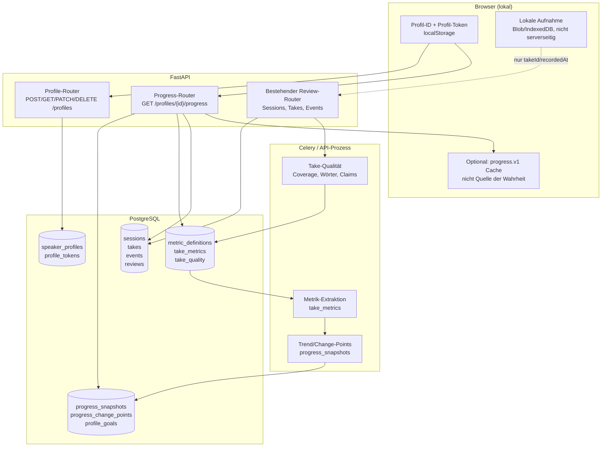
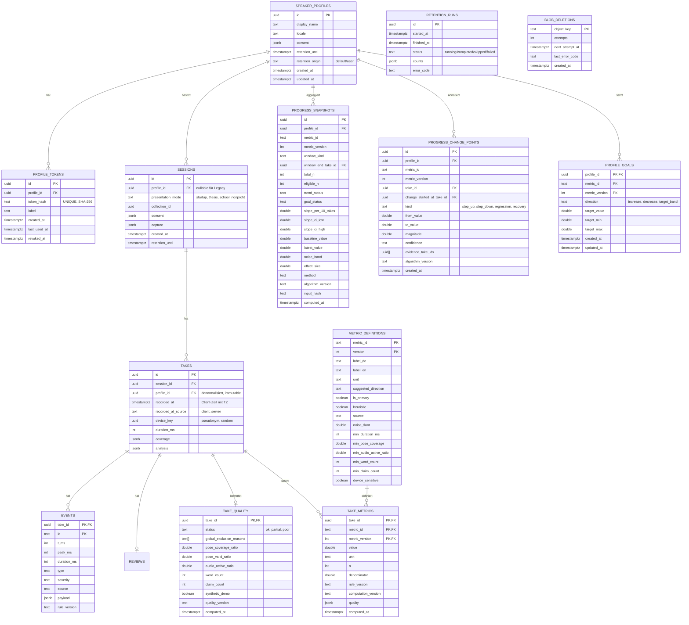
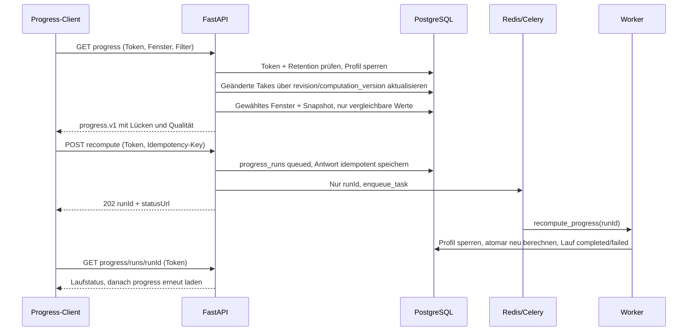

# Long-Term-Fortschritt — Data Design, Speicherung und Auswertung

Status: **Backend und Web-UI umgesetzt (24.10.2026); Retention am 25.10.2026
ergänzt.** Der Code liegt in `backend/app/progress/`, die additiven
Spalten/Tabellen werden beim Start idempotent angelegt. Der aktuelle Prüfstand
(25.10.2026) ist 370 bestandene und 2 übersprungene Backend-Tests sowie 314
Frontend-Tests in 44 Dateien; Lint, Typecheck und Build sind grün. Die
Web-Oberfläche `/progress` (Consent, Demo, Filter, Ziele, Export und Löschung)
ist umgesetzt; die Verknüpfung neuer Live-Aufnahmen mit einem Profil ist noch
offen. Dieses Dokument beschreibt weiterhin die Zielarchitektur und die Gründe;
Abweichungen zum ersten Entwurf sind in §2.3 ausdrücklich festgehalten. Der
Frontend-Vertrag steht separat in
[`13-long-term-progress-frontend-contract.md`](13-long-term-progress-frontend-contract.md).

> **Leitplanken des Projekts bleiben gültig.** Es gibt keinen Gesamtscore,
> keine Note, kein Ranking und keinen Vergleich mit anderen Personen. Alle
> regelbasierten Werte sind Heuristiken und als solche zu kennzeichnen. Fehlende
> Daten werden nicht als „gut“ oder „0“ interpretiert. Das Video bleibt lokal;
> dieses Feature speichert keine Videos, Clips oder Snapshots.

**Kurzfassung**

- Neues, optionales **pseudonymes Profil** pro Browser; Verknüpfung über
  `profile_id` an Sessions/Takes, Zugriff über einen gehashten Token.
- **`take_quality`** erfasst die Messqualität pro Take; die **metrikspezifische
  Eligibility** wird daraus plus Metrikdefinition abgeleitet und in jedem
  API-Punkt ausgewiesen. **`take_metrics`** speichert normalisierte,
  versionierte Messwerte.
- **`progress_snapshots`** und **`progress_change_points`** halten Trend,
  Unsicherheit und „ab wann“-Aussagen als reproduzierbaren Read-Layer.
- Auswertung: **Theil–Sen + Mann–Kendall + EWMA/CUSUM**, Baseline aus den
  ersten 3 eligible Takes, Rauschband aus MAD, Valenz nur mit optionalem Ziel.
- Kein Gesamtscore, keine Kausalität, keine Personenvergleiche; die UI zeigt
  Rohpunkte, Lücken, Qualität und Unsicherheit.

## 1. Ziel, Scope und Nicht-Ziele

### 1.1 Ziel

Nach etwa 20 Präsentationen soll eine Person sehen können:

> **Zähleinheit:** Die Timeline zählt **Takes** (Aufnahmen), nicht Sessions.
> Eine Präsentation kann mehrere Takes haben (z. B. Wiederholungen); im
> Normalfall entspricht „20 Präsentationen“ 20 Takes. Die UI nennt sie
> „Aufnahme #n“ und kann mehrere Takes derselben Session gruppieren.

- wie sich einzelne, nachvollziehbare Messgrößen über die Zeit verändern,
- **wann** eine Veränderung begann (z. B. „ab Aufnahme 13“),
- ob die Veränderung größer ist als die normale Schwankung,
- ob sie zum selbst gesetzten Ziel passt (Verbesserung / Rückschritt),
- welche Aufnahmen vergleichbar sind und welche aus Qualitätsgründen fehlen.

Die Timeline ist eine **Beschreibung der eigenen Messreihe**, keine Bewertung
der Person und keine Prognose.

### 1.2 Scope

- Pseudonymes, browserlokales Fortschrittsprofil (optional, mit Einwilligung).
- Verknüpfung bestehender Sessions/Takes mit diesem Profil.
- Normalisierte, versionierte Metriken pro Take.
- Robuste Trend- und Veränderungserkennung auf diesen Metriken.
- API und Datenvertrag für eine Timeline im Frontend.
- Löschung, Export und Aufbewahrungssteuerung.

### 1.3 Nicht-Ziele

- Kein Login, keine Kursverwaltung, keine Social-Funktion.
- Kein Vergleich zwischen Personen oder gegen eine Population.
- Kein zusammengesetzter „Präsentationsscore“.
- Keine Emotions-, Persönlichkeits- oder Eignungsdiagnostik.
- Keine serverseitige Video-/Clip-/Snapshot-Speicherung.
- Keine LLM-Bewertung des Fortschritts. Die Auswertung ist deterministisch und
  aus Rohdaten reproduzierbar. Ein späterer LLM-Text dürfte nur bereits geprüfte
  Aggregate umformulieren, niemals neue Zahlen oder Kausalitäten erfinden.
- Keine Genauigkeits- oder Wirksamkeitsversprechen. Die Metriken sind
  Prototyp-Heuristiken; menschliche Validierung steht aus.

## 2. Forschungsgrundlage und Designprinzipien

Die folgenden Prinzipien sind bewusst konservativ. Sie verhindern, dass aus
Rauschen, fehlenden Daten oder einem einzelnen Ausreißer eine scheinbare
„Verbesserung“ wird.

| Prinzip | Konsequenz im Design | Quelle / Begründung |
|---|---|---|
| **Längsschnitt statt Querschnitt** | Eine Person wird mit sich selbst verglichen; die Einheit ist der Take, gruppiert nach Session/Präsentation. | Innerhalb-Personen-Fragestellung; keine Normstichprobe vorhanden. |
| **Rohdaten und abgeleitete Daten trennen** | Events und Wörter bleiben die Fakten; `take_metrics` ist ein reproduzierbarer Read-Layer. | Materialisierte Projektion (CQRS-nah): Zustand aus Ereignissen und Summaries rekonstruierbar halten. |
| **Messdefinitionen versionieren** | Jede Metrik hat `metric_id` + `version`; jede Berechnung hat `computation_version`; Upstream-Regeln haben `rule_version`. | Sonst werden alte und neue Regeln stillschweigend verglichen. |
| **Rauschen explizit modellieren** | Baseline, MAD-Rauschband und Mindeständerung (`MDC`) sind Teil jeder Serie. | Ein Delta ohne Bezug zur Messstreuung ist keine belastbare Veränderung. |
| **Robuste Verfahren für kurze Reihen** | Theil-Sen-Steigung, Mann-Kendall-Test, EWMA und CUSUM statt OLS/p-Wert allein. | Kurze, nicht-normalverteilte, autokorrelierte Reihen sind typisch. |
| **Veränderung braucht Bestätigung** | Ein einzelner Ausreißer ist kein Rückschritt; CUSUM-Alarm plus Wiederholung/Kontext. | Reaktion auf Rauschen vermeiden; Regression-to-the-Mean beachten. |
| **Fehlende Daten sind unbekannt** | `null`/`eligible=false`; keine Imputation; Lücken bleiben sichtbar. | Coverage ohne Messintervall bleibt unbekannt (bestehender Projektvertrag). |
| **Wenige primäre Metriken** | 6–7 primäre Metriken; explorative Metriken nur als Detail. | Multiple Testing und narrative Überladung vermeiden. |
| **Kontext miterfassen** | Präsentationstyp, Dauer, Gerät, Upstream-Regelversion, Coverage. | Like-for-like-Vergleich statt Äpfel/Birnen. |
| **Valenz nur mit Ziel** | „gestiegen/gefallen“ ist neutral; „Verbesserung/Rückschritt“ nur bei selbst gesetztem Ziel und belastbarem Trend. | Es gibt keine universell „gute“ Sprechgeschwindigkeit oder Gestenhäufigkeit. |
| **Zugängliche, ehrliche Visualisierung** | Rohpunkte, Unsicherheitsband, Qualitätsmarker, Tabellenalternative. | Überblick zuerst, Details auf Anfrage; Farbe nie allein. |
| **Datensparsamkeit** | Keine neuen Medien; nur abgeleitete Metriken und Qualitätsmerkmale. | GDPR Art. 5 (Datenminimierung), Art. 25 (Privacy by Design). |

### 2.1 Statistische Quellen

- **Theil–Sen**: mediane Steigung aller Punktpaare, robust gegen Ausreißer;
  Konfidenzintervall über die mittleren 95 % der paarweisen Steigungen, bei
  großen Reihen über ca. 600 gezogene Paare. [Theil 1950; Sen 1968; USGS/Helsel et al.](https://pubs.usgs.gov/sir/2005/5275/)
- **Mann–Kendall**: nichtparametrischer Test auf monotone Tendenz; setzt
  Unabhängigkeit voraus. Bei serieller Korrelation wird die effektive
  Stichprobengröße konservativ per AR(1)-Näherung reduziert; das ist eine
  Heuristik, keine exakte Hamed–Rao-Implementierung.
  [USGS Kendall family](https://pubs.usgs.gov/sir/2005/5275/)
- **EWMA**: exponentiell gewichteter gleitender Mittelwert; `λ` typischerweise
  0,2–0,3; sensitiv für kleine, graduelle Drifts.
  [NIST/SEMATECH e-Handbook 6.3.2.4](https://www.itl.nist.gov/div898/handbook/pmc/section3/pmc324.htm)
- **CUSUM**: kumulative Summe standardisierter Abweichungen; gut für
  Level-Shifts/Change-Points bei Einzelbeobachtungen.
  [NIST/SEMATECH e-Handbook 6.3.2.3](https://www.itl.nist.gov/div898/handbook/pmc/section3/pmc323.htm)
- **Reliable Change Index (RCI)**: Jacobson & Truax, 1991;
  `RCI = (post − pre) / S_diff`, `S_diff = sqrt(2) · SEM`.
  Ohne validierte Reliabilität wird hier konservativ `SEM ≈ SD` gesetzt; das
  Ergebnis heißt deshalb **RCI-Analogon**, nicht „klinisch signifikant“.
  [DOI 10.1037/0022-006X.59.1.12](https://doi.org/10.1037/0022-006X.59.1.12)
- **Regression to the Mean**: Startwerte nicht nach „bestem“ Take wählen;
  Baseline aus den ersten vergleichbaren Takes, nicht aus dem Maximum.
  [Barnett et al., Int J Epidemiol 2005](https://doi.org/10.1093/ije/dyh299)
- **Multiple Testing**: primäre Metriken vorab festlegen; bei p-Werten
  Benjamini–Hochberg mit `q = 0.1`.
  [Benjamini & Hochberg 1995](https://doi.org/10.1111/j.2517-6161.1995.tb02031.x)

### 2.2 Visualisierungs- und UX-Quellen

- Shneiderman: „Overview first, zoom and filter, then details-on-demand“.
- Tufte: Small Multiples, hohe Daten-Tinte-Ratio, keine Dekoration.
- Financial Times Visual Vocabulary: Linie für Zeitverläufe, Slope für
  Vorher/Nachher, keine Dual-Achsen, keine irreführenden Skalen.
  [FT Visual Vocabulary](https://github.com/Financial-Times/chart-doctor/tree/main/visual-vocabulary)
- NN/g Progressive Disclosure: wenige Kernoptionen zuerst, Details auf Wunsch.
  [NN/g](https://www.nngroup.com/articles/progressive-disclosure/)
- W3C WAI/WCAG 2.2: Textalternativen, Farbe nicht als einziges Mittel,
  Tastaturbedienung, Kontrast, reduzierte Bewegung.
  [W3C WAI](https://www.w3.org/WAI/tutorials/), [WCAG 2.2](https://www.w3.org/TR/WCAG22/)
- PostgreSQL-Partitionierung erst bei sehr großen Tabellen; für 20–1.000 Takes
  ist sie unnötig. [PostgreSQL 18, Table Partitioning](https://www.postgresql.org/docs/current/ddl-partitioning.html)

### 2.3 Deep-Research-Validierung und Korrekturen (24.10.2026)

Der erste Entwurf wurde gegen Primärquellen, die PostgreSQL-Dokumentation und
den tatsächlich implementierten Code geprüft. Die folgende Tabelle hält die
Korrekturen fest; sie ersetzt die früheren Aussagen an den betroffenen Stellen.

| Thema | Prüfung | Korrektur im Code/Dokument |
|---|---|---|
| **Read-Model statt Event Sourcing** | Das System speichert bereits den aktuellen Session-/Take-Zustand und zusätzlich Events. Es ist kein Event-Sourced-System im engeren Sinn. | `take_metrics`/`progress_snapshots` werden als **materialisierte Projektion** (CQRS-nah) bezeichnet, nicht als Event Sourcing. Events bleiben die Evidenz für Review-Sprünge. |
| **RCI/MDC** | Der RCI nutzt `S_diff = sqrt(2)·SEM`; ohne Reliabilität ist `SEM` unbekannt. Eine einzelne letzte Beobachtung ist als Veränderungsmaß rausch-anfällig. | `s` ist eine konservative robuste Fehlerschätzung, kein validierter SEM. `recent` ist der Median der letzten 3 eligible Takes, nicht der letzte Einzelwert. Die Formel heißt weiterhin **RCI-Analogon**, nie „klinisch signifikant“. |
| **Rauschband** | `MAD` aus nur 3 Baseline-Werten ist instabil; ein linearer Trend kann als „Rauschen“ erscheinen. | Baseline-Niveau = Median der ersten 3; Rauschband = `1.4826·MAD` der **Residuen um die Theil–Sen-Gerade** über alle eligible Punkte. Bei <5 Punkten wird keine Trendaussage getroffen. |
| **Theil–Sen-Konfidenzintervall** | Paarweise 2,5-/97,5-Perzentile sind die Streuung der Steigungen, kein Konfidenzintervall des Schätzers. | Sen-Rangintervall mit Normalapproximation und Korrektur für gleiche y-Werte, wie `scipy.stats.theilslopes`. Keine Genauigkeitszusage für kleine oder abhängige Stichproben. |
| **Mann–Kendall** | Der Test setzt Unabhängigkeit voraus; p-Werte bei n<10 sind praktisch nicht aussagekräftig. | p nur ab n≥10. Bei Lag-1-Autokorrelation wird die Varianz über eine AR(1)-Effektivstichprobe konservativ vergrößert; das ist eine Heuristik, keine exakte Hamed–Rao-Implementierung. p ist Diagnose, kein alleiniges Trend-Gate. |
| **CUSUM** | NIST empfiehlt `k≈0.5` und `h≈4–5`; ein festes Ziel ist nötig. Ein einzelner Alarm ist kein belastbarer Change-Point. | CUSUM startet nach den ersten 3 Baseline-Punkten, nutzt `k=0.5`, `h=4.0` und **zwei aufeinanderfolgende** Überschreitungen als Produktschutz. Zusätzlich muss die Änderung die metrikspezifische praktische Mindestgröße (`min_effect`) überschreiten. Das ist keine Kausalaussage. |
| **EWMA** | Als deskriptive Glättung vorgeschlagen, aber in `progress.v1` nicht berechnet. | Keine EWMA-Aussage aus den aktuellen Antworten ableiten. |
| **Trendstatus** | Ein signifikanter Slope und ein CUSUM-Alarm messen Verschiedenes. | `trend_up/down` benötigt einen belastbaren Theil–Sen-Slope (CI schließt 0 aus, Mindestgröße); CUSUM liefert separat Change-Points. Ein fehlender CUSUM-Alarm verhindert keinen Trend. |
| **Mehrfachtests** | Sieben primäre Metriken wurden vorab festgelegt. | Benjamini–Hochberg `q=0.1` über die primären Metriken; `adjustedP` bleibt `null`, wenn kein p-Wert berechnet wurde. |
| **Ziel-Valenz** | „Verbesserung/Rückschritt“ ist ohne Ziel nicht definierbar. `mixed` ist eine Aussage über mehrere Metriken, nicht über eine einzelne Reihe. | `goalStatus` pro Metrik kennt nur `not_applicable`, `unknown`, `on_track`, `off_track`. `mixed` bleibt ausschließlich eine mögliche spätere Profil-Zusammenfassung. Change-Point-Arten `regression`/`recovery` nur mit Ziel; sonst `step_up`/`step_down`. |
| **Fehlender Wert** | `value NOT NULL` widersprach der dokumentierten „nicht berechenbar“-Semantik. | `take_metrics.value` ist **nullable**. Kein Wert bedeutet unbekannt, nicht 0. |
| **Löschung** | Ein Profil-Löschvorgang darf nicht stillschweigend Analysedaten löschen, die unter einer separaten Session-Einwilligung stehen. | Profil löschen entfernt Token, Ziele, Snapshots, Change-Points sowie `take_quality`/`take_metrics`; Sessions/Takes werden per `ON DELETE SET NULL` **entkoppelt**, nicht gelöscht. `DELETE /profiles/{id}?deleteSessions=true` löscht optional zusätzlich die verknüpfte serverseitige Analyse; ohne den Parameter bleibt `DELETE /sessions/{id}` der separate Weg. |
| **Partitionierung** | PostgreSQL nennt als Faustregel eine Tabelle größer als der physische RAM; die Partitionierungsspalte muss zum Query-Muster passen. | Keine Partitionierung im MVP. Ein späterer Schnitt muss `profile_id`/Zeit gemeinsam berücksichtigen; `computed_at` allein würde Profilabfragen nicht zuverlässig pruning-fähig machen. |
| **Token** | 256-Bit-Zufallstoken sind für SHA-256-Speicherung ausreichend; `localStorage` bleibt XSS-exponiert. | Token nur als Hash, Rotation/Revoke, keine Logs. Für Produktion ist HttpOnly-Cookie/echtes Auth zu prüfen; das ist keine Hackathon-Zusage. |
| **Wiederholte Takes** | Mehrere Takes derselben Session sind keine unabhängigen Präsentationen. | Die Timeline zählt weiterhin Takes (Vertrag), aber der Server setzt die Confidence auf `low` und liefert die Limitation `clustered-takes`, wenn mehrere eligible Takes dieselbe Session teilen. Empfehlung: eine primäre Aufnahme pro Präsentation. |
| **Zeitstempel** | `created_at` ist Serverzeit; Client-Zeit kann falsch sein. | `recorded_at` mit Quelle `client`/`server`; bei fehlender/implausibler Zeit wird Serverzeit verwendet und `recordedAtSource="server"` ausgewiesen. Kein Ausschluss allein wegen Serverzeit. |

Die statistischen Quellen wurden für diese Prüfung erneut herangezogen:
NIST CUSUM/EWMA, USGS/Kendall, Theil–Sen (mittleres 95-%-Intervall),
Jacobson–Truax (RCI), Barnett et al. (Regression to the Mean), Benjamini–Hochberg
und die PostgreSQL-Partitionierungsdokumentation. Zusätzlich wurden
OWASP-Hinweise zu `localStorage` und die W3C-WAI-Tutorials geprüft.

## 3. Ausgangszustand vor der Progress-Implementierung

### 3.1 Was heute persistiert wird

| Tabelle / Ort | Inhalt | Granularität | Für Fortschritt nutzbar? |
|---|---|---|---|
| `sessions` | `id`, `title`, `collection_id`, `status`, `consent`, `capture`, `created_at`, `deleted_at` | eine Präsentations-Session | Ja, aber ohne Person/Profil und ohne Präsentationstyp. |
| `takes` | `id`, `session_id`, `status`, `duration_ms`, `mime_type`, `timebase`, `coverage`, `audio_probe`, `warnings`, `analysis`, `revision`, `created_at` | eine Aufnahme | Ja; zentrale Einheit. |
| `events` | `id`, `take_id`, `t_ms`, `peak_ms`, `duration_ms`, `type`, `severity`, `source`, `stage`, `payload`, `dedupe_key`, `rule_version` | einzelnes Ereignis | Ja; Quelle für Pose-/Sprech-/Inhaltsmetriken. |
| `reviews` | `report` (`review.v1`), `generator`, `verification` | eine Review pro Take | Nur indirekt; keine belastbare Zeitreihe. |
| `jobs` | Audio-/Review-/Fact-Check-/Frage-Jobs | ein Job pro Take | Nein, nur Betrieb. |
| `sources`, `source_chunks` | Quellen, Chunks, Embeddings | Collection | Kontext für Inhaltsmetriken, nicht Fortschritt selbst. |
| `takes.analysis` (JSONB) | Wörter, `audioSummary`, `wordSummary`, `asrProvider`, `syntheticDemo`, `notices`, `factcheck`, `questions` | pro Take | Ja, aber als JSONB nicht querybar/versioniert. |
| Browser-Speicher | FeatureFlags, Quellen-Collection, Darstellung; abgeschlossene Takes in IndexedDB (inzwischen umgesetzt) | pro Browser | Lokale Historie vorhanden; serverseitige Progress-Verknüpfung weiterhin offen. |

### 3.2 Relevante vorhandene Messwerte

**Pose-/Gesten-Events** (`source=browser`, `payload.schema=pose.event.v1`):

- `category`: `posture | head | hands | framing | data-quality`
- `kind`: u. a. `trunk-lateral`, `shoulder-tilt`, `head-lateral`,
  `head-orientation`, `arms-closed`, `self-touch`, `hand-hidden-near-torso`
- `metric`: `{metricId, valueAtPeak, baseline, delta, unit}`
- `rule`: `{ruleId, version, evidence, confidence, thresholdsStatus}`
- `evidence`: `{sampleCount, validRatio}`
- `t_ms`, `duration_ms`, `peak_ms`
- `rule_version` wird beim Persistieren aus `payload.rule.version` gesetzt.

**Sprach-/ASR-Events**:

- `pause`: `gap_ms`, `before`, `after`, `mid_sentence`
- `volume`: `direction`, `window_delta_db`/`delta_db_median`, Baseline-Felder
- `pitch`: `direction`, `window_std_st`/`std_st_median`
- `pace` (ASR): `direction`, `window_wpm`, `baseline_wpm`
- `pace` (Audio): `direction`, `window_syllables_per_s`, Baseline
- `filler`: `kind: filler | repetition`, `word`

**Summaries in `takes.analysis`**:

- `audioSummary`: `duration_ms`, `active_ms`, `median_level_db`,
  `median_f0_hz`, `f0_range_st` (p10–p90), `syllables_per_second`,
  `pause_count`
- `wordSummary`: `word_count`, `speaking_duration_ms`, `words_per_minute`,
  `pause_count`, `filler_count`, `repetition_count`, `median_window_wpm`
- `asrProvider`, `syntheticDemo`, `notices`
- `factcheck.claims` mit `verdict` (`supports`, `contradicts`, `not_found`)

**Coverage**:

- `takes.coverage`: gemessene Intervalle mit `evaluable` und `reason`
- `GET /takes/{id}/timeline`: `coverage.evaluable_ms`,
  `not_evaluable_ms`, `reasons`
- Nicht gemeldete Zeit bleibt `coverage-not-reported` und darf nicht als
  auswertbar gelten.

### 3.3 Was heute fehlt

1. **Identität über Sessions hinweg.** Es gibt kein Profil, keinen Speaker und
   keine stabile Verknüpfung. Sessions sind Einzelstücke.
2. **Normalisierte Metriken.** Werte stecken in JSONB und Event-Payloads; jede
   Auswertung müsste sie neu und möglicherweise anders berechnen.
3. **Metrik-/Regelversion auf Metric-Ebene.** `events.rule_version` existiert,
   aber keine versionierte Metrikdefinition und keine `computation_version`.
4. **Zeitstempel der tatsächlichen Aufnahme.** `takes.created_at` ist
   Serverzeit; für eine Timeline braucht es `recorded_at` (Client, mit
   Zeitzone) und eine Quelle (`client`/`server`).
5. **Präsentationstyp und Gerät.** `presentationMode` lebt nur im Frontend;
   `capture` hat kein stabiles, pseudonymes Gerätekennzeichen. Ohne dies sind
   Inhalts- und Lautstärkevergleiche nicht sauber.
6. **Qualitätsentscheidung pro Metrik.** Coverage existiert, aber kein
   explizites `eligible`/`exclusion_reasons` je Fortschrittsmetrik. Ein Take kann
   für Pose auswertbar und für das Transkript unbrauchbar sein.
7. **Persistente Browser-Historie (inzwischen umgesetzt).** Abgeschlossene
   Takes liegen in IndexedDB; die Startseite zählt den wiederhergestellten
   Bestand. Die Anbindung an die serverseitige Progress-API bleibt offen.
8. **Frontend-Anbindung an die Review-API.** Die Session-/Take-API ist laut
   Projektdokumentation implementiert, aber die Browser-Aufnahmen werden noch
   nicht durchgängig als Sessions/Takes persistiert. Das ist Voraussetzung für
   Long-Term-Tracking.

### 3.4 Heutige Datenqualitätsgrenzen

- Pose-Regeln sind `heuristic-unvalidated` (siehe `docs/04-gesture-evaluation.md`).
- Füllwort-Erkennung hängt vom ASR-Modell ab; deutsche Qualität ist ungeprüft.
- Lautstärke ist geräte-/mikrofonabhängig; `median_level_db` ist **kein**
  langfristig vergleichbarer Wert über verschiedene Geräte.
- `coverage` beschreibt Pose-/Framing-Auswertbarkeit, nicht die Qualität der
  Präsentation.
- Ein fehlendes Event bedeutet nur dann „0“, wenn der Zeitraum nachweislich
  auswertbar war. Sonst ist der Wert unbekannt.
- `syntheticDemo`-Takes dürfen nicht in echte Trends einfließen.

## 4. Zielarchitektur: Wo welche Daten liegen

### 4.1 Überblick



**Speicherorte im Zielbild**

| Daten | Ort | Begründung |
|---|---|---|
| Profil, Token-Hash, Einwilligung, Retention | Postgres `speaker_profiles`, `profile_tokens` | Pseudonym, löschbar, keine Login-Pflicht. |
| Session-/Take-Metadaten, Events, Reviews | Postgres (bestehend) | Bereits vorhanden; bleibt Quelle für Details. |
| `recorded_at`, `profile_id`, `device_key`, `presentation_mode` | Postgres, additive Spalten | Querybare Zeitachse und Kontext. |
| Messqualität pro Take | Postgres `take_quality` | Nachvollziehbar, nicht im Frontend versteckt; Eligibility wird pro Metrik abgeleitet. |
| Normalisierte Metriken | Postgres `take_metrics` | Eine Zeile pro Take/Metrik/Version; querybar, versioniert. |
| Trend-Snapshots/Change-Points | Postgres `progress_snapshots`, `progress_change_points` | Teure Auswertung einmal berechnen, API schnell halten. |
| Ziele | Postgres `profile_goals` | Valenz nur mit explizitem Ziel. |
| Video/Audio | Browser bzw. temporär S3 (bestehend) | Keine neuen Medien; Datenschutz. |
| Recompute-Lock/Queue | Redis/Celery | Idempotent, ein Lauf pro Profil. |
| Profil-Token im Browser | `localStorage` | Kein Cookie/CSRF; Token nur für dieses Profil. |

### 4.2 Warum eine schmale Metriktabelle statt nur JSONB?

| Variante | Vorteil | Nachteil | Entscheidung |
|---|---|---|---|
| Nur `takes.analysis`/Events lesen und bei jedem Request rechnen | Keine Migration | Langsam, jede Änderung verändert historische Werte, keine stabile API, keine Qualitätsentscheidung | verworfen |
| Nur materialisierte JSON-Snapshots | Schnell | Nicht querybar, schwer löschbar/versionierbar, keine Reproduzierbarkeit | verworfen |
| **`take_metrics` + `progress_snapshots`** | Querybar, versioniert, reproduzierbar, löschbar, klein | Zwei zusätzliche Tabellen, Recompute nötig | **gewählt** |
| Externe Analytics-DB/Warehouse | Skaliert stark | Für 20–1.000 Takes Overkill, zusätzliche PII-Kopie | später möglich |

`take_metrics` ist **kein Ersatz** für Events. Es ist ein abgeleiteter,
versionierter Read-Layer. Die Events bleiben die Evidenz für den Review-Sprung.

### 4.3 Warum keine Partitionierung jetzt?

Bei 20 Präsentationen × ca. 15 Metriken entstehen ca. 300 Zeilen; bei 1.000
Takes ca. 15.000. Das ist für Postgres trivial. Die PostgreSQL-Dokumentation
nennt als Faustregel eine Tabelle, die größer als der physische RAM ist, und
verlangt eine Partitionierungsspalte, die zu den häufigen `WHERE`-Bedingungen
passt. Beides ist hier nicht erfüllt; deshalb bewusst **keine** Partitionierung
im MVP. Bei späterem Wachstum muss der Schnitt `profile_id` und Zeit gemeinsam
berücksichtigen; `computed_at` allein würde Profilabfragen nicht zuverlässig
pruning-fähig machen. Primary-/Unique-Keys müssen dann die Partitionsspalte
enthalten.

## 5. Datenmodell im Zielbild

### 5.1 ER-Diagramm



### 5.2 Tabellen und DDL

Die folgende DDL ist ein **Vorschlag** im Stil des bestehenden Schemas
(`CREATE TABLE IF NOT EXISTS`, additive Änderungen, Advisory Lock). Für eine
echte Produktion ist Alembic o. Ä. zu ergänzen; der Hackathon-Stack erzeugt das
Schema derzeit idempotent beim Start.

#### 5.2.1 Profil und Token

```sql
CREATE TABLE IF NOT EXISTS speaker_profiles (
    id uuid PRIMARY KEY,
    display_name text NOT NULL DEFAULT '',
    locale text NOT NULL DEFAULT 'de' CHECK (locale IN ('de', 'en')),
    consent jsonb NOT NULL,
    retention_until timestamptz,
    retention_origin text NOT NULL DEFAULT 'default'
        CHECK (retention_origin IN ('default', 'user')),
    created_at timestamptz NOT NULL DEFAULT now(),
    updated_at timestamptz NOT NULL DEFAULT now()
);

CREATE TABLE IF NOT EXISTS profile_tokens (
    id uuid PRIMARY KEY,
    profile_id uuid NOT NULL REFERENCES speaker_profiles(id) ON DELETE CASCADE,
    token_hash text NOT NULL UNIQUE,
    label text,
    created_at timestamptz NOT NULL DEFAULT now(),
    last_used_at timestamptz,
    revoked_at timestamptz
);

CREATE INDEX IF NOT EXISTS profile_tokens_profile_idx
    ON profile_tokens(profile_id, created_at);

CREATE TABLE IF NOT EXISTS profile_idempotency (
    scope text NOT NULL, key text NOT NULL, request_hash text NOT NULL,
    profile_id uuid REFERENCES speaker_profiles(id) ON DELETE CASCADE,
    status integer NOT NULL, response jsonb NOT NULL,
    expires_at timestamptz NOT NULL DEFAULT now() + interval '24 hours',
    PRIMARY KEY (scope, key)
);
```

`last_used_at` wird höchstens stündlich aktualisiert, damit jede GET-Anfrage
keine zusätzliche Schreiblast erzeugt.

`consent` hat dieselbe Grundform wie bei Sessions, aber einen eigenen Scope:

```json
{
  "granted": true,
  "at": "2026-10-24T18:00:00Z",
  "version": "2026-10-24",
  "scope": "long-term-progress",
  "retentionUntil": "2027-10-24T18:00:00Z"
}
```

Der Scope `long-term-progress` ist **unabhängig** von
`local-analysis`/`local-and-cloud-analysis` einer Session. Ein Take wird nur
dann einem Profil zugeordnet, wenn beide Einwilligungen passen.

Für das Profil ist ein eigener Pydantic-Typ `ProfileConsent` nötig
(`scope: "long-term-progress"`, `granted: Literal[True]`); der bestehende
`Consent`-Typ bleibt für Sessions unverändert. Ein Profil ohne
`long-term-progress`-Consent wird nicht angelegt.

Token-Format (Vorschlag): `pp_` + 32 zufällige Bytes base64url. Gespeichert
wird nur `sha256(token)`; der Roh-Token wird einmal bei `POST /profiles`
zurückgegeben und nie geloggt.

#### 5.2.2 Bestehende Tabellen erweitern

```sql
ALTER TABLE sessions
    ADD COLUMN IF NOT EXISTS profile_id uuid REFERENCES speaker_profiles(id) ON DELETE SET NULL;
ALTER TABLE sessions
    ADD COLUMN IF NOT EXISTS presentation_mode text
    CHECK (presentation_mode IS NULL OR presentation_mode IN
           ('startup', 'thesis', 'school', 'nonprofit'));
ALTER TABLE sessions
    ADD COLUMN IF NOT EXISTS retention_until timestamptz;

ALTER TABLE takes
    ADD COLUMN IF NOT EXISTS profile_id uuid REFERENCES speaker_profiles(id) ON DELETE SET NULL;
ALTER TABLE takes
    ADD COLUMN IF NOT EXISTS recorded_at timestamptz;
ALTER TABLE takes
    ADD COLUMN IF NOT EXISTS recorded_at_source text
    CHECK (recorded_at_source IS NULL OR recorded_at_source IN ('client', 'server'));
ALTER TABLE takes
    ADD COLUMN IF NOT EXISTS device_key uuid;

-- Bestehende Zeilen: Serverzeit als Fallback, explizit als solches markiert.
UPDATE takes
   SET recorded_at = created_at,
       recorded_at_source = 'server'
 WHERE recorded_at IS NULL;

-- Neue Inserts ohne Client-Zeit erhalten Serverzeit statt NULL.
ALTER TABLE takes ALTER COLUMN recorded_at SET DEFAULT now();
ALTER TABLE takes ALTER COLUMN recorded_at_source SET DEFAULT 'server';
ALTER TABLE takes ALTER COLUMN recorded_at SET NOT NULL;
ALTER TABLE takes ALTER COLUMN recorded_at_source SET NOT NULL;

CREATE INDEX IF NOT EXISTS sessions_profile_time_idx
    ON sessions(profile_id, created_at DESC);
CREATE INDEX IF NOT EXISTS takes_profile_time_idx
    ON takes(profile_id, recorded_at DESC, created_at DESC);
CREATE INDEX IF NOT EXISTS takes_session_recorded_idx
    ON takes(session_id, recorded_at);
```

**Konsistenzregel:** `takes.profile_id` wird beim Anlegen aus
`sessions.profile_id` kopiert und danach nicht mehr geändert. Ein Test prüft
`takes.profile_id = sessions.profile_id` für alle Takes mit Profil. Für strikte
Integrität kann später ein zusammengesetzter Fremdschlüssel ergänzt werden.

`device_key` ist eine zufällige UUID pro Browser/Gerät, **kein** Fingerprint.
Sie dient nur dazu, geräteabhängige Metriken (Lautstärke) nicht über Geräte
hinweg zu vergleichen. Sie ist im Frontend löschbar; ein neuer Key erzeugt
bewusst eine neue Vergleichsgruppe.

`recorded_at` ist die Client-Zeit am Ende der Aufnahme (mit Zeitzone). Das
Backend validiert: nicht mehr als 5 Minuten in der Zukunft, nicht älter als 30
Tage (beide Grenzen sind Konfiguration, keine Produktwahrheit). Bei Verstoß wird
`recorded_at_source='server'` und `created_at` verwendet; die
Qualitätsentscheidung markiert den Take über `recordedAtSource="server"` als
weniger präzise; ein Ausschluss ist das nicht. Der Insert-Pfad setzt
`recorded_at` und `recorded_at_source` immer explizit, damit die `NOT NULL`-
Constraints auch bei alten Clients greifen.

#### 5.2.3 Metrikdefinitionen

```sql
CREATE TABLE IF NOT EXISTS metric_definitions (
    metric_id text NOT NULL,
    version integer NOT NULL CHECK (version >= 1),
    label_de text NOT NULL,
    label_en text NOT NULL,
    description_de text NOT NULL,
    description_en text NOT NULL,
    unit text NOT NULL,
    value_type text NOT NULL CHECK (value_type IN
        ('ratio', 'rate', 'count', 'duration', 'level', 'angle', 'perMin')),
    suggested_direction text NOT NULL CHECK (suggested_direction IN
        ('increase', 'decrease', 'target_band', 'neutral')),
    is_primary boolean NOT NULL DEFAULT false,
    heuristic boolean NOT NULL DEFAULT true,
    source text NOT NULL CHECK (source IN
        ('pose', 'speech', 'asr', 'factcheck', 'derived')),
    noise_floor double precision NOT NULL DEFAULT 0 CHECK (noise_floor >= 0),
    min_duration_ms integer NOT NULL DEFAULT 0 CHECK (min_duration_ms >= 0),
    min_pose_coverage double precision,
    min_pose_valid_ratio double precision,
    min_audio_active_ratio double precision,
    min_word_count integer,
    min_claim_count integer,
    device_sensitive boolean NOT NULL DEFAULT false,
    status text NOT NULL DEFAULT 'active' CHECK (status IN ('active', 'deprecated')),
    created_at timestamptz NOT NULL DEFAULT now(),
    PRIMARY KEY (metric_id, version),
    CHECK (min_pose_coverage IS NULL OR min_pose_coverage BETWEEN 0 AND 1),
    CHECK (min_pose_valid_ratio IS NULL OR min_pose_valid_ratio BETWEEN 0 AND 1),
    CHECK (min_audio_active_ratio IS NULL OR min_audio_active_ratio BETWEEN 0 AND 1),
    CHECK (min_word_count IS NULL OR min_word_count >= 0),
    CHECK (min_claim_count IS NULL OR min_claim_count >= 0)
);
```

`noise_floor` ist die kleinste fachlich sinnvolle Änderung. Sie darf **nicht**
aus einer Publikation als „gültiger Schwellenwert“ abgeleitet werden. Für den
Prototyp ist sie 0, sofern kein belastbarer Messfehler bekannt ist; dann schätzt
das Rauschband ausschließlich aus der individuellen Reihe.

Die Seed-Zeilen für den Katalog (`metric_id`, `version=1`) werden mit
`INSERT ... ON CONFLICT DO NOTHING` angelegt. Änderungen an Formel, Nenner oder
Qualitätsgates erzeugen eine neue `version`, keine stille Änderung der alten
Zeile. Der Seed setzt höchstens 7 `is_primary=true`; ein Test prüft diese
Obergrenze.

#### 5.2.4 Take-Qualität

```sql
CREATE TABLE IF NOT EXISTS take_quality (
    take_id uuid PRIMARY KEY REFERENCES takes(id) ON DELETE CASCADE,
    status text NOT NULL CHECK (status IN ('ok', 'partial', 'poor')),
    global_exclusion_reasons text[] NOT NULL DEFAULT '{}',
    pose_coverage_ratio double precision,
    pose_valid_ratio double precision,
    audio_active_ratio double precision,
    word_count integer,
    claim_count integer,
    synthetic_demo boolean NOT NULL DEFAULT false,
    quality_version text NOT NULL,
    computed_at timestamptz NOT NULL DEFAULT now(),
    CHECK (pose_coverage_ratio IS NULL OR pose_coverage_ratio BETWEEN 0 AND 1),
    CHECK (pose_valid_ratio IS NULL OR pose_valid_ratio BETWEEN 0 AND 1),
    CHECK (audio_active_ratio IS NULL OR audio_active_ratio BETWEEN 0 AND 1)
);
```

`take_quality` speichert die **Messqualität** eines Takes (Coverage, aktive
Sprache, Wörter, Claims, synthetische Demo) und globale Ausschlussgründe
(Dauer, Consent, Zeit). Die **metrikspezifische** Eligibility wird beim
Schreiben von `take_metrics` aus `take_quality` + `metric_definitions`
abgeleitet und im `quality`-JSONB der Metrikzeile sowie im API-Punkt
(`eligible`, `exclusionReasons`) ausgewiesen. So kann derselbe Take für Pose
eligible und für das Transkript nicht eligible sein.

Ändert sich die Qualitätslogik, wird `quality_version` erhöht und der Take neu
bewertet.

`status` ist eine grobe globale Einordnung: `ok` (relevante Messungen
vorhanden), `partial` (einige fehlen), `poor` (für die meisten Metriken nicht
auswertbar). Sie ersetzt nicht die metrikspezifische Eligibility und darf nicht
als Präsentationsbewertung angezeigt werden.

#### 5.2.5 Normalisierte Metriken

```sql
CREATE TABLE IF NOT EXISTS take_metrics (
    take_id uuid NOT NULL REFERENCES takes(id) ON DELETE CASCADE,
    metric_id text NOT NULL,
    metric_version integer NOT NULL,
    value double precision,
    unit text NOT NULL,
    n integer NOT NULL DEFAULT 1 CHECK (n >= 0),
    denominator double precision,
    rule_version text,
    computation_version text NOT NULL,
    quality jsonb NOT NULL DEFAULT '{}',
    computed_at timestamptz NOT NULL DEFAULT now(),
    PRIMARY KEY (take_id, metric_id, metric_version),
    FOREIGN KEY (metric_id, metric_version)
        REFERENCES metric_definitions(metric_id, version) ON DELETE RESTRICT,
    CHECK (denominator IS NULL OR denominator > 0)
);

CREATE INDEX IF NOT EXISTS take_metrics_metric_idx
    ON take_metrics(metric_id, metric_version, computed_at DESC);
```

`quality` enthält nur aggregierte Qualitätswerte, keine Rohmedien:

```json
{
  "eligible": true,
  "exclusionReasons": [],
  "poseCoverage": 0.92,
  "poseValidRatio": 0.95,
  "audioActiveRatio": 0.61,
  "wordCount": 420,
  "claimCount": 4,
  "censored": false
}
```

`eligible` und `exclusionReasons` in diesem JSONB sind **metrikspezifisch**.
`take_quality` liefert die gemeinsamen Rohwerte; die Metrikzeile entscheidet,
ob genau diese Metrik für diesen Take verwendet werden darf.

`rule_version` ist die tatsächlich verwendete Upstream-Regel, z. B.
`pose-rules-v7` oder `speech-config-2026-10-24`. `computation_version` ist die
Version des Metrik-Codes, z. B. `metrics-1`. Beide sind **nicht** identisch mit
`metric_version`: Die Definition kann gleich bleiben, während der Code oder die
Upstream-Regel wechselt.

Hinweis: Im persistierten `pose.event.v1` ist `payload.rule.version` derzeit
eine Ganzzahl; die Metrik-Schicht mappt sie auf eine kanonische
`rule_version`-Zeichenkette (z. B. `pose-rules-v7`). Diese Mapping-Version ist
Teil der `computation_version`.

#### 5.2.6 Trend-Snapshots

```sql
CREATE TABLE IF NOT EXISTS progress_snapshots (
    id uuid PRIMARY KEY,
    profile_id uuid NOT NULL REFERENCES speaker_profiles(id) ON DELETE CASCADE,
    metric_id text NOT NULL,
    metric_version integer NOT NULL,
    window_kind text NOT NULL CHECK (window_kind IN
        ('all', 'last_20', 'last_10', 'last_5')),
    window_end_take_id uuid NOT NULL REFERENCES takes(id) ON DELETE CASCADE,
    total_n integer NOT NULL,
    eligible_n integer NOT NULL,
    baseline_value double precision,
    latest_value double precision,
    recent_value double precision,
    noise_band double precision,
    trend_status text NOT NULL CHECK (trend_status IN
        ('insufficient', 'early_signal', 'stable', 'trend_up', 'trend_down', 'unclear')),
    goal_status text NOT NULL CHECK (goal_status IN
        ('not_applicable', 'unknown', 'on_track', 'off_track')),
    slope_per_take double precision,
    slope_per_10_takes double precision,
    slope_ci_low double precision,
    slope_ci_high double precision,
    relative_change double precision,
    effect_size double precision,
    minimum_detectable_change double precision,
    mann_kendall_p double precision,
    adjusted_p double precision,
    method text NOT NULL,
    algorithm_version text NOT NULL,
    rule_versions text[] NOT NULL DEFAULT '{}',
    version_break boolean NOT NULL DEFAULT false,
    input_hash text NOT NULL,
    computed_at timestamptz NOT NULL DEFAULT now(),
    FOREIGN KEY (metric_id, metric_version)
        REFERENCES metric_definitions(metric_id, version) ON DELETE RESTRICT,
    UNIQUE (profile_id, metric_id, metric_version, window_kind, window_end_take_id)
);

CREATE INDEX IF NOT EXISTS progress_snapshots_profile_idx
    ON progress_snapshots(profile_id, metric_id, computed_at DESC);
```

**Konsistenz:** `window_end_take_id` muss zu `profile_id` gehören. Da Postgres
keinen zusammengesetzten Fremdschlüssel über `takes(id, profile_id)` ohne
zusätzlichen Unique-Index erzwingt, prüft der Writer diese Bedingung in
derselben Transaktion; ein Test deckt den Fall ab. Für strikte Integrität kann
`takes` um `UNIQUE (id, profile_id)` und einen zusammengesetzten FK ergänzt
werden. Dasselbe gilt für `progress_change_points.take_id` und
`change_started_at_take_id`. Snapshots werden per `ON CONFLICT (profile_id,
metric_id, metric_version, window_kind, window_end_take_id) DO UPDATE`
geschrieben, damit ein Recompute nach Löschung/Qualitätsänderung denselben
Endpunkt aktualisiert.

#### 5.2.7 Change-Points

```sql
CREATE TABLE IF NOT EXISTS progress_change_points (
    id uuid PRIMARY KEY,
    profile_id uuid NOT NULL REFERENCES speaker_profiles(id) ON DELETE CASCADE,
    metric_id text NOT NULL,
    metric_version integer NOT NULL,
    take_id uuid NOT NULL REFERENCES takes(id) ON DELETE CASCADE,
    change_started_at_take_id uuid NOT NULL REFERENCES takes(id) ON DELETE CASCADE,
    kind text NOT NULL CHECK (kind IN
        ('step_up', 'step_down', 'regression', 'recovery')),
    from_value double precision,
    to_value double precision,
    magnitude double precision,
    confidence text NOT NULL CHECK (confidence IN ('low', 'medium', 'high')),
    evidence_take_ids uuid[] NOT NULL DEFAULT '{}',
    algorithm_version text NOT NULL,
    created_at timestamptz NOT NULL DEFAULT now(),
    FOREIGN KEY (metric_id, metric_version)
        REFERENCES metric_definitions(metric_id, version) ON DELETE RESTRICT,
    UNIQUE (profile_id, metric_id, metric_version, take_id, algorithm_version)
);

CREATE INDEX IF NOT EXISTS progress_change_points_profile_idx
    ON progress_change_points(profile_id, metric_id, created_at DESC);
```

`evidence_take_ids` ist bewusst ein Array ohne FK: Es sind Beleg-Referenzen für
die Anzeige, keine Fremdschlüssel. Beim Löschen eines Takes wird der
Change-Point, der auf ihm liegt, kaskadiert; andere Evidence-IDs können als
historische Referenz stehen bleiben. Die UI darf daraus keine wiederherstellbaren
Inhalte ableiten. Change-Points werden über den Unique-Key idempotent upserted;
ein Recompute erzeugt keine Duplikate.

#### 5.2.8 Ziele

```sql
CREATE TABLE IF NOT EXISTS profile_goals (
    profile_id uuid NOT NULL REFERENCES speaker_profiles(id) ON DELETE CASCADE,
    metric_id text NOT NULL,
    metric_version integer NOT NULL,
    direction text NOT NULL CHECK (direction IN
        ('increase', 'decrease', 'target_band')),
    target_value double precision,
    target_min double precision,
    target_max double precision,
    created_at timestamptz NOT NULL DEFAULT now(),
    updated_at timestamptz NOT NULL DEFAULT now(),
    PRIMARY KEY (profile_id, metric_id, metric_version),
    FOREIGN KEY (metric_id, metric_version)
        REFERENCES metric_definitions(metric_id, version) ON DELETE RESTRICT,
    CHECK (
        (direction = 'target_band' AND target_min IS NOT NULL AND target_max IS NOT NULL
         AND target_min <= target_max)
        OR (direction IN ('increase', 'decrease') AND target_value IS NOT NULL)
    )
);
```

Ein Ziel ist **optional**. Ohne Ziel bleibt die Richtung neutral; die UI sagt
„gestiegen/gefallen“, nicht „besser/schlechter“.

#### 5.2.9 Recompute-Läufe (implementiert)

```sql
CREATE TABLE IF NOT EXISTS progress_runs (
    id uuid PRIMARY KEY,
    profile_id uuid NOT NULL REFERENCES speaker_profiles(id) ON DELETE CASCADE,
    status text NOT NULL CHECK (status IN ('queued','running','completed','failed')),
    error text,
    created_at timestamptz NOT NULL DEFAULT now(),
    updated_at timestamptz NOT NULL DEFAULT now()
);
CREATE UNIQUE INDEX IF NOT EXISTS progress_runs_one_active_idx
    ON progress_runs(profile_id) WHERE status IN ('queued','running');
```

Fehler enthalten nur Codes. Der Token schützt auch den Status-Endpunkt.

#### 5.2.10 Retention-Läufe und S3-Outbox (implementiert)

```sql
CREATE TABLE IF NOT EXISTS retention_runs (
    id uuid PRIMARY KEY,
    started_at timestamptz NOT NULL,
    finished_at timestamptz,
    status text NOT NULL CHECK (status IN ('running', 'completed', 'failed', 'skipped')),
    counts jsonb NOT NULL DEFAULT '{}',
    error_code text
);

CREATE TABLE IF NOT EXISTS blob_deletions (
    object_key text PRIMARY KEY,
    attempts integer NOT NULL DEFAULT 0 CHECK (attempts >= 0),
    next_attempt_at timestamptz NOT NULL DEFAULT now(),
    last_error_code text,
    created_at timestamptz NOT NULL DEFAULT now()
);
```

`retention_runs` enthält nur Zähler und Fehlercodes, keine Inhalte.
`blob_deletions` wird in derselben Transaktion wie die Metadaten-Löschung
befüllt; der S3-Aufruf folgt nach dem Commit. Fehler erhöhen `attempts` und
verschieben `next_attempt_at` exponentiell bis maximal eine Stunde.

### 5.3 Feld- und Null-Semantik

| Feld | Bedeutung | `null` bedeutet |
|---|---|---|
| `recorded_at` | Ende der Aufnahme, Client-Zeit mit TZ | nie; bei Legacy `created_at` + `recorded_at_source='server'` |
| `recorded_at_source` | `client` oder `server` | unbekannt |
| `profile_id` | Pseudonymes Profil | Take gehört zu keinem Fortschrittsprofil (Legacy/opt-out) |
| `presentation_mode` | Präsentationstyp | unbekannt/Legacy oder anderer Typ; `null` nicht als eigenen Wert erfinden |
| `device_key` | zufällige Geräte-UUID | unbekannt; geräteabhängige Metriken nicht trenden |
| `eligible` | Take darf in Trendserie | — |
| `exclusion_reasons` | warum nicht | leer = keine Ausschlussgründe |
| `value` in `take_metrics` | berechneter Messwert | Metrik nicht berechenbar; **nicht** 0 |
| `denominator` | Nenner einer Rate | keine Rate |
| `rule_version` | Upstream-Regel | unbekannt/Legacy |
| `trend_status` | statistischer Zustand | — |
| `goal_status` | Zielbezug | `not_applicable` ohne Ziel |
| `slope_ci_*` | 95-%-Konfidenzintervall | zu wenige Daten |
| `mann_kendall_p` | Roh-p-Wert | zu wenige Daten |
| `adjusted_p` | BH-korrigiert über primäre Metriken | nicht primär/zu wenige Daten |
| `version_break` | Reihe überschreitet Regel-/Metrikversion | keine Aussage über Trend über den Bruch hinweg |

**Wichtig:** `eligible=false` heißt nicht „schlechte Präsentation“, sondern
„nicht vergleichbar“. Die UI muss das sichtbar trennen. Ein Punkt kann trotz
`eligible=false` einen `value` haben (z. B. berechneter Wert bei zu geringer
Coverage); dieser Wert darf angezeigt, aber **nicht** in Baseline, Trend oder
Change-Point-Berechnung verwendet werden.

## 6. Metrikkatalog

### 6.1 Primäre Metriken (maximal 7)

Primäre Metriken sind vorab festgelegt. Nur sie dürfen in eine headline-artige
Zusammenfassung einfließen und werden für Multiple Testing korrigiert.

| `metric_id` | Label (de) | Einheit | Vorschlag Richtung | Quelle | Mindestbedingungen |
|---|---|---|---|---|---|
| `speech.pace_wpm` | Sprechtempo | `WPM` | `neutral` | ASR-Wörter | ≥ 60 s, ≥ 50 Wörter, nicht synthetisch |
| `speech.pause_share` | Pausenanteil | `ratio` | `decrease` | ASR/Speech-Pausen (gemerged) | ≥ 60 s, aktive Sprache ≥ 20 % |
| `speech.filler_rate_per_100_words` | Füllwörter pro 100 Wörter | `per100w` | `decrease` | ASR-Füllwörter | ≥ 60 s, ≥ 50 Wörter, nicht synthetisch |
| `pose.posture_share` | Zeitanteil Haltungsereignisse | `ratio` | `decrease` | Pose-Events | ≥ 60 s, Pose-Coverage ≥ 60 % |
| `pose.head_away_share` | Zeitanteil Kopforientierung abgewandt | `ratio` | `decrease` | Pose-Events | ≥ 60 s, Pose-Coverage ≥ 60 % |
| `pose.gesture_rate_per_min` | Gesten pro Minute | `perMin` | `neutral` | Pose-Events | ≥ 60 s, Pose-Coverage ≥ 60 % |
| `content.contradiction_rate` | Widerspruchsquote | `ratio` | `decrease` | Fact-Check | ≥ 60 s, ≥ 3 geprüfte Aussagen, nicht synthetisch |

`neutral` bedeutet: Die Richtung wird angezeigt, aber ohne Ziel nicht als
Verbesserung/Rückschritt interpretiert. Das ist bei Tempo und Gestenhäufigkeit
besonders wichtig: Es gibt keinen universell „guten“ Wert.

**Wichtig:** Die Spalte „Vorschlag Richtung“ ist nur ein Default für ein
optionales Ziel, keine Qualitätsaussage. Auch `decrease` bei Pausen,
Haltungsereignissen oder Kopforientierung ist eine Übungskonvention
(„weniger markierte Abweichung“), keine validierte Aussage darüber, was eine
gute Präsentation ist. Ohne `profile_goals` bleibt die UI bei
„gestiegen/gefallen“.

### 6.2 Explorative Metriken

Explorative Metriken sind für Detailansichten und optionales Ziel-Tracking.
Sie fließen nicht in eine globale Aussage ein.

| `metric_id` | Label (de) | Einheit | Vorschlag Richtung | Quelle | Hinweis |
|---|---|---|---|---|---|
| `speech.pitch_range_st` | Tonhöhenstreuung | `st` | `neutral` | `audioSummary.f0_range_st` | Höhere Streuung ist nicht automatisch besser; keine Emotionsaussage. |
| `speech.speaking_ratio` | Sprechzeitanteil | `ratio` | `neutral` | `audioSummary.active_ms` | Stille kann bewusstes Mittel sein. |
| `speech.volume_event_share` | Zeitanteil Lautstärkeabweichung | `ratio` | `neutral` | Speech-Events | **Geräteabhängig**; nur gleiche `device_key` vergleichen. |
| `speech.repetition_rate_per_100_words` | Wiederholungen pro 100 Wörter | `per100w` | `decrease` | ASR | Getrennt von Füllwörtern. |
| `pose.trunk_lean_peak_deg` | Maximale Rumpfabweichung | `deg` | `decrease` | Pose-Events | Nur Takes mit mindestens einem Posture-Event; Ereignis ist schwellenwertzensiert, kein echter p95. |
| `pose.arms_crossed_share` | Zeitanteil Arme verschränkt | `ratio` | `decrease` | Pose-Events | Heuristik; keine Aussage über Abwehr/Emotion. |
| `content.supported_rate` | Belegte Aussagenquote | `ratio` | `increase` | Fact-Check | Nur bei ≥ 3 geprüften Aussagen. |
| `content.not_found_rate` | Nicht gefundene Aussagenquote | `ratio` | `neutral` | Fact-Check | „Nicht gefunden“ ≠ „falsch“. |

### 6.3 Formeln und Extraktion

Alle Formeln arbeiten auf **finalen** Events (`stage='final'`) und den bereits
gemergten Pausen (`merge_events`), damit Live- und Backend-Pfad nicht doppelt
zählen.

#### `speech.pause_share`

```text
pause_ms = union( [e.t_ms, e.t_ms + e.duration_ms] für finale pause-Events )
pause_share = pause_ms / take.duration_ms
```

Überlappende Pausen werden vereinigt. Der Nenner ist die Take-Dauer, nicht die
aktive Sprechzeit. Dadurch ist der Wert als „Anteil der Präsentation, in der eine
Pause markiert war“ interpretierbar.

#### `speech.filler_rate_per_100_words`

```text
filler_count = Anzahl finaler filler-Events mit payload.kind == "filler"
filler_rate = filler_count / max(word_count, 1) * 100
```

`repetition`-Events zählen nicht als Füllwort; sie haben eine eigene Metrik.
Die Füllwortliste und ASR-Qualität sind ungeprüft; der Wert ist ein Marker, keine
Sprachkompetenz.

#### `speech.pace_wpm`

```text
speaking_ms = Σ (word.end_ms - word.start_ms)
            + Σ (gap zwischen aufeinanderfolgenden Wörtern, wenn 0 < gap < pause_min_ms)
pace_wpm = word_count / speaking_ms * 60000
```

Damit werden lange Pausen nicht als „langsames Tempo“ fehlinterpretiert. Die
Formel entspricht der Logik der Wortanalyse (`_pace`), nur über den ganzen Take.

#### `speech.pitch_range_st`

Direkt aus `takes.analysis.audioSummary.f0_range_st` (p10–p90 der stimmhaften
Frames). Kein `f0_range_st` → Metrik nicht berechenbar. Keine Aussage über
Emotion, Geschlecht oder „Ausdrucksstärke“.

#### `speech.speaking_ratio`

```text
speaking_ratio = audioSummary.active_ms / take.duration_ms
```

#### `speech.volume_event_share`

```text
volume_ms = union( [e.t_ms, e.t_ms + e.duration_ms] für finale volume-Events )
volume_share = volume_ms / audioSummary.active_ms
```

Nur bei gleichem `device_key` vergleichen. `median_level_db` wird **nicht** als
Langzeitmetrik verwendet, weil Mikrofon, Abstand und Gain den absoluten Pegel
verändern.

#### Pose-Metriken

Denominator ist die **auswertbare Pose-Zeit**:

```text
evaluable_ms = coverage.evaluable_ms
posture_share = union(posture-Events) / evaluable_ms
head_away_share = union(head-Events mit kind ∈ {head-orientation, head-lateral,
                 head_turned, head_down}) / evaluable_ms
arms_crossed_share = union(hands-Events mit kind=arms-closed) / evaluable_ms
gesture_rate_per_min = count(gesture-Events) / evaluable_ms * 60000
trunk_lean_peak_deg = max(|payload.metric.delta|) über posture-Events mit kind=trunk-lateral
```

Wenn `evaluable_ms = 0` oder Coverage unter der Metrikschwelle liegt, ist die
Metrik `null`, nicht 0. Wenn die Coverage gut ist und **kein** Event auftritt,
ist `0` ein gültiger Wert für „keine markierte Zeit“; das ist keine Aussage
darüber, dass die Haltung „gut“ war.

`trunk_lean_peak_deg` ist bewusst explorativ: Es existiert nur, wenn ein Event
die Schwelle überschritten hat. Es ist kein kontinuierlicher p95-Winkel.

#### `content.*`

```text
checked = supports + contradicts + not_found
contradiction_rate = contradicts / checked
supported_rate = supports / checked
not_found_rate = not_found / checked
```

Nur wenn `checked >= 3`. `unchecked` (technischer Fehlschlag der Prüfung)
zählt **nicht** als geprüft und nicht in den Nenner. Die Zitatprüfung belegt die
Fundstelle, nicht die Wahrheit der Aussage. „Nicht gefunden“ ist kein
Widerspruch.

### 6.4 Qualitäts-Gates

Ein Take ist für eine Metrik **eligible**, wenn alle Bedingungen erfüllt sind:

| Gruppe | Bedingungen | Ausschlussgrund |
|---|---|---|
| Alle | `take.duration_ms >= min_duration_ms`; Profil-Consent vorhanden; `synthetic_demo=false` (Ausnahme: explizit synthetische Demo-Serien) | `duration-too-short`, `no-profile-consent`, `synthetic-demo` |
| Pose | `coverage.evaluable_ms / duration_ms >= min_pose_coverage`; median `validRatio >= 0.8`; `framing`/`data-quality` nicht überwiegend | `pose-coverage-low`, `pose-valid-ratio-low`, `pose-not-evaluable` |
| Sprache | `audioSummary.active_ms / duration_ms >= min_audio_active_ratio`; `audioSummary` vorhanden | `audio-active-low`, `audio-missing` |
| Wortbasiert | `wordSummary.word_count >= min_word_count`; ASR-Provider nicht Demo/JSON; Wörter vorhanden | `word-count-low`, `transcript-missing`, `synthetic-demo` |
| Inhalt | `checked >= min_claim_count`; Fact-Check vorhanden | `claims-low`, `factcheck-missing` |
| Gerät | bei `device_sensitive`: gleicher `device_key` wie Baseline; sonst `device-changed` | `device-changed`, `device-unknown` |
| Version | keine Vermischung von `metric_version`/`rule_version` über einen Bruch | `rule-version-break`, `metric-version-break` |
| Zeit | `recorded_at` plausibel; sonst `recorded_at_source='server'` | kein Ausschluss; UI markiert „Serverzeit“ |

**Wichtig:** Ein Take kann für Pose eligible und für Inhalt nicht eligible sein.
Die API liefert die Gründe pro Metrik, nicht nur global.

### 6.5 Metrik-Versionierung

Drei Ebenen:

1. **`metric_version`** — fachliche Definition (Formel, Nenner, Qualitätsgates).
   Änderung → neue Zeile in `metric_definitions`, neue `take_metrics`-Version.
2. **`rule_version`** — Upstream-Regel, z. B. `pose-rules-v7` oder
   `speech-config-2026-10-24`. Änderung → neue Berechnung oder Bruch.
3. **`computation_version`** — Code-/Algorithmusversion, z. B. `metrics-1`.
   Änderung → Recompute, `input_hash` neu.

Regeln:

- Alte Versionen bleiben in der DB, werden aber nicht mehr aktiv ausgeliefert
  (`status='deprecated'`).
- Wenn eine Metrik über einen Versionsbruch hinweg gezeigt wird, setzt die API
  `versionBreak=true` und die UI zeigt eine Unterbrechung, keine durchgehende
  Linie.
- Ein Backfill ist erlaubt, wenn er aus gespeicherten Events/Wörtern
  deterministisch möglich ist. Sonst bleibt der Bruch sichtbar.
- `input_hash` = Hash über Take-IDs, Metrikversion, Regelversionen,
  Qualitätsentscheidungen und relevante Analysefelder. Gleicher Hash →
  identischer Snapshot.
- Die API liefert pro `metric_id` die höchste `status='active'`-Version.
  Deprecated Versionen bleiben für alte Snapshots lesbar, werden aber nicht
  neu berechnet oder neu ausgeliefert.

## 7. Schreib- und Lesepfad



- Normale Reads extrahieren nur neue/geänderte Takes. Es gibt keine 200-Take-
  Sonderregel, die neue Aufnahmen aus größeren Profilen ausschließt.
- Extraktion, Datenqualität und Snapshots werden pro Anfrage in einer
  Transaktion geschrieben; keine verschachtelten Verbindungen oder doppelte
  Berechnung aller Fenster. Ein `last_5`-Read überschreibt keinen `all`-Snapshot.
- `includeExcluded=false` blendet nur die ausgegebenen Punkte aus. Zähler,
  Steigung, Unsicherheit und Qualitätsstatus bleiben gleich. Die Steigung nutzt
  die ursprüngliche `sequence`; Lücken werden nicht zusammengeschoben.
- Regel- und ASR-Anbieterbrüche liefern `unclear`, keine Steigung/Baseline-Differenz, keinen
  Zielstatus und keine Change-Points über den Bruch. Bei Lücken werden ebenfalls
  keine Change-Points behauptet.
- Pose-Dauer zählt nur innerhalb gemeldeter auswertbarer Intervalle. Fehlende
  Pose-Validität bleibt unbekannt. Ohne persistierte Gestenmessung ist die
  Gestenrate `null`; der bisherige Browser-Pose-Vertrag liefert keine
  allgemeinen Gesture-Events.
- `progress_runs` gehört zum Profil (`ON DELETE CASCADE`); ein aktiver Lauf pro
  Profil. Retries nach Queue-Ausfall publizieren dieselbe Run-ID. Redelivery
  überspringt abgeschlossene Läufe, Löschung kann keine Daten wiederherstellen.
- `last_20` bleibt das interaktive Standardfenster. `all` und Export sind noch
  unpaginiert; die vollständige Theil–Sen-Auswertung braucht quadratisch viele
  Paare. Große Profile/Last sind damit noch nicht abgenommen.

## 8. Auswertungslogik: Fortschritt und Rückschritt zuverlässig erkennen

### 8.1 Grundbegriffe

- **Beobachtung** `y_i`: Metrikwert eines eligible Takes, sortiert nach
  `recorded_at`, `sequence = 1..n`.
- **Baseline** `b`: Median der ersten `k` eligible Takes (`k = min(3, n)`).
- **Rauschband** `s`: `1.4826 * MAD` der Residuen um die Theil–Sen-Gerade über
  alle eligible Punkte, mindestens `noise_floor`. Dadurch wird ein echter
  linearer Trend nicht als Rauschen gezählt. Bei weniger als 5 Werten wird
  keine Trendaussage getroffen. Ist `s = 0` bei nicht-konstanten Werten, wird
  die Reihe als deterministisch behandelt; die Unsicherheit ist dann klein,
  aber der Trend wird nicht allein daraus als „bewiesen“ bezeichnet.
- **Mindeständerung** `MDC_single = 1.96 * sqrt(2) * s` (RCI-Analogon,
  konservativ ohne validierte Reliabilität).
- **Steigung** `β`: Theil-Sen pro Take; `β10 = 10 * β`.
- **Richtung**: `up`, `down`, `flat`, `unknown` — zunächst ohne Valenz.
- **Valenz**: nur mit `profile_goals`; sonst `not_applicable`.

### 8.2 Baseline und Fenster

| Fenster | Verwendung | Regel |
|---|---|---|
| `first_3_eligible` | Standard-Baseline | Median der ersten 3 eligible Takes; bei < 3 keine Baseline |
| `same_mode_first_3` | Inhaltsmetriken | erste 3 eligible Takes mit gleichem `presentation_mode`; bei zu wenigen **kein** stiller Fallback, sondern `insufficient`/Hinweis |
| `last_5` | aktuelle Form | Median der letzten 5 eligible Takes; für EWMA/CUSUM |
| `last_10` | mittelfristiger Trend | nur wenn ≥ 10 eligible |
| `last_20` | Langzeit-Timeline | Standardansicht ab 20 Takes |
| `all` | gesamte Historie | für Export/Detail; bei > 100 Takes paginieren |

**Keine** Baseline aus dem besten oder schlechtesten Take. Das verhindert
Regression-to-the-Mean und „Bestwerte“ als Referenz.

### 8.3 Einzelveränderung (RCI-Analogon)

```text
recent_value = Median der letzten min(3, n) eligible Takes
delta = recent_value - baseline_value
relative_change = delta / baseline_value        (nur wenn baseline_value != 0)
rci_like = delta / (s * sqrt(2))
reliable_change = |rci_like| >= 1.96
```

Der Median der letzten drei Punkte reduziert das Rauschen einer einzelnen
letzten Aufnahme. Das ist **kein** klinisch validierter RCI. Die Reliabilität
der Metrik ist unbekannt; `s` ist eine konservative Schätzung der
Messstreuung. Die UI nennt es „Veränderung außerhalb der üblichen Schwankung“,
nicht „signifikant“ oder „klinisch relevant“.

### 8.4 Trend (Theil–Sen + Mann–Kendall)

```text
β = median( (y_j - y_i) / (sequence_j - sequence_i) ) für alle i < j
β10 = 10 * β
CI95 = Sen-Rangintervall mit Normalapproximation, gleiche y-Werte korrigiert
       (alle Paare; keine Perzentil-Streuung als Schätzer-CI)
τ, p = Kendall's tau / Mann-Kendall
```

- `β` ist robust gegen einzelne Ausreißer.
- `CI95` zeigt die Unsicherheit; bei wenigen Punkten ist sie breit. Ein
  Exaktheits- oder Validierungsnachweis ist damit nicht verbunden. Referenz:
  [SciPy `theilslopes`](https://docs.scipy.org/doc/scipy/reference/generated/scipy.stats.theilslopes.html).
- `p` wird nur berichtet, wenn `n >= 10`; darunter ist der Test zu schwach.
- Bei serieller Korrelation (Lag-1 > 0,3) wird die Varianz über eine
  AR(1)-Effektivstichprobe konservativ vergrößert; das ist eine Heuristik, keine
  exakte Hamed–Rao-Implementierung. Die UI zeigt dann `confidence=low`.
- `reliable_slope = CI95 schließt 0 aus AND |β| >= mdc_slope`, mit
  `mdc_slope = 1.96 * s / sqrt(Σ(sequence_i - mean(sequence))²)` als
  OLS-Näherung. Das ist eine Heuristik, kein exakter Test.
- `effect_size = β10 / s` (dimensionslos, nur zur Einordnung der Größenordnung;
  kein standardisierter Effektstärkenschätzer).

### 8.5 EWMA und CUSUM

**EWMA** (optionale deskriptive Glättung, in `progress.v1` nicht berechnet):

```text
ewma_0 = baseline
ewma_t = λ * y_t + (1 - λ) * ewma_{t-1},  λ = 0.25 (n >= 10)
```

**CUSUM** (Change-Point, festes Baseline-Ziel):

```text
Start nach den ersten 3 Baseline-Punkten
z_t = (y_t - baseline_value) / s
S+_t = max(0, S+_{t-1} + z_t - k)
S-_t = max(0, S-_{t-1} - z_t - k)
k = 0.5, h = 4.0
```

- Alarm erst nach **zwei aufeinanderfolgenden** Überschreitungen. Das ist ein
  zusätzlicher Produktschutz, keine Standard-CUSUM-Eigenschaft.
- Zusätzlich muss `|to_value - from_value| >= min_effect` der Metrik sein
  (z. B. 0,05 bei Anteilen, 5 WPM beim Tempo, 1 pro 100 Wörter bei Füllwörtern).
  Damit wird ein winziger, aber statistisch „sauberer“ Sprung nicht als
  Change-Point verkauft.
- CUSUM erkennt Level-Shifts; ein langsamer Trend ist kein CUSUM-Alarm und
  umgekehrt. Beide Signale werden getrennt angezeigt.
- Bei `n < 10` kein CUSUM; stattdessen nur `early_signal` über RCI/Steigung.

### 8.6 Status- und Confidence-Regeln

| Bedingung | `trend_status` |
|---|---|
| `n < 5` oder Baseline/Rauschen nicht schätzbar | `insufficient` |
| 5 ≤ `n` < 10 und `reliable_change` oder `reliable_slope` | `early_signal` |
| 5 ≤ `n` < 10 und kein Signal | `stable` |
| `n >= 10`, `reliable_slope`; ein p-Wert wird berichtet, ist aber kein Muss-Gate | `trend_up`/`trend_down` |
| `n >= 10`, kein belastbares Signal | `stable` |
| Qualitäts-/Versionsproblem, das die Reihe bricht | `unclear` |

CUSUM ist **kein** Pflicht-Gate für `trend_up`/`trend_down`; es liefert
separate Change-Points. Ein p-Wert ist ebenfalls diagnostisch: Bei
Autokorrelation oder zu wenigen Punkten bleibt er `null`, ohne den robusten
Slope zu verwerfen.

**Confidence:**

| Stufe | Bedingungen |
|---|---|
| `high` | `n >= 20`; eligible/total ≥ 0,8; CI-Breite ≤ 0,5 × |β|; kein Versionsbruch; Lag-1 ≤ 0,3; keine mehrfachen Takes derselben Session |
| `medium` | `n >= 10`; CI schließt 0 aus; Qualität ok; kein Bruch |
| `low` | `early_signal`, breite CI, viele fehlende Punkte, Autokorrelation oder geclusterte Takes derselben Session |

Confidence ist **keine** Wahrscheinlichkeit und kein Score. Sie ist eine
kommunizierbare Datenqualitätsstufe.

### 8.7 Ziel-Status (Valenz)

| Ziel | `goal_status` |
|---|---|
| kein Ziel | `not_applicable` |
| zu wenige Daten | `unknown` |
| `direction=decrease`, Trend `down`, belastbar | `on_track` |
| `direction=decrease`, Trend `up`, belastbar | `off_track` |
| `direction=increase`, Trend `up`, belastbar | `on_track` |
| `direction=increase`, Trend `down`, belastbar | `off_track` |
| `target_band`: Abstand zum Band sinkt | `on_track` |
| `target_band`: Abstand steigt | `off_track` |

`mixed` ist **keine** Aussage über eine einzelne Metrik; es bleibt einer
späteren Profil-Zusammenfassung über mehrere Metriken vorbehalten. Die
`progress.v1`-Serie liefert pro Metrik nur `not_applicable`, `unknown`,
`on_track` oder `off_track`.

`on_track` bedeutet **belastbare Bewegung in Richtung Ziel**, nicht „Ziel
erreicht“. Die UI darf daraus keine Erfolgsmeldung machen, solange der Zielwert
nicht erreicht ist.

Ohne Ziel gibt es **keine** Aussage „verbessert“/„verschlechtert“. Die UI sagt
„gestiegen“/„gefallen“ und nennt den Kontext.

### 8.8 Change-Points und „wann“

Ein Change-Point ist ein **beobachteter Level-Shift**, keine Kausalaussage.
Ausgabe:

```json
{
  "takeId": "…",
  "sequence": 13,
  "recordedAt": "2026-09-12T18:00:00Z",
  "kind": "step_down",
  "fromValue": 6.1,
  "toValue": 4.6,
  "magnitude": -1.5,
  "confidence": "medium",
  "evidenceTakeIds": ["…", "…", "…"]
}
```

Die UI formuliert: „Zwischen Aufnahme 11 und 13 verringert sich der Wert; ab
Aufnahme 13 liegt er stabil niedriger.“ Nicht: „Du hast dich in Aufnahme 13
verbessert, weil …“.

`step_up`/`step_down` sind neutrale Richtungen. `regression`/`recovery` werden
nur vergeben, wenn ein selbst gesetztes Ziel die Richtung definiert; ohne Ziel
gibt es keine Valenz. Die UI darf daraus keine Kausalität oder Erfolgsmeldung
ableiten.

### 8.9 Umgang mit Kontext und Störgrößen

| Störgröße | Behandlung |
|---|---|
| Präsentationstyp | In jedem Punkt speichern; Inhaltsmetriken standardmäßig `same_mode`, Delivery-Metriken mit Filter/Annotation. |
| Dauer | Qualitätsgate; bei stark unterschiedlicher Dauer separat zeigen. |
| Gerät/Mikrofon | `device_key`; volumenabhängige Metriken nur gleiche Geräte. Bei neuem Gerät wird eine eigene Baseline aus den ersten 3 Takes dieses Geräts gebildet, sobald vorhanden; vorher `device-changed`/`insufficient`. |
| Upstream-Regelversion | `rule_version`; Bruch markieren oder backfillen. |
| ASR-Anbieter | In `quality` speichern; Füllwort-/WPM-Reihen nicht über Anbieterwechsel als identisch behandeln. |
| Coverage | Qualitätsgate; fehlende Zeit bleibt unbekannt. |
| Übungsabstand | `days_since_previous` als Kontext; keine Kausalität. |
| Ausreißer | Theil-Sen/CUSUM robust; einzelner Take wird nicht zur Trendaussage. |
| Regression to the Mean | Baseline aus ersten 3, nicht aus Bestwert; keine Auswahl „guter“ Takes. |
| Mehrere Metriken | Primäre Metriken vorab; BH-q=0.1; explorative Metriken nicht in Headline. |
| Automatische Löschung | Serie neu berechnen; keine gelöschten Takes versteckt weiterverwenden. |

### 8.10 Mehrere Metriken: keine globale Note

Es gibt **keinen** Gesamtscore. Eine mögliche Zusammenfassung ist:

> „In 2 von 5 Zielmetriken gibt es einen belastbaren Trend in die gewünschte
> Richtung; in 1 Metrik ist die Datenlage unklar. Die übrigen Metriken sind
> stabil.“

Das ist eine Beschreibung, keine Note. Voraussetzung: mindestens 10 eligible
Takes, keine primäre Metrik mit `off_track`, und alle Aussagen sind auf
`progress_snapshots` zurückführbar.

### 8.11 Worked Example (synthetisch)

Füllwörter pro 100 Wörter, 20 eligible Takes:

```text
Baseline (erste 3): 7,4
MAD: 0,74  → Rauschband s = 1,10
MDC_single = 1,96 * sqrt(2) * 1,10 ≈ 3,05
Theil–Sen β = -0,19 pro Take → β10 = -1,9
CI95 = [-0,26, -0,11] (schließt 0 aus)
mdc_slope ≈ 1,96 * 1,10 * sqrt(12 / (20 * 399)) ≈ 0,084 pro Take
|β| = 0,19 > 0,084 → reliable_slope = true
Mann–Kendall p = 0,003; BH-q = 0,012
CUSUM-Alarm bei Take 13 (zwei aufeinanderfolgende)
latest = 4,2; delta = -3,2; RCI-Analogon ≈ -2,06 → reliable_change
goal = decrease → goal_status = on_track
trend_status = trend_down; confidence = high
```

UI: „Füllwörter: 7,4 → 4,2 pro 100 Wörter über 20 Aufnahmen. Belastbarer Trend
nach unten; Änderung ab Aufnahme 13. Ziel: weniger Füllwörter — auf Kurs.“

### 8.12 Worked Example: scheinbarer Rückschritt

Haltungsanteil steigt in den letzten 3 Takes stark. Die letzten 3 Takes haben
aber nur 41–48 % Pose-Coverage; die Baseline-Takes hatten 92 %. Ergebnis:

```text
take_metrics.quality.eligible = false für die letzten 3 Takes (Metrik pose.*)
exclusion_reasons = ["pose-coverage-low"]
progress_snapshots.trend_status = "unclear"
```

UI: „Die letzten 3 Aufnahmen sind für Haltung nicht vergleichbar
(Kameraabdeckung zu niedrig). Kein Rückschritt belegt.“ Das ist der gewünschte
Umgang mit Datenqualität.

## 9. API-Design

### 9.1 Authentifizierung und Profile

- `POST /profiles` ist ohne Token erreichbar. Rate Limiting ist für Produktion
  vorgesehen, im lokalen Hackathon-MVP aber noch nicht implementiert.
- Alle anderen Profil-Routen verlangen `X-Profile-Token: pp_…`.
- Der Token wird nur als SHA-256-Hash gespeichert; Vergleich constant-time.
- `profile_id` allein gewährt **keinen** Zugriff.
- Kein Token in URLs, Logs oder Fehlermeldungen.

### 9.2 Endpunkte

| Methode | Pfad | Zweck | Antwort |
|---|---|---|---|
| `POST` | `/profiles` | Profil + Token anlegen | `201 { profile, token, tokenIssued:true }`; Retry `200 { profile, tokenIssued:false }` |
| `GET` | `/profiles/{profileId}` | Profil lesen | `200 { profile }` |
| `PATCH` | `/profiles/{profileId}` | Name/Locale/Retention ändern | `200 { profile }` |
| `DELETE` | `/profiles/{profileId}` | Profil und Fortschrittsdaten löschen; `?deleteSessions=true` zusätzlich verknüpfte Sessions/Takes/Analyse | `204` |
| `POST` | `/profiles/{profileId}/rotate-token` | Token rotieren | `200 { token }` |
| `GET` | `/profiles/{profileId}/progress` | Timeline-Daten | `200 ProgressResponse (progress.v1)` |
| `GET` | `/profiles/{profileId}/progress/{metricId}` | Detail einer Metrik | `200 { series }` |
| `GET` | `/profiles/{profileId}/goals` | Ziele lesen | `200 { goals }` |
| `PUT` | `/profiles/{profileId}/goals/{metricId}` | Ziel setzen/aktualisieren | `200 { goal }` |
| `DELETE` | `/profiles/{profileId}/goals/{metricId}` | Ziel löschen | `204` |
| `POST` | `/profiles/{profileId}/progress/recompute` | Neuberechnung anstoßen | `202 {runId,statusUrl}` |
| `GET` | `/profiles/{profileId}/progress/runs/{runId}` | Laufstatus | `queued/running/completed/failed` |
| `GET` | `/profiles/{profileId}/export` | JSON/CSV-Export | `200` |
| `GET` | `/profiles/{profileId}/takes` | Take-Liste für Tabelle | `200 { takes, nextCursor }` |

Bestehende Routen werden additiv erweitert:

- `POST /sessions` akzeptiert `profileId` und `presentationMode`.
- `POST /sessions/{id}/takes` akzeptiert `recordedAt` und
  `capture.deviceKey`.
- `GET /sessions/{id}` und `GET /takes/{id}` liefern die neuen Felder.
- `DELETE /sessions/{id}` kaskadiert weiterhin; `take_metrics`/
  `take_quality` hängen an `takes` und verschwinden mit. Die Route committet die
  DB-Löschung und flusht danach die `blob_deletions`-Outbox.

### 9.3 `POST /profiles`

```json
{
  "displayName": "Mein Übungsprofil",
  "locale": "de",
  "consent": {
    "granted": true,
    "at": "2026-10-24T18:00:00Z",
    "version": "2026-10-24",
    "scope": "long-term-progress",
    "retentionUntil": "2027-10-24T18:00:00Z"
  }
}
```

Antwort (Token nur einmal):

```json
{
  "profile": {
    "profileId": "5e0f…",
    "displayName": "Mein Übungsprofil",
    "locale": "de",
    "createdAt": "2026-10-24T18:00:00Z",
    "consent": {
      "scope": "long-term-progress",
      "version": "2026-10-24",
      "grantedAt": "2026-10-24T18:00:00Z",
      "retentionUntil": "2027-10-24T18:00:00Z"
    }
  },
  "token": "pp_…",
  "tokenIssued": true
}
```

`Idempotency-Key` ist erforderlich. Ein Profil wird nur mit
`long-term-progress`-Consent (`granted=true`) angelegt. Ohne Consent gibt es
kein Profil und keine Verknüpfung; die UI zeigt stattdessen die Erklärung und
den Opt-in.

**Token und Idempotenz:** Der Roh-Token wird nie gespeichert, daher kann ein
idempotenter Retry ihn nicht erneut ausgeben. Die erste Antwort ist `201` mit
`token`; ein Retry mit demselben Key liefert `200 { profile }` ohne Token
(`tokenIssued=false`). Der Client muss den Token aus der ersten Antwort
gespeichert haben. Ist er verloren, bleibt nur ein neues Profil oder ein
späterer Recovery-Prozess; das ist die bewusste Grenze des loginfreien Modells.

### 9.4 `GET /profiles/{id}/progress`

Query-Parameter:

| Parameter | Typ | Default | Bedeutung |
|---|---|---|---|
| `window` | `all | last_20 | last_10 | last_5` | `last_20` (falls ≥ 20, sonst `all`) | Betrachtungsfenster |
| `metrics` | CSV oder `all` | `primary` | primäre + Ziel-Metriken |
| `from` | ISO-Datum | null | inklusive |
| `to` | ISO-Datum | null | inklusive |
| `presentationMode` | `startup | thesis | school | nonprofit | all` | `all` | Filter |
| `includeExcluded` | bool | `true` | ausgeschlossene Punkte mitliefern |
| `includeExploratory` | bool | `false` | explorative Metriken mitliefern |

Antwort: `progress.v1` (vollständiger Vertrag in
[`13-long-term-progress-frontend-contract.md`](13-long-term-progress-frontend-contract.md)).

**Invarianten:**

- `series[].points` sind nach `sequence` sortiert.
- `metricDefinitions` enthält pro angefragter `metric_id` genau die aktive
  Version, die auch in `series[].metricVersion` verwendet wird.
- `series[].points` enthalten einen Eintrag pro Take im Fenster, auch bei
  `value=null`.
- `sequence` ist eine Anzeige-Ordnung, keine unveränderliche ID.
- `eligible=true` ⇒ `exclusionReasons=[]`; `eligible=false` ⇒ mindestens ein
  Grund.
- Jeder Punkt trägt `recordedAtSource` (`client`/`server`); Serverzeit wird in
  der UI als weniger präzise markiert.
- `eligible=false` Punkte haben `value` (falls berechenbar) und
  `exclusionReasons`.
- `trend` ist auch bei `insufficient` vorhanden, aber mit `null`-Werten.
- `changePoints` sind nach `sequence` sortiert.
- `changePoints` liegen im angefragten Zeit-/Fensterbereich; ältere Change-Points
  werden nicht als aktuelle Marker ausgeliefert.
- `highlights` referenzieren nur Punkte im angefragten Bereich.
- `limitations` sind immer nichtleer.
- Keine Felder für Scores, Noten, Rang, Emotion, Persönlichkeit.
- Keine Wörter, Transkripte, Landmarks oder Medien-URLs.
- Profil-Antworten verwenden `Cache-Control: private, no-store` (oder ein sehr
  kurzes `max-age`); kein Shared-Cache mit Profildaten.

### 9.5 `POST /profiles/{id}/progress/recompute`

- Token + `Idempotency-Key` erforderlich; Antwort `202 {runId,statusUrl}`.
- Status: `GET /profiles/{id}/progress/runs/{runId}` mit demselben Token,
  `queued`, `running`, `completed` oder `failed`; Fehler enthalten nur einen Code.
- Danach `GET /profiles/{id}/progress` neu laden. Kein Warten auf Worker-Ergebnisse
  im Request; Redis erhält nur die Run-ID.
- Bei Queue-Ausfall `503`; Retry mit demselben Key publiziert denselben queued
  Lauf erneut. Bei einem anderen Key während eines aktiven Laufs
  `409 E_PROGRESS_RECOMPUTE_IN_PROGRESS` mit `runId`.
- Tokenprüfung erfolgt auch vor Idempotenz-Replays. Bei Tokenrotation kann der
  alte Token auch keine gespeicherten Mutationsantworten mehr lesen.

### 9.6 Fehlercodes (Auszug)

| Code | HTTP | Bedeutung |
|---|---|---|
| `E_PROFILE_NOT_FOUND` | 404 | Profil existiert nicht/gelöscht |
| `E_PROFILE_TOKEN_INVALID` | 401 | Token fehlt/ungültig/revoked |
| `E_PROFILE_CONSENT_REQUIRED` | 409 | Kein `long-term-progress`-Consent |
| `E_METRIC_UNKNOWN` | 422 | Metrik-ID/Version unbekannt |
| `E_GOAL_INVALID` | 422 | Zielrichtung/-grenzen passen nicht zur Metrik |
| `E_PROGRESS_INSUFFICIENT_DATA` | 200 | Kein belastbarer Trend; API liefert `insufficient` statt Fehler |
| `E_PROGRESS_RECOMPUTE_IN_PROGRESS` | 409 | Recompute läuft bereits |
| `E_PROFILE_DELETE_FAILED` | 500 | Löschung unvollständig; keine Teilantwort |

### 9.7 Export

`GET /profiles/{id}/export?format=json|csv`

- JSON: `progress.v1` plus `take_metrics`/`take_quality` pro Take; Ziele sind
  im JSON enthalten.
- CSV: eine Zeile pro Take/Metrik mit `takeId`, `recordedAt`, `metricId`,
  `metricVersion`, `value`, `unit`, `eligible`, `exclusionReasons`,
  `goalDirection`, `goalTarget`, `goalTargetMin`, `goalTargetMax` (leer, wenn
  kein Ziel).
- Keine Rohmedien, keine Wörter, keine Landmarks.
- `Content-Disposition: attachment; filename="progress-<profileId>.csv"`.

### 9.8 Ziele

Ziele sind optional und steuern ausschließlich die **Valenz** („Verbesserung“
vs. „Rückschritt“), nicht die Messung.

```http
PUT /api/profiles/{profileId}/goals/speech.filler_rate_per_100_words
X-Profile-Token: pp_…
Idempotency-Key: <uuid>
Content-Type: application/json
```

```json
{
  "direction": "decrease",
  "targetValue": 4.0,
  "targetMin": null,
  "targetMax": null
}
```

Antwort:

```json
{
  "goal": {
    "metricId": "speech.filler_rate_per_100_words",
    "metricVersion": 1,
    "direction": "decrease",
    "targetValue": 4.0,
    "targetMin": null,
    "targetMax": null,
    "createdAt": "2026-03-01T10:00:00Z",
    "updatedAt": "2026-03-01T10:00:00Z"
  }
}
```

Regeln:

- Der Server löst `metricId` auf die höchste aktive `metric_version` auf.
- `direction=target_band` erfordert `targetMin`/`targetMax` mit
  `targetMin <= targetMax`; `increase`/`decrease` erfordern `targetValue`.
- `DELETE` entfernt das Ziel; danach ist `goalStatus` wieder
  `not_applicable`.
- Jede Zieländerung stößt einen idempotenten Recompute der betroffenen
  Metrik-Snapshots an; `goalStatus` wird nie im Frontend berechnet.
- Ziele dürfen nicht als Note oder Score interpretiert werden. Sie sind eine
  selbst gesetzte Übungsrichtung.
- Bei einem Metrik-Versionswechsel wird ein bestehendes Ziel auf die neue
  aktive Version übernommen, wenn Richtung und Zielwerte kompatibel sind; sonst
  bleibt `goalStatus=unknown` und die UI bittet um Bestätigung. Das Ziel wird
  nie stillschweigend auf eine andere Metrik umgebogen.
- Ohne Ziel bleibt die API bei `goalStatus=not_applicable`; die UI sagt
  „gestiegen/gefallen“, nicht „verbessert/verschlechtert“.

## 10. Datenschutz, Sicherheit und Aufbewahrung

### 10.1 Einwilligung

- `long-term-progress` ist ein eigener Scope und **optional**.
- Ohne Consent: keine `profile_id`-Verknüpfung, keine Langzeitspeicherung.
- Widerruf: `DELETE /profiles/{id}`; danach werden alle Fortschrittsdaten
  gelöscht. Ein bloßes `PATCH` auf `granted=false` ist nicht vorgesehen, weil
  die bestehende Consent-Form `granted=true` erzwingt.
- Die Session-Einwilligung bleibt davon unberührt; ein Take kann analysiert,
  aber nicht langfristig gespeichert werden.

### 10.2 Datenminimierung

- Keine neuen Videos, Clips, Snapshots, Audio- oder Landmark-Rohdaten.
- `take_metrics` enthält nur abgeleitete Zahlen und Qualitätsaggregate.
- `progress_snapshots` enthält nur Aggregate.
- `display_name` ist optional und nicht verpflichtend.
- Keine E-Mail, kein Login, keine IP-Speicherung in Anwendungsdaten.

### 10.3 Aufbewahrung

- **Standard:** 12 Monate (`RETENTION_PROFILE_DAYS`, `RETENTION_SESSION_DAYS`).
  Ein Profil ohne eigene Frist hat `retention_origin='default'` und wird bei
  neuen Takes bis `recorded_at + 365 Tage` verlängert. Eine vom Nutzer gesetzte
  Frist hat `retention_origin='user'` und wird nicht implizit verlängert. Die
  Web-UI setzt beim Anlegen explizit ein Jahr, daher ist ein dort erzeugtes
  Profil `user` und wird durch neue Takes nicht verlängert.
- **Täglicher Sweep:** Celery Beat startet `retention_sweep` um 03:15 UTC. Ein
  Advisory Lock verhindert parallele Läufe; `retention_runs` protokolliert
  Status und Zähler. Abgelaufene Profile/Sessions, hängende Jobs (2 h),
  terminale Jobs (30 Tage) und abgelaufene Idempotenz werden entfernt.
- **S3-Outbox:** Objekt-Keys werden in derselben Transaktion wie die
  Metadaten-Löschung in `blob_deletions` geschrieben. Die S3-Löschung folgt nach
  dem Commit; Fehler bleiben mit Retry in der Outbox. Eine Session-Löschung
  committet die DB und flusht danach die Outbox best-effort.
- **Profil-Ablauf:** Profil, Token, Ziele, `take_quality`/`take_metrics`,
  `progress_snapshots`/`progress_change_points` und `progress_runs` werden
  entfernt. Zugehörige Sessions/Takes bleiben per `ON DELETE SET NULL`
  **entkoppelt** und unter ihrer eigenen Session-Einwilligung bestehen.
- **Optionale vollständige Löschung:** `DELETE /profiles/{id}?deleteSessions=true`
  löscht zusätzlich verknüpfte Sessions/Takes und die serverseitige Analyse.
  Ohne den Parameter ist `DELETE /sessions/{id}` der separate Weg. Die UI zeigt
  beide Wirkungen; lokale Videos bleiben im Browser.
- **Grenzen:** Quellen-Collections und mehrere S3-Präfixe (u. a.
  `agent-context-jobs`, ältere Analysepfade) werden nicht vollständig
  durchsucht. Eine S3-Lifecycle-Regel ist nur Backstop und im lokalen SeaweedFS
  nicht verifiziert. Es gibt **keine Rechtsgarantie** und keine Zusage, dass
  jede Kopie gelöscht ist. `DELETE /profiles/{id}` ist idempotent (bereits
  gelöscht → 204); lokale Videos werden nicht vom Server gelöscht.
- **UI-Copy:** Die Oberfläche nennt „Aufbewahrung zunächst 12 Monate“, „nach
  Ablauf gesperrt“ und „automatische Löschung läuft täglich“. Sie zeigt die
  Frist aus `consent.retentionUntil`, bietet aber noch keine eigene Änderung
  der Frist an, obwohl `PATCH {retentionUntil}` serverseitig existiert.

### 10.4 Sicherheit

- Token: 256 Bit Zufall, nur Hash gespeichert, Rotation/Revoke.
- Rate Limits pro IP und Token sind **nicht implementiert**; die lokale API ist
  für `localhost` gedacht. Profil-Enumeration wird durch den Token erschwert,
  nicht durch ein allgemeines Auth-System verhindert.
- Alle Profil-Routen und alle verknüpften Session-/Take-/Job-Routen prüfen den
  Token, einschließlich Lesen, Upload, Löschung und Idempotenz-Replays.
- Abgelaufene Profile liefern `410`; Profil-/Session-Löschung bleibt mit gültigem
  Token erlaubt. `PATCH {retentionUntil:null}` hebt eine Frist vor Ablauf auf.
- Antworten und Fehler tragen `Cache-Control: private, no-store`.
- `display_name` im Frontend escapen; keine HTML-Injection.
- Keine Tokens/Profile in Standardlogs; Request-ID + Fehlercode genügen.
- CORS bleibt restriktiv; Token-Header statt Cookie (kein CSRF).
- `localStorage` ist XSS-exponiert: strikte CSP, keine Drittanbieter-Skripte,
  Token nur für dieses Profil, Rotation möglich. Für eine echte Produktion ist
  ein HttpOnly-Cookie/echtes Auth-Modell zu prüfen.
- Backups/Volume-Verschlüsselung bei echter Produktion separat bewerten.

**Bekannte Grenze des loginfreien Modells:** Ist der Token verloren, ist das
Profil ohne Recovery nicht mehr erreichbar. Damit ist eine Löschung nach Art. 17
GDPR nur mit Token möglich. Für die Hackathon-Demo ist das akzeptabel, wenn die
UI es klar sagt; für eine Produktion braucht es einen Recovery-/Support-Prozess
oder Login. Das ist eine offene Entscheidung, keine stille Annahme.

### 10.5 GDPR-Bezug

- Art. 5: Zweckbindung, Datenminimierung, Speicherbegrenzung.
- Art. 15/20: Export über `GET /profiles/{id}/export`.
- Art. 17: Löschung über `DELETE /profiles/{id}`.
- Art. 25: Privacy by Design/Default; Langzeitspeicherung opt-in.
- Art. 6: Einwilligung für die Langzeitspeicherung; Analyse-Consent separat.

## 11. Skalierung, Betrieb und Reproduzierbarkeit

| Thema | Entscheidung |
|---|---|
| 20 Takes | Alles inline; keine Partitionierung; lokales Ziel < 500 ms. |
| 1.000 Takes | Snapshots cachen; Detailansicht paginieren; Theil-Sen ggf. Paare samplen. |
| 100.000 Takes | Postgres-Partitionierung und/oder Warehouse; nicht MVP. |
| Recompute | Idempotent, Redis-Lock pro Profil, `input_hash`; kein doppelter Lauf. |
| Backfill | Aus Events/Wörtern; bei fehlenden Rohdaten `versionBreak` statt Lüge. |
| Determinismus | Gleicher Input + gleiche Versionen → gleicher Output; Tests mit Fixtures. |
| Monitoring | Anzahl eligible/excluded, Recompute-Dauer, Fehlerraten, API-Latenz; keine Inhalte loggen. |
| Retention-Job | Täglich 03:15 UTC; löscht abgelaufene Profile/Sessions/Jobs/Idempotenz, flusht die S3-Outbox; dokumentiert Anzahl, keine Inhalte. Quellen/S3-Präfixe nicht vollständig abgedeckt. |
| Schema-Migration | Aktuell idempotente DDL; für Produktion Alembic einführen. |

## 12. Testing und Acceptance Criteria

### 12.1 Backend-Tests

| Bereich | Test |
|---|---|
| Metrik-Extraktion | Feste Fixtures für jede Metrik; erwartete Werte, `null` bei fehlenden Daten. |
| Qualitäts-Gates | Low Coverage, wenig Wörter, keine Claims, synthetische Demo, Gerätewechsel. |
| Baseline | Erste 3 eligible; Ausreißer im ersten Take; < 3 Takes → `insufficient`. |
| Trend | Flach, linear up/down, Step, einzelner Ausreißer, hohe Autokorrelation. |
| Change-Point | CUSUM-Alarm, zwei aufeinanderfolgende Alarme, Reset. |
| Ziel | increase/decrease/target_band; `on_track`/`off_track`/`unknown` (kein `mixed` pro Metrik). |
| Versionierung | Regel-/Metrikwechsel → `versionBreak`, keine durchgehende Linie. |
| Idempotenz | Zweiter Recompute mit gleichem Input → gleicher `input_hash`/Snapshot. |
| Löschung | Profil löschen entfernt Progress-Zeilen und entkoppelt Sessions/Takes; `deleteSessions=true` bzw. Session-Löschung entfernt auch die Analyse. |
| API-Vertrag | camelCase, `schemaVersion`, keine Score-/Ranking-Felder, keine Medien-URLs. |
| Performance | 20/100/1.000 Takes; API < 500 ms bei gecachten Snapshots. |

### 12.2 Frontend-Tests

- 0, 1–4, 5–9, 10–19, 20+ Takes: korrekte Zustände.
- Ausgeschlossene Punkte sichtbar, nicht als 0.
- Change-Point-Label korrekt (keine Kausalität).
- Mobile Layout, Dark/Light, reduzierte Bewegung.
- Tastaturbedienung, Screenreader-Zusammenfassung, Tabellenalternative.
- Kein horizontales Scrollen bei 320 px.
- Keine Farbe als einziges Unterscheidungsmerkmal.

### 12.3 Acceptance Criteria

1. Ab 20 eligible Takes liefert die API pro primärer Metrik Punkte, Baseline,
   Trend, Confidence und Change-Points.
2. Jede Trendaussage ist auf `take_ids`, `metric_version`, `rule_version` und
   `algorithm_version` zurückführbar.
3. Ausgeschlossene Takes sind sichtbar und werden nicht in die Trendrechnung
   einbezogen.
4. Ein einzelner Ausreißer erzeugt keinen `trend_up`/`trend_down`.
5. Ohne Ziel gibt es keine „Verbesserung/Rückschritt“-Valenz.
6. Regel-/Metrikwechsel erzeugt einen sichtbaren Bruch.
7. Löschung entfernt alle Fortschrittsdaten; Export enthält keine Rohmedien.
8. Kein Gesamtscore, kein Ranking, kein Personenvergleich.
9. Die UI erklärt Datenlücken und Unsicherheit in Textform.
10. Die bestehenden Review-Flows bleiben unverändert; Fortschritt ist additiv.

## 13. Rollout und Migration

### 13.0 Implementierter Backend-Stand (24.10.2026)

- `backend/app/progress/{schema,models,definitions,metrics,stats,db,service,router}.py`
- Endpunkte: `POST/GET/PATCH/DELETE /profiles`, `POST /profiles/{id}/rotate-token`,
  `GET /profiles/{id}/progress[/{metricId}]`, `POST /profiles/{id}/progress/recompute`,
  `GET/PUT/DELETE /profiles/{id}/goals[/{metricId}]`, `GET /profiles/{id}/takes`,
  `GET /profiles/{id}/export`.
- Additive Felder: `sessions.profile_id`, `sessions.presentation_mode`,
  `takes.profile_id`, `takes.recorded_at`, `takes.recorded_at_source`,
  `takes.device_key`.
- `POST /sessions` mit `profileId` und `X-Profile-Token`; `POST /sessions/{id}/takes`
  prüft den Token, wenn die Session einem Profil gehört. Bestehende Sessions ohne
  Profil bleiben kompatibel.
- Review-Runde: 370 bestandene, 2 übersprungene Backend-Tests (lokales
  Postgres, synthetische Daten, keine externen Keys nötig); 314 Frontend-Tests
  in 44 Dateien, Lint/Typecheck/Build grün. Recompute zusätzlich mit echtem
  Celery/Redis geprüft. Das sind synthetische Tests, keine Nutzerdaten- oder
  Genauigkeitsvalidierung.
- Retention: täglicher Beat 03:15 UTC, `retention_runs`, `blob_deletions`,
  Profil-Entkopplung und optionales `deleteSessions` umgesetzt.
- Noch offen: Frontend-Anbindung an `/sessions`/`/takes`, Rate Limiting,
  Multi-Device, echte Nutzerdaten-Validierung und die vollständige
  Quellen-/S3-Lifecycle-Prüfung.

### Phase 0 — Voraussetzungen

- Frontend persistiert Aufnahmen als Sessions/Takes (bestehende Review-API).
- `recorded_at`, `profile_id`, `presentation_mode`, `device_key` additiv
  ergänzen; bestehende Takes als `legacy` markieren. Bestehende Takes werden
  **nicht** automatisch einem Profil zugeordnet; das braucht eine bewusste
  Zustimmung/Backfill-Entscheidung.
- Profil-/Consent-Flow im Frontend; Token in `localStorage`.

### Phase 1 — Metriken

- `take_quality` + `take_metrics` für 7 primäre Metriken.
- Backfill für vorhandene **synthetische Demo-Takes** in einer explizit
  gekennzeichneten Demo-Session, soweit möglich; keine echten Nutzerdaten.
- Keine Trend-UI; nur Punkte und Qualität.

### Phase 2 — Trend

- `progress_snapshots` + `progress_change_points`.
- API `progress.v1`.
- UI: Small Multiples + Detail + Timeline-Strip.

### Phase 3 — Ziele und Export

- `profile_goals`, Ziel-Status, Export/CSV.
- Retention-Job (umgesetzt: täglicher Sweep plus Outbox).

### Phase 4 — Optionen

- Multi-Device-Sync (nur mit echtem Auth).
- Hierarchische/Bayes-Modelle, wenn Datenmenge und Validierung es rechtfertigen.
- Weitere Metriken nur nach menschlicher Prüfung.

**Bei Umsetzung:** `docs/03-architecture.md` (Datenmodell, API-Endpunkte,
Datenfluss) und `docs/06-backend-review-api.md` aktualisieren; OpenAPI →
`schema.d.ts` neu generieren. Dieses Dokument beschreibt den Entwurf, nicht den
implementierten Stand.

## 14. Offene Entscheidungen

1. **Identität:** anonymes Browser-Profil mit Token (empfohlen) oder späteres
   Login? Ohne Login ist Multi-Device-Sync nicht möglich.
2. **Retention:** Entscheidung für den Prototyp: 12 Monate Standard, täglicher
   Sweep, Nutzerfrist über `PATCH` möglich. Offen ist eine UI zum Ändern der
   Frist; die Web-Oberfläche zeigt derzeit die beim Anlegen gesetzten 12 Monate.
   Keine Aussage zu Rechtskonformität.
3. **Primäre Metriken:** Ist die Auswahl in §6.1 die richtige? Besonders
   `pose.gesture_rate_per_min` ist neutral und nur mit Ziel sinnvoll.
4. **Ziel-Valenz:** Sollen Nutzer Ziele setzen dürfen, oder bleibt die Timeline
   rein deskriptiv? Ohne Ziele gibt es keine „Verbesserung“.
5. **Rohdaten:** Reichen Events/Summaries, oder sollen kontinuierliche Pose-
   Winkel/Audio-Serien persistiert werden? Das würde die Metriken verbessern,
   aber Datenschutz/Speicher erhöhen.
6. **Regelversionen:** Backfill bei jedem Pose-/Speech-Update oder sichtbarer
   Bruch? Backfill ist teuer und nur teilweise möglich.
7. **Präsentationstyp:** Inhaltsmetriken nur same-mode oder gepoolt mit
   Covariate? Bei 20 Takes ist same-mode oft zu klein.
8. **Schwellen:** `20` ist eine UX-Schwelle, keine statistische Garantie. Soll
   die UI früher „early signal“ zeigen? Empfehlung: ja, ab 5–9 Takes, aber
   klar als vorläufig.
9. **LLM-Narrativ:** Nicht empfohlen. Falls doch, nur aus geprüften
   `progress_snapshots`, keine neuen Zahlen/Kausalitäten.
10. **Mehrere Personen pro Browser:** Separate Profile; UI muss Profilwechsel
    und Löschung erklären.

## 15. Quellen

1. NIST/SEMATECH e-Handbook of Statistical Methods, EWMA Control Charts:
   <https://www.itl.nist.gov/div898/handbook/pmc/section3/pmc324.htm>
2. NIST/SEMATECH e-Handbook, CUSUM Control Charts:
   <https://www.itl.nist.gov/div898/handbook/pmc/section3/pmc323.htm>
3. USGS, Computer Program for the Kendall Family of Trend Tests:
   <https://pubs.usgs.gov/sir/2005/5275/>
4. Theil–Sen estimator (Überblick, Primärliteratur):
   <https://en.wikipedia.org/wiki/Theil%E2%80%93Sen_estimator>
5. Jacobson, N. S., & Truax, P. (1991). Clinical significance: A statistical
   approach to defining meaningful change in psychotherapy research.
   *Journal of Consulting and Clinical Psychology, 59*(1), 12–19.
   <https://doi.org/10.1037/0022-006X.59.1.12>
6. Barnett, A. G., van der Pols, J. C., & Dobson, A. J. (2005). Regression to
   the mean: what it is and how to deal with it. *International Journal of
   Epidemiology, 34*(1), 215–220. <https://doi.org/10.1093/ije/dyh299>
7. Benjamini, Y., & Hochberg, Y. (1995). Controlling the false discovery rate.
   *Journal of the Royal Statistical Society B, 57*(1), 289–300.
   <https://doi.org/10.1111/j.2517-6161.1995.tb02031.x>
8. Shneiderman, B. (1996). The Eyes Have It: A Task by Data Type Taxonomy for
   Information Visualizations. <https://doi.org/10.1109/VL.1996.545307>
9. Tufte, E. R. *The Visual Display of Quantitative Information*.
10. Financial Times Visual Vocabulary:
    <https://github.com/Financial-Times/chart-doctor/tree/main/visual-vocabulary>
11. Nielsen Norman Group, Progressive Disclosure:
    <https://www.nngroup.com/articles/progressive-disclosure/>
12. W3C WAI Tutorials: <https://www.w3.org/WAI/tutorials/>; WCAG 2.2:
    <https://www.w3.org/TR/WCAG22/>
13. PostgreSQL 18, Table Partitioning:
    <https://www.postgresql.org/docs/current/ddl-partitioning.html>
14. Martin Fowler, CQRS:
    <https://martinfowler.com/bliki/CQRS.html>
15. GDPR Art. 5, 17, 20, 25: <https://gdpr-info.eu/>
16. OpenAPI Specification: <https://spec.openapis.org/oas/latest.html>
17. OWASP HTML5 Security, Local Storage:
    <https://cheatsheetseries.owasp.org/cheatsheets/HTML5_Security_Cheat_Sheet.html>
