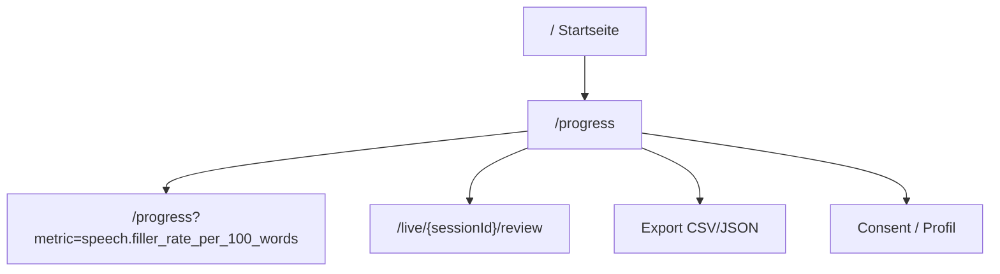

# Long-Term-Fortschritt — Frontend Data Contract und Timeline-UI

Status: **Web-UI umgesetzt (24.10.2026); Retention- und Löschtexte am
25.10.2026 präzisiert.** Route `/progress` mit Profil-/Consent-Flow, Small
Multiples, Detail-Chart, Change-Points, Qualitätstabelle, Zielen, Export und
Löschung; die synthetischen Demo-Daten liegen unter `/progress/demo`. Dieses
Dokument bleibt der Arbeitsvertrag und beschreibt die API-Antwort `progress.v1`,
die Bedeutung jedes Feldes, die Zustände und bewährte Muster für eine Timeline
über viele Präsentationen. Die Verknüpfung neuer Live-Aufnahmen mit einem Profil
(Checkliste in §2) ist noch offen.

Die fachliche Datenspeicherung und Auswertung steht in
[`12-long-term-progress-data-design.md`](12-long-term-progress-data-design.md).

> **Produktgrenzen:** kein Gesamtscore, keine Note, kein Ranking, kein
> Personenvergleich, keine Emotions- oder Persönlichkeitsaussage. Die Timeline
> beschreibt die eigene Messreihe. „Verbesserung“ und „Rückschritt“ sind nur
> mit einem selbst gesetzten Ziel zulässig. Alle regelbasierten Werte sind
> Heuristiken.

## 1. Was das Frontend bekommt

Das Frontend bekommt **keine Roh-Events, keine Wörter, keine Landmarks und
keine Medien-URLs**. Es bekommt:

- eine Liste versionierter Metrikdefinitionen,
- pro Metrik eine Zeitreihe von Take-Punkten mit Qualitätsstatus,
- Baseline, aktuellem Wert, Trend, Konfidenz und Change-Points,
- eine servergenerierte, aber sprachneutrale Highlight-Liste (`textKey` +
  `params`),
- Grenzen/Limitations und Datenqualitätsinformationen.

Trends werden **serverseitig** berechnet. Das Frontend darf nicht aus
Einzelwerten eigene Trends, Scores oder „Verbesserungen“ ableiten. So bleibt die
Auswertung für alle Clients identisch und reproduzierbar.

**Zähleinheit:** Ein Punkt ist ein **Take** (eine Aufnahme), nicht zwingend eine
Session. Eine Session kann mehrere Takes enthalten (Wiederholungen). Die UI
zeigt „Aufnahme #n“; die 20er-Schwelle bezieht sich auf Takes. Wenn eine
Präsentation aus mehreren Takes besteht, kann die UI sie gruppieren, aber nicht
zu einem Durchschnittswert verschmelzen.

## 2. Voraussetzungen und Integrationscheckliste

Long-Term-Tracking setzt voraus, dass Aufnahmen als Sessions/Takes in der
bestehenden Review-API persistiert werden. Lokale Takes inklusive Video liegen
in IndexedDB und werden nach Reload wiederhergestellt; der Server hat nur
Metadaten und Analyse. Die Anbindung an `/sessions`/`/takes` fehlt noch. Vor
der Progress-UI muss daher gelten:

- [ ] Beim Start einer Aufnahme wird eine Session mit `profileId` und
      `presentationMode` angelegt.
- [ ] Die Session speichert `capture.deviceKey`; beim Stoppen wird ein Take
      mit `recordedAt` angelegt und übernimmt den Geräteschlüssel.
- [ ] Die lokale Aufnahme speichert die zurückgegebene `takeId` (z. B. im
      `LiveRecording`-Objekt oder in einer Map `localRecordingId -> takeId`).
      Ohne diese Zuordnung kann die Progress-UI nicht auf das lokale Video
      springen.
- [ ] Events/Wörter/Audio werden über die bestehenden Take-Routen gespeichert.
- [ ] Nach Abschluss der Analyse ist `GET /profiles/{id}/progress` verfügbar.
- [ ] Das Profil hat `consent.scope = "long-term-progress"`. Ohne Consent wird
      keine Progress-UI mit echten Daten angezeigt.
- [ ] Das Frontend behandelt fehlende/kaputte Tokens, gelöschte Profile und
      nicht verfügbare Backends.
- [ ] Das lokale Video bleibt lokal; die Progress-UI verlinkt nur, wenn die
      Aufnahme im Browser noch vorhanden ist. IndexedDB kann bei Speicherdruck
      Daten verdrängen; dann bleiben nur die Messwerte sichtbar und die UI sagt
      „Video nicht mehr lokal verfügbar“.

## 3. Profil, Token und Consent

### 3.1 Lokale Profilablage

Empfohlen: ein pseudonymes Profil pro Browser, kein Login.

```ts
const PROFILE_KEY = "pitchcoach.profile.v1";

type StoredProfile = {
  profileId: string;
  token: string;       // nur lokal; nie loggen, nie in URLs
  displayName: string;
  createdAt: string;   // ISO 8601
};
```

Regeln:

- Beim ersten Öffnen der Progress-Funktion `ensureProfile()` aufrufen.
- Existiert kein Profil, Consent-Dialog zeigen und `POST /profiles` ausführen.
- Der Roh-Token wird **nur einmal** vom Server zurückgegeben und in
  `localStorage` gespeichert. Er darf nicht in Analytics, Logs, URLs,
  Fehlermeldungen oder Screenshots erscheinen.
- `profileId` allein ist kein Zugriffsschutz; jede Anfrage sendet
  `X-Profile-Token`.
- Mehrere Profile pro Browser sind optional (z. B. für mehrere Personen). Dann
  `activeProfileId` separat speichern; die Daten dürfen nie vermischt werden.
- „Profil löschen“ entfernt serverseitig alle Fortschrittsdaten. Optional
  (`deleteSessions=true`) werden auch verknüpfte Sessions/Takes und deren
  serverseitige Analyse gelöscht; ohne Option bleiben sie unter ihrer eigenen
  Einwilligung bestehen. Lokale Videos müssen separat gelöscht werden; die UI
  muss beide Wirkungen nennen.
- Bei `401 E_PROFILE_TOKEN_INVALID`: Profil zurücksetzen anbieten. Dabei
  erklären, dass die serverseitigen Fortschrittsdaten ohne Token nicht mehr
  erreichbar sind.

### 3.2 Consent

Der Consent ist ein eigener Scope, nicht die Session-Einwilligung:

```json
{
  "granted": true,
  "at": "2026-10-24T18:00:00Z",
  "version": "2026-10-24",
  "scope": "long-term-progress",
  "retentionUntil": "2027-10-24T18:00:00Z"
}
```

UI-Anforderungen:

- Zweck: „Fortschritt über mehrere Präsentationen speichern und auswerten.“
- Speicherort: „Auf dem Server, verknüpft mit einem zufälligen Profil. Kein
  Login, keine E-Mail.“
- Aufbewahrung: Standard 12 Monate; die UI setzt beim Anlegen explizit ein
  Jahr (`retention_origin='user'`), das durch neue Takes nicht automatisch
  verlängert wird. Sie nennt das konkrete Datum, den täglichen Löschlauf und
  dass der Zugriff nach Ablauf gesperrt ist. Eine Verkürzung/Verlängerung ist
  serverseitig per `PATCH {retentionUntil}` möglich, in der UI aber noch nicht
  angeboten. Das ist keine Rechtsgarantie; Quellen/S3-Lifecycle sind nicht
  vollständig abgedeckt.
- Jederzeit löschbar und exportierbar; die Löschung von Fortschritt und die
  optionale Löschung der serverseitigen Analyse sind getrennt zu erklären.
- Ohne Consent: keine Verknüpfung, keine Progress-Seite mit echten Daten;
  optional eine Erklärung mit CTA.
- Der Consent darf nicht vorausgewählt sein.
- Serverseitig speichert `speaker_profiles` die effektive Frist als
  `retention_until` und ihre Herkunft als `retention_origin` (`default` oder
  `user`). Die API liefert dem Frontend nur `consent.retentionUntil`; die
  Herkunft ist kein eigener Response-Parameter. Die UI darf deshalb keine
  Aussage über eine „Standard-“ oder „Nutzerfrist“ ableiten, außer sie kennt
  den Erstellungsweg.

### 3.3 Profil anlegen

```http
POST /api/profiles
Idempotency-Key: <uuid>
Content-Type: application/json
```

```json
{
  "displayName": "Mein Übungsprofil",
  "locale": "de",
  "consent": {
    "granted": true,
    "at": "2026-10-24T18:00:00Z",
    "version": "2026-10-24",
    "scope": "long-term-progress",
    "retentionUntil": "2027-10-24T18:00:00Z"
  }
}
```

Antwort:

```json
{
  "profile": {
    "profileId": "5e0f7c2a-…",
    "displayName": "Mein Übungsprofil",
    "locale": "de",
    "createdAt": "2026-10-24T18:00:00Z",
    "consent": {
      "scope": "long-term-progress",
      "version": "2026-10-24",
      "grantedAt": "2026-10-24T18:00:00Z",
      "retentionUntil": "2027-10-24T18:00:00Z"
    }
  },
  "token": "pp_…",
  "tokenIssued": true
}
```

Der Token wird **einmalig** angezeigt/gespeichert. Bei Verlust ist das Profil
ohne Recovery nicht mehr erreichbar; das ist der Preis des loginfreien Modells.

Hinweis: Der Request verwendet `consent.granted`/`consent.at`; die Antwort
normalisiert das zu `consent.grantedAt`, weil ein existierendes Profil immer
eingewilligt hat. Das Frontend soll die Antwortform verwenden.

**Idempotenz und Token:** Die erste Antwort ist `201` und enthält `token`. Ein
Retry mit demselben `Idempotency-Key` liefert `200 { profile }` **ohne** Token
(`tokenIssued=false`), weil der Roh-Token serverseitig nie gespeichert wird. Der
Client muss den Token aus der ersten Antwort speichern. Ist er verloren, kann
das Profil ohne Recovery nicht mehr erreicht werden; dann bleibt nur ein neues
Profil.

## 4. Takes mit dem Profil verknüpfen

### 4.1 Session anlegen

```http
POST /api/sessions
Idempotency-Key: <uuid>
Content-Type: application/json
```

```json
{
  "title": "Hackathon-Pitch – Durchlauf 12",
  "profileId": "5e0f7c2a-…",
  "presentationMode": "startup",
  "collectionId": "2b7d…",
  "capture": {
    "framingMode": "upper-body",
    "audienceMode": "camera",
    "width": 1280,
    "height": 720,
    "fps": 30,
    "mirrored": true,
    "deviceKey": "a3f1c9e2-…"
  },
  "consent": {
    "granted": true,
    "at": "2026-10-24T18:00:00Z",
    "version": "2026-10-24",
    "scope": "local-and-cloud-analysis"
  }
}
```

`presentationMode`:

```ts
type PresentationMode = "startup" | "thesis" | "school" | "nonprofit";
```

- `startup`: Startup-Pitch
- `thesis`: Bachelor-/Master-Verteidigung
- `school`: Schulvortrag
- `nonprofit`: Nonprofit-/Vereins-Einladung

Für Legacy/„anderer Typ“ bleibt `presentationMode` `null`. Es gibt bewusst
keinen fünften Wert, damit Frage-Agent und Progress dieselbe Typmenge
verwenden.

`deviceKey` ist eine zufällige UUID pro Browser/Gerät, **kein Fingerprint**.
Sie wird nur für geräteabhängige Metriken (Lautstärke) verwendet. Bei
Gerätewechsel oder Reset neu erzeugen; die UI kann erklären, dass
Lautstärke-Reihen dann nicht vergleichbar sind.

### 4.2 Take anlegen

```http
POST /api/sessions/{sessionId}/takes
Idempotency-Key: <uuid>
Content-Type: application/json
```

```json
{
  "durationMs": 182200,
  "mimeType": "video/webm;codecs=vp8,opus",
  "recordedAt": "2026-10-24T18:03:00Z",
  "timebase": {
    "onstartPerfMs": 12345.6,
    "firstVideoPtsMs": 12,
    "audioStartMs": 24,
    "avOffsetMs": 12,
    "containerDurationMs": 182200,
    "wallDurationMs": 182340
  },
  "coverage": [
    { "tMs": 0, "durationMs": 163800, "evaluable": true },
    { "tMs": 163800, "durationMs": 18400, "evaluable": false, "reason": "hips-not-visible" }
  ]
}
```

- `recordedAt` ist die Client-Zeit am Ende der Aufnahme, mit Zeitzone.
- Ohne `recordedAt` verwendet der Server `created_at` und markiert den Take als
  `recordedAtSource: "server"`.
- `profileId` wird serverseitig aus der Session kopiert; das Frontend muss sie
  beim Take nicht erneut senden.
- Die Session-/Take-IDs sind die einzigen stabilen Identitäten für die
  Progress-Punkte. Die laufende Nummer (`sequence`) ist nur Anzeige.

## 5. API-Schnellreferenz

| Methode | Pfad | Auth | Zweck |
|---|---|---|---|
| `POST` | `/api/profiles` | — | Profil + Token |
| `GET` | `/api/profiles/{id}` | `X-Profile-Token` | Profil lesen |
| `PATCH` | `/api/profiles/{id}` | `X-Profile-Token` | Name/Retention ändern |
| `DELETE` | `/api/profiles/{id}` | `X-Profile-Token` | Profil + Fortschrittsdaten löschen; `?deleteSessions=true` löscht zusätzlich Sessions/Takes/Analyse |
| `GET` | `/api/profiles/{id}/progress` | `X-Profile-Token` | Timeline |
| `GET` | `/api/profiles/{id}/progress/{metricId}` | `X-Profile-Token` | Metrik-Detail |
| `GET` | `/api/profiles/{id}/goals` | `X-Profile-Token` | Ziele lesen |
| `PUT` | `/api/profiles/{id}/goals/{metricId}` | `X-Profile-Token` | Ziel setzen/aktualisieren |
| `DELETE` | `/api/profiles/{id}/goals/{metricId}` | `X-Profile-Token` | Ziel löschen |
| `POST` | `/api/profiles/{id}/progress/recompute` | `X-Profile-Token` | `202 {runId,statusUrl}` |
| `GET` | `/api/profiles/{id}/progress/runs/{runId}` | `X-Profile-Token` | Laufstatus |
| `GET` | `/api/profiles/{id}/export?format=json|csv` | `X-Profile-Token` | Export |
| `GET` | `/api/profiles/{id}/takes` | `X-Profile-Token` | Take-Tabelle |

Recompute läuft über Celery. `statusUrl` mit Token pollen, bis `status` den Wert
`completed` oder `failed` hat; bei `completed` Progress erneut laden. Bei `503`
denselben Idempotency-Key wiederverwenden; ein zweiter aktiver Lauf liefert
`409`. Auch verknüpfte Session-/Take-/Job-Routen verlangen `X-Profile-Token`,
anonyme Sessions bleiben kompatibel. Abgelaufene Profile liefern `410`,
Löschen bleibt erlaubt. Ein täglicher Sweep (03:15 UTC) entfernt abgelaufene
Profile/Sessions/Jobs und flusht die S3-Outbox; Profil-Ablauf entkoppelt
Sessions/Takes. `DELETE /profiles/{id}?deleteSessions=true` löscht optional
zusätzlich die serverseitige Analyse. Antworten tragen
`Cache-Control: private, no-store`.

`includeExcluded=false` ändert nur die sichtbaren Punkte, keine Qualitätszähler
oder Trends. `sequence` behält Lücken; `versionBreak` unterdrückt die numerische
Vergleichsaussage. `latest.changeVsBaseline` bezieht sich auf `latest.value`,
`trend.relativeChange` auf den Median der letzten drei eligible Werte.


Beispiel:

```ts
async function loadProgress(profile: StoredProfile, signal?: AbortSignal) {
  const query = new URLSearchParams({
    window: "last_20",
    metrics: "primary",
    includeExcluded: "true",
  });
  const response = await fetch(
    `/api/profiles/${profile.profileId}/progress?${query}`,
    {
      headers: { "X-Profile-Token": profile.token },
      signal,
      cache: "no-store",
    },
  );
  if (!response.ok) throw await response.json();
  return (await response.json()) as ProgressResponse;
}
```

**Nie** den Token in eine Query-URL schreiben. Keine Token-Logs, keine
Fehlertexte mit Token.

## 6. `progress.v1` — TypeScript-Vertrag

Die folgenden Typen sind der verbindliche Frontend-Vertrag. Sie sind bewusst
frontendfreundlich (camelCase, ISO-Strings, `null` statt fehlender Felder).
Wenn die generierten `api/schema.d.ts`-Typen verfügbar sind, sollen sie die
Quelle der Wahrheit sein; diese Typen sind dann nur eine lesbare Fassade.

```ts
export type ProgressSchemaVersion = "progress.v1";

export type PresentationMode =
  | "startup"
  | "thesis"
  | "school"
  | "nonprofit";

export type TrendStatus =
  | "insufficient"
  | "early_signal"
  | "stable"
  | "trend_up"
  | "trend_down"
  | "unclear";

export type GoalStatus =
  | "not_applicable"
  | "unknown"
  | "on_track"
  | "off_track"
  | "mixed";

export type SuggestedDirection =
  | "increase"
  | "decrease"
  | "target_band"
  | "neutral";

export type Confidence = "low" | "medium" | "high";

export type MetricUnit =
  | "ratio"
  | "WPM"
  | "per100w"
  | "st"
  | "deg"
  | "perMin"
  | "ms"
  | "count"
  | "dB"
  | (string & {}); // neue Einheiten müssen nicht sofort brechen

export type ExclusionReason =
  | "duration-too-short"
  | "no-profile-consent"
  | "synthetic-demo"
  | "pose-coverage-low"
  | "pose-valid-ratio-low"
  | "pose-not-evaluable"
  | "audio-active-low"
  | "audio-missing"
  | "word-count-low"
  | "transcript-missing"
  | "claims-low"
  | "factcheck-missing"
  | "device-changed"
  | "device-unknown"
  | "rule-version-break"
  | "metric-version-break"
  | "metric-not-computable"
  | (string & {}); // unbekannte Gründe robust behandeln

export interface ProgressResponse {
  schemaVersion: "progress.v1";
  generatedAt: string;
  profile: ProgressProfile;
  range: ProgressRange;
  metricDefinitions: MetricDefinition[];
  series: MetricSeries[];
  highlights: ProgressHighlight[];
  limitations: ProgressLimitation[];
}

export interface ProfileIdentity {
  profileId: string;
  displayName: string;
  locale: "de" | "en";
  createdAt: string;
  consent: {
    scope: "long-term-progress";
    version: string;
    grantedAt: string;
    retentionUntil: string | null;
  };
}

export interface ProgressProfile extends ProfileIdentity {
  totalTakes: number;
  /** Takes mit mindestens einer eligible primären Metrik; nicht die Summe der Metrikpunkte. */
  eligibleTakes: number;
  firstRecordedAt: string | null;
  lastRecordedAt: string | null;
}

export interface ProfileCreateResponse {
  profile: ProfileIdentity;
  /** Nur in der ersten 201-Antwort; bei idempotentem Retry null. */
  token: string | null;
  tokenIssued: boolean;
}

export interface ProgressRange {
  from: string | null;
  to: string | null;
  /** Effektives Fenster; bei weniger als 20 Takes kann der Server `all` zurückgeben. */
  window: "all" | "last_20" | "last_10" | "last_5";
  presentationMode: PresentationMode | null;
}

export interface LocalizedText {
  de: string;
  en: string;
}

export interface MetricDefinition {
  metricId: string;
  version: number;
  label: LocalizedText;
  description: LocalizedText;
  unit: MetricUnit;
  valueType: "ratio" | "rate" | "count" | "duration" | "level" | "angle" | "perMin";
  suggestedDirection: SuggestedDirection;
  isPrimary: boolean;
  heuristic: boolean;
  source: "pose" | "speech" | "asr" | "factcheck" | "derived";
  quality: {
    minDurationMs: number;
    minPoseCoverage: number | null;
    minAudioActiveRatio: number | null;
    minWordCount: number | null;
    minClaimCount: number | null;
    deviceSensitive: boolean;
  };
}

export interface MetricSeries {
  metricId: string;
  metricVersion: number;
  label: LocalizedText;
  unit: MetricUnit;
  suggestedDirection: SuggestedDirection;
  isPrimary: boolean;
  heuristic: boolean;
  goal: ProfileGoal | null;
  points: ProgressPoint[];
  baseline: ProgressBaseline | null;
  latest: ProgressLatest | null;
  trend: ProgressTrend;
  changePoints: ProgressChangePoint[];
  goalStatus: GoalStatus;
  quality: ProgressSeriesQuality;
  limitations: ProgressLimitation[];
}

export interface ProgressPoint {
  takeId: string;
  sessionId: string;
  recordedAt: string;
  recordedAtSource: "client" | "server";
  sequence: number;
  value: number | null;
  unit: MetricUnit;
  eligible: boolean;
  exclusionReasons: ExclusionReason[];
  quality: {
    poseCoverage: number | null;
    poseValidRatio: number | null;
    audioActiveRatio: number | null;
    wordCount: number | null;
    claimCount: number | null;
    asrProvider: string | null;
    syntheticDemo: boolean;
  };
  context: {
    presentationMode: PresentationMode | null;
    durationMs: number;
    deviceKey: string | null;
    ruleVersions: string[];
  };
}

export interface ProgressBaseline {
  kind:
    | "first_3_eligible"
    | "first_5_eligible"
    | "same_mode_first_3"
    | "rolling_5"
    | "none";
  value: number | null;
  n: number;
  takeIds: string[];
}

export interface ProgressLatest {
  takeId: string;
  recordedAt: string;
  value: number | null;
  changeVsBaseline: number | null;
  relativeChange: number | null;
  zScore: number | null;
  reliableChange: boolean;
}

export interface ProgressTrend {
  status: TrendStatus;
  direction: "up" | "down" | "flat" | "unknown";
  method: string;
  algorithmVersion: string;
  n: number;
  window: {
    fromTakeId: string | null;
    toTakeId: string | null;
    fromRecordedAt: string | null;
    toRecordedAt: string | null;
  };
  slopePerTake: number | null;
  slopePer10Takes: number | null;
  slopeCi95: [number, number] | null;
  relativeChange: number | null;
  effectSize: number | null;
  noiseBand: number | null;
  minimumDetectableChange: number | null;
  mannKendallP: number | null;
  adjustedP: number | null;
  reliableSlope: boolean;
  confidence: Confidence;
}

export interface ProgressChangePoint {
  id: string;
  metricId: string;
  metricVersion: number;
  takeId: string;
  sequence: number;
  recordedAt: string;
  kind: "step_up" | "step_down" | "regression" | "recovery";
  fromValue: number | null;
  toValue: number | null;
  magnitude: number | null;
  confidence: Confidence;
  evidenceTakeIds: string[];
  algorithmVersion: string;
}

export interface ProgressSeriesQuality {
  totalPoints: number;
  eligiblePoints: number;
  /** Punkte mit eligible=false; kann sich mit missingPoints überschneiden. */
  excludedPoints: number;
  /** Punkte mit value=null; kann sich mit excludedPoints überschneiden. */
  missingPoints: number;
  versionBreak: boolean;
  ruleVersions: string[];
  status: "good" | "partial" | "poor";
}

export interface ProfileGoal {
  direction: "increase" | "decrease" | "target_band";
  targetValue: number | null;
  targetMin: number | null;
  targetMax: number | null;
  createdAt: string;
  updatedAt: string;
}

export interface ProfileGoalRecord extends ProfileGoal {
  metricId: string;
  metricVersion: number;
}

export interface ProgressHighlight {
  kind:
    | "insufficient_data"
    | "trend_up"
    | "trend_down"
    | "goal_on_track"
    | "goal_off_track"
    | "change_point"
    | "quality_warning";
  metricId: string;
  takeId: string | null;
  sequence: number | null;
  textKey: string;
  params: Record<string, string | number>;
}

export interface ProgressLimitation {
  code: string;
  message: string;
}
```

### 6.1 Vollständiges Beispiel (gekürzt)

```json
{
  "schemaVersion": "progress.v1",
  "generatedAt": "2026-10-24T20:15:00Z",
  "profile": {
    "profileId": "5e0f7c2a-…",
    "displayName": "Mein Übungsprofil",
    "locale": "de",
    "createdAt": "2026-01-10T09:00:00Z",
    "totalTakes": 24,
    "eligibleTakes": 20,
    "firstRecordedAt": "2026-01-12T18:00:00Z",
    "lastRecordedAt": "2026-10-20T18:00:00Z",
    "consent": {
      "scope": "long-term-progress",
      "version": "2026-10-24",
      "grantedAt": "2026-01-10T09:00:00Z",
      "retentionUntil": "2027-10-24T18:00:00Z"
    }
  },
  "range": {
    "from": null,
    "to": null,
    "window": "last_20",
    "presentationMode": null
  },
  "metricDefinitions": [
    {
      "metricId": "speech.filler_rate_per_100_words",
      "version": 1,
      "label": {
        "de": "Füllwörter pro 100 Wörter",
        "en": "Fillers per 100 words"
      },
      "description": {
        "de": "Anzahl erkannter Füllwörter pro 100 Wörter im Transkript. Abhängig vom ASR-Modell; Heuristik, unvalidiert.",
        "en": "Detected filler words per 100 transcript words. Depends on the ASR model; heuristic, unvalidated."
      },
      "unit": "per100w",
      "valueType": "rate",
      "suggestedDirection": "decrease",
      "isPrimary": true,
      "heuristic": true,
      "source": "asr",
      "quality": {
        "minDurationMs": 60000,
        "minPoseCoverage": null,
        "minAudioActiveRatio": null,
        "minWordCount": 50,
        "minClaimCount": null,
        "deviceSensitive": false
      }
    }
  ],
  "series": [
    {
      "metricId": "speech.filler_rate_per_100_words",
      "metricVersion": 1,
      "label": {
        "de": "Füllwörter pro 100 Wörter",
        "en": "Fillers per 100 words"
      },
      "unit": "per100w",
      "suggestedDirection": "decrease",
      "isPrimary": true,
      "heuristic": true,
      "goal": {
        "direction": "decrease",
        "targetValue": 4.0,
        "targetMin": null,
        "targetMax": null,
        "createdAt": "2026-03-01T10:00:00Z",
        "updatedAt": "2026-03-01T10:00:00Z"
      },
      "points": [
        {
          "takeId": "t_001",
          "sessionId": "s_001",
          "recordedAt": "2026-01-12T18:00:00Z",
          "recordedAtSource": "client",
          "sequence": 1,
          "value": 7.4,
          "unit": "per100w",
          "eligible": true,
          "exclusionReasons": [],
          "quality": {
            "poseCoverage": null,
            "poseValidRatio": null,
            "audioActiveRatio": 0.62,
            "wordCount": 420,
            "claimCount": null,
            "asrProvider": "whisper",
            "syntheticDemo": false
          },
          "context": {
            "presentationMode": "startup",
            "durationMs": 180000,
            "deviceKey": "a3f1c9e2-…",
            "ruleVersions": ["asr-whisper-small", "speech-config-2026-10-24"]
          }
        },
        {
          "takeId": "t_013",
          "sessionId": "s_013",
          "recordedAt": "2026-09-12T18:00:00Z",
          "recordedAtSource": "client",
          "sequence": 13,
          "value": 4.6,
          "unit": "per100w",
          "eligible": true,
          "exclusionReasons": [],
          "quality": {
            "poseCoverage": null,
            "poseValidRatio": null,
            "audioActiveRatio": 0.58,
            "wordCount": 455,
            "claimCount": null,
            "asrProvider": "whisper",
            "syntheticDemo": false
          },
          "context": {
            "presentationMode": "startup",
            "durationMs": 184000,
            "deviceKey": "a3f1c9e2-…",
            "ruleVersions": ["asr-whisper-small", "speech-config-2026-10-24"]
          }
        }
      ],
      "baseline": {
        "kind": "first_3_eligible",
        "value": 7.4,
        "n": 3,
        "takeIds": ["t_001", "t_002", "t_003"]
      },
      "latest": {
        "takeId": "t_020",
        "recordedAt": "2026-10-20T18:00:00Z",
        "value": 4.2,
        "changeVsBaseline": -3.2,
        "relativeChange": -0.432,
        "zScore": -2.91,
        "reliableChange": true
      },
      "trend": {
        "status": "trend_down",
        "direction": "down",
        "method": "theil-sen+mann-kendall+ewma-cusum",
        "algorithmVersion": "progress-algo-1",
        "n": 20,
        "window": {
          "fromTakeId": "t_001",
          "toTakeId": "t_020",
          "fromRecordedAt": "2026-01-12T18:00:00Z",
          "toRecordedAt": "2026-10-20T18:00:00Z"
        },
        "slopePerTake": -0.19,
        "slopePer10Takes": -1.9,
        "slopeCi95": [-0.26, -0.11],
        "relativeChange": -0.432,
        "effectSize": -1.73,
        "noiseBand": 1.1,
        "minimumDetectableChange": 3.05,
        "mannKendallP": 0.003,
        "adjustedP": 0.012,
        "reliableSlope": true,
        "confidence": "high"
      },
      "changePoints": [
        {
          "id": "cp_001",
          "metricId": "speech.filler_rate_per_100_words",
          "metricVersion": 1,
          "takeId": "t_013",
          "sequence": 13,
          "recordedAt": "2026-09-12T18:00:00Z",
          "kind": "step_down",
          "fromValue": 6.1,
          "toValue": 4.6,
          "magnitude": -1.5,
          "confidence": "medium",
          "evidenceTakeIds": ["t_011", "t_012", "t_013", "t_014"],
          "algorithmVersion": "progress-algo-1"
        }
      ],
      "goalStatus": "on_track",
      "quality": {
        "totalPoints": 20,
        "eligiblePoints": 20,
        "excludedPoints": 0,
        "missingPoints": 0,
        "versionBreak": false,
        "ruleVersions": ["asr-whisper-small", "speech-config-2026-10-24"],
        "status": "good"
      },
      "limitations": [
        {
          "code": "heuristic-unvalidated",
          "message": "Regelbasierte Werte sind Heuristiken und nicht extern validiert."
        }
      ]
    }
  ],
  "highlights": [
    {
      "kind": "goal_on_track",
      "metricId": "speech.filler_rate_per_100_words",
      "takeId": "t_013",
      "sequence": 13,
      "textKey": "progress.filler.goal_on_track",
      "params": {
        "before": 7.4,
        "after": 4.2,
        "unit": "per100w",
        "takeCount": 20
      }
    }
  ],
  "limitations": [
    {
      "code": "within-person-only",
      "message": "Die Timeline beschreibt nur diese Person; es gibt keinen Vergleich mit anderen."
    },
    {
      "code": "missing-not-imputed",
      "message": "Fehlende oder nicht vergleichbare Aufnahmen werden nicht ersetzt."
    }
  ]
}
```

### 6.2 Feld-Semantik

`metricDefinitions` ist die autoritative Definition. `series[].label`, `unit`
usw. sind für die direkte Darstellung dupliziert; bei Widerspruch gilt
`metricDefinitions`.

| Feld | Bedeutung | UI-Regel |
|---|---|---|
| `profile.consent.retentionUntil` | effektive serverseitige Frist (`retention_until`) | Als Datum anzeigen; „nach Ablauf gesperrt, täglicher Löschlauf“. Keine Frist → „keine automatische Frist“. |
| `sequence` | 1-basierte Reihenfolge der Takes im Profil, global (nicht pro Filter neu nummeriert) | Als „Aufnahme #13“ anzeigen; nicht als ID verwenden. |
| `profile.eligibleTakes` | Takes mit mindestens einer eligible primären Metrik | „20 von 24 Aufnahmen vergleichbar“; nicht als Summe aller Metrikpunkte lesen. |
| `recordedAt` | Aufnahmezeit (Client, mit TZ) | Lokal formatieren; bei `recordedAtSource`-Hinweis „Serverzeit“ kennzeichnen. |
| `recordedAtSource` | `client` oder `server` | Bei `server` dezent „Serverzeit“ anzeigen; Zeitachse bleibt nutzbar, aber als weniger präzise markieren. |
| `context.ruleVersions` | Upstream-Regel-/Modellkennungen (Pose-Regel, ASR-Modell, Speech-Config) | Nicht als Zahlen anzeigen; bei Änderung `versionBreak` beachten. |
| `range.presentationMode` | `null` = kein Filter | Nicht mit „unbekannt“ verwechseln. |
| `range.from` / `range.to` | inklusive Zeitfilter auf `recordedAt` | `null` = offen; bei leerem Ergebnis keinen Fake-Verlauf zeichnen. |
| `points[].context.presentationMode` | `null` = Präsentationstyp unbekannt/Legacy | Als „Typ unbekannt“ anzeigen, nicht als eigenen Typ. |
| `eligible` | Punkt darf in Baseline/Trend eingehen | Gefüllter Punkt; bei `false` hohl/grau und **nicht** mit der Trendlinie verbinden. |
| `exclusionReasons` | Warum nicht vergleichbar | In Tooltip/Detail als verständlichen Text zeigen, nicht als Code. |
| `value: null` | Metrik nicht berechenbar | Lücke, kein 0-Punkt. |
| `latest` | letzter **eligible** Punkt | `null`, wenn kein eligible Punkt existiert; nicht den letzten ausgeschlossenen Punkt als „aktuell“ zeigen. |
| `latest.reliableChange` | letzter eligible Einzelwert außerhalb der heuristischen MDC, ab 5 Punkten | Nicht als „signifikant“ oder „klinisch relevant“ formulieren. |
| `baseline` | Referenz (Median der ersten eligible Takes) | Gestrichelte Linie + „Startphase (3 Aufnahmen)“; nicht als „Ziel“ bezeichnen. `null` bei < 3 eligible Punkten. |
| `noiseBand` | normale Schwankung | Als unauffälliges Band um die Baseline/das Trendmodell zeigen; nicht als Konfidenzintervall der Wahrheit. |
| `minimumDetectableChange` | kleinste darstellbare Änderung | In „Warum sichtbar?“ erklären; nicht als Note. |
| `slopeCi95` | Sen-Rangintervall der Steigung (Normalapproximation) | Nur in Detail/„Warum sichtbar?“; nicht als p-Wert-Badge. |
| `mannKendallP` / `adjustedP` | statistischer Test | Nicht als Hauptzahl in der UI; höchstens in Details. |
| `trend.status` | statistischer Zustand | `insufficient`, `early_signal`, `stable`, `trend_up`, `trend_down`, `unclear` klar unterscheiden. |
| `trend.n` | Anzahl **eligible** Punkte in der Trendrechnung | Nicht mit `quality.totalPoints` gleichsetzen; im Detail „n=14 vergleichbar“ zeigen. |
| `trend.direction` | Richtung ohne Valenz | „gestiegen/gefallen“; nicht „besser/schlechter“. |
| `goalStatus` | Zielbezug | Nur bei `goal != null` „auf Kurs/nicht auf Kurs“; sonst „kein Ziel gesetzt“. |
| `versionBreak` | Reihe überschreitet Regel-/Metrikversion | Linie unterbrechen + Hinweis; nicht über den Bruch mitteln. || `confidence` | Datenqualitätsstufe, keine Wahrscheinlichkeit | Als Text „hohe/mittlere/niedrige Datenlage“, nicht als Prozent. |
| `highlights[].textKey` | sprachneutraler Schlüssel | Lokalisieren; unbekannte Keys ausblenden, nicht roh anzeigen. |
| `limitations` | Grenzen | Immer sichtbar (mindestens ein Link/Detail), nicht verstecken. `message` ist Deutsch; für eine englische UI `code` über eine Translation-Map lokalisieren. |

**Vollständigkeit der Punkte:** `points` enthält einen Eintrag pro Take im
gewählten Fenster, auch wenn die Metrik für diesen Take nicht berechenbar ist
(`value: null`, `eligible: false`, `metric-not-computable`). So bleiben Lücken
und ausgeschlossene Aufnahmen sichtbar; das Frontend darf fehlende Punkte nicht
einfach weglassen und die Linie durchziehen.

**Bei `trend.status = "insufficient"`** bleibt das `trend`-Objekt vorhanden;
`baseline`/`latest` können `null` sein und alle Trendzahlen sind `null`. Das
Frontend darf daraus keinen Trend konstruieren; es zeigt den Zustand „zu wenig
Daten“ und die vorhandenen Rohpunkte.

**`quality.status`:** `good` = mindestens 80 % der Punkte eligible und kein
`versionBreak`; `partial` = mindestens 50 %; `poor` = weniger als 50 % oder
`versionBreak`. Das sind UI-Schwellen für die Datenlage, keine Bewertung der
Präsentation.

**Wichtig zu `eligible` und `value`:** Ein Punkt kann einen `value` haben und
trotzdem `eligible=false` sein (z. B. berechneter Wert bei zu geringer
Kameraabdeckung). Die UI darf diesen Wert als hohlen/grauen Punkt zeigen, aber
**nicht** in die Trendlinie, Baseline oder Change-Point-Darstellung einbeziehen.
`value: null` bedeutet: Metrik nicht berechenbar; als Lücke zeichnen, nicht als
0. Ein `eligible=false`-Punkt ist keine Aussage über die Qualität der
Präsentation, sondern über die Vergleichbarkeit der Messung. Bei
`eligible=true` ist `exclusionReasons` immer leer.

**Bei `versionBreak=true`:** Die Trendlinie wird nur auf dem letzten
zusammenhängenden Segment gleicher `metricVersion`/`ruleVersion` berechnet.
Ältere Punkte bleiben sichtbar, werden aber nicht über den Bruch hinweg
verbunden oder gemittelt. Die UI zeigt „Reihe unterbrochen“ und den Grund
(z. B. „Pose-Regel aktualisiert“).

### 6.3 Trend-Status in UI-Sprache

| `trend.status` | Deutsch (du) | Bedeutung |
|---|---|---|
| `insufficient` | „Noch kein belastbarer Trend“ | Zu wenige vergleichbare Aufnahmen. |
| `early_signal` | „Erste Hinweise“ | 5–9 Punkte; vorläufig. |
| `stable` | „Weitgehend stabil“ | Keine belastbare Veränderung. |
| `trend_up` | „Gestiegen“ | Belastbarer Aufwärtstrend; Valenz nur mit Ziel. |
| `trend_down` | „Gefallen“ | Belastbarer Abwärtstrend; Valenz nur mit Ziel. |
| `unclear` | „Datenlage unklar“ | Qualitäts-/Versionsproblem oder widersprüchliche Signale. |

**Nicht** verwenden: „signifikant“, „bewiesen“, „KI erkennt“, „Score“,
„Performance“, „besser als …“, „Platz …“, „Note“.

### 6.4 Change-Point-Sprache

| `kind` | Deutsch | Beispiel |
|---|---|---|
| `step_up` | „Anstieg ab Aufnahme #“ | „Ab Aufnahme 13 liegt der Wert höher.“ |
| `step_down` | „Rückgang ab Aufnahme #“ | „Ab Aufnahme 13 liegt der Wert niedriger.“ |
| `regression` | „Rückschritt ab Aufnahme #“ | Nur mit Ziel und belastbarem Signal. |
| `recovery` | „Erholung ab Aufnahme #“ | Nur mit Ziel und belastbarem Signal. |

Immer ergänzen: „Zwischen Aufnahme X und Y“ und „beobachtet, nicht bewiesen“.
Keine Kausalität („weil du …“).

### 6.5 `textKey`-Katalog (Vorschlag)

`highlights[].textKey` ist sprachneutral; das Frontend lokalisiert. Unbekannte
Keys ausblenden. Vorschlag für die wichtigsten Keys:

| `textKey` | Bedeutung | Beispiel-Copy |
|---|---|---|
| `progress.insufficient` | zu wenige Daten | „Noch kein belastbarer Trend. Es fehlen noch 2 Aufnahmen.“ |
| `progress.early_signal` | vorläufiger Hinweis | „Erste Hinweise – mit mehr Aufnahmen wird die Einschätzung stabiler.“ |
| `progress.stable` | stabil | „Weitgehend stabil über die letzten Aufnahmen.“ |
| `progress.trend_up` | Anstieg | „Der Wert ist über die letzten Aufnahmen gestiegen.“ |
| `progress.trend_down` | Rückgang | „Der Wert ist über die letzten Aufnahmen gefallen.“ |
| `progress.unclear` | unklare Datenlage | „Datenlage unklar: zu wenige vergleichbare Aufnahmen.“ |
| `progress.change_point` | Change-Point | „Ab Aufnahme {sequence} liegt der Wert {direction}.“ |
| `progress.goal_on_track` | Ziel erreicht/kurs | „{goalLabel}: auf Kurs.“ |
| `progress.goal_off_track` | Ziel verfehlt/kurs | „{goalLabel}: nicht auf Kurs.“ |
| `progress.quality_warning` | Datenqualität | „{count} Aufnahmen sind nicht vergleichbar.“ |
| `progress.version_break` | Regelwechsel | „Regelversion geändert; die Reihe ist unterbrochen.“ |

`params` enthält nur primitive Werte (Zahlen, Strings), keine HTML-Snippets.
Das Frontend escaped alle Werte.

### 6.6 Ziel setzen (optional)

Ein Ziel ist die einzige Grundlage für „Verbesserung“/„Rückschritt“. Ohne Ziel
bleibt die UI bei „gestiegen/gefallen“.

```http
PUT /api/profiles/{profileId}/goals/speech.filler_rate_per_100_words
X-Profile-Token: pp_…
Idempotency-Key: <uuid>
Content-Type: application/json
```

```json
{
  "direction": "decrease",
  "targetValue": 4.0,
  "targetMin": null,
  "targetMax": null
}
```

Antwort:

```json
{
  "goal": {
    "metricId": "speech.filler_rate_per_100_words",
    "metricVersion": 1,
    "direction": "decrease",
    "targetValue": 4.0,
    "targetMin": null,
    "targetMax": null,
    "createdAt": "2026-03-01T10:00:00Z",
    "updatedAt": "2026-03-01T10:00:00Z"
  }
}
```

- `target_band` braucht `targetMin` und `targetMax`.
- `increase`/`decrease` brauchen `targetValue`.
- `DELETE /goals/{metricId}` entfernt das Ziel.
- `GET /goals` liefert `{ goals: ProfileGoalRecord[] }`; in
  `series[].goal` sind `metricId`/`metricVersion` redundant und entfallen.
- Das Frontend darf ein Ziel nicht als Note darstellen; es ist eine selbst
  gesetzte Übungsrichtung.

## 7. UI-Informationsarchitektur

Die Timeline ist eine **Sammlung von Metrik-Spuren** mit Quality- und
Change-Point-Annotationen, kein einzelner „Fortschritts-Score“. Die oberste
Ebene beantwortet: „Was hat sich verändert, wann, und ist es belastbar?“ Die
Detail-Ebene beantwortet: „Welche Aufnahme, welcher Wert, welche Datenqualität,
welches Ziel?“

### 7.1 Empfohlene Route

Neue Route: `/progress` (oder `/fortschritt`) mit Link von der Startseite und
vom Review. Die bestehende Startseite bleibt „Arbeitsbereich“; die Progress-Seite
ist die Langzeitansicht. Keine Überladung des StatsDashboard.



### 7.2 Seitenlayout (Desktop)

```
┌──────────────────────────────────────────────────────────────────────┐
│ Fortschritt                                                          │
│ 20 vergleichbare Aufnahmen · Jan–Okt 2026 · [Zeitraum] [Typ] [Export]│
├──────────────────────────────────────────────────────────────────────┤
│ Hinweis: „Füllwörter sinken seit Aufnahme 13“        [Warum?]        │
├──────────────────────────────────────────────────────────────────────┤
│ Small Multiples: 6 Karten                                            │
│ ┌──────────────┐ ┌──────────────┐ ┌──────────────┐                   │
│ │ Tempo        │ │ Pausenanteil │ │ Füllwörter   │                   │
│ │ 128 WPM      │ │ 18 %         │ │ 4,2 /100     │                   │
│ │ ▁▂▃▅▆▇       │ │ ▇▆▅▄▃▂       │ │ ▇▆▅▃▂▁       │                   │
│ └──────────────┘ └──────────────┘ └──────────────┘                   │
│ ┌──────────────┐ ┌──────────────┐ ┌──────────────┐                   │
│ │ Haltung      │ │ Kopf abgewandt│ │ Widersprüche │                   │
│ └──────────────┘ └──────────────┘ └──────────────┘                   │
├──────────────────────────────────────────────────────────────────────┤
│ Fokus: Füllwörter pro 100 Wörter                     [Metrikwechsel]│
│                                                                      │
│  8 ┤                                                                 │
│    │  ●──●                                                           │
│  6 ┤      ●──●                                                       │
│    │            ●──●──●   ┌── Trend                                  │
│  4 ┤                      ●──●──●──●──●                              │
│    │  ░░░░ Baseline/Noise-Band ░░░░                                  │
│  2 ┤                                                                 │
│    └──┬───┬───┬───┬───┬───┬───┬───┬───┬───┬───┬───┬──→ Aufnahme #    │
│       1   3   5   7   9  11  13  15  17  19  21  23                  │
│                         ▲ Change-Point                               │
├──────────────────────────────────────────────────────────────────────┤
│ Aufnahme-Streifen: ●●●○○●○●●●○●○●●●○●○●●●○  (Qualität/Change)      │
├──────────────────────────────────────────────────────────────────────┤
│ Veränderungen (chronologisch)                                       │
│ • Ab #13: Füllwörter 6,1 → 4,6 · mittlere Datenlage · [Ansehen]     │
│ • Ab #9: Pausenanteil leicht gesunken · erste Hinweise              │
├──────────────────────────────────────────────────────────────────────┤
│ Datenqualität: 4 Aufnahmen nicht vergleichbar  [Details] [Tabelle]  │
│ Grenzen: Heuristik, unvalidiert · kein Vergleich mit anderen        │
└──────────────────────────────────────────────────────────────────────┘
```

### 7.3 Mobile

- Titel + Zeitraum/Filter als kompakte Chips.
- Eine Karte pro Metrik (Sparkline), horizontal scrollbar nur für Filterchips,
  **nicht** für Charts.
- Tap auf Karte öffnet Detail als Vollbild/Sheet.
- Detail: Chart mit horizontalem Scrollen nur wenn nötig; besser: letzte 10/20
  Punkte mit horizontalem Pan, aber Y-Achse fix.
- Aufnahme-Streifen als horizontale, snapbare Liste mit großen Touch-Zielen
  (≥ 44 px).
- Tabellenalternative unter „Details“.
- Keine Hover-only-Interaktion.
- Bei mehr als ca. 30 Aufnahmen im Streifen: aggregieren (z. B. pro Monat/10er-
  Block) oder horizontal scrollen; nicht jeden Punkt beschriften.

## 8. Visualisierungs-Best-Practices

### 8.1 Small Multiples statt Radar/Score

- Jede Metrik bekommt eine eigene Karte mit eigener Y-Skala und Einheit.
- Gemeinsame X-Domäne (Aufnahme 1..n) für visuellen Vergleich des Verlaufs.
- Keine Radar-Charts, Gauges, Tacho, „Performance-Ringe“ oder Composite Scores.
- Höhen der Karten sind gleich, aber die Y-Skalen sind unabhängig; nie die
  Höhe zweier Metriken direkt vergleichen.
- Jede Karte zeigt: Label, aktueller Wert, Delta zur Baseline, Sparkline,
  Status-Badge, Qualitätsmarker.

### 8.2 Rohpunkte, Trend und Unsicherheit

- Rohpunkte immer zeigen; Trendlinie dünn/dashed darüber.
- Baseline als gestrichelte Linie; Rauschband als dezente Fläche.
- Keine Glättung, die Rohpunkte verdeckt. Wenn EWMA gezeigt wird, als eigene
  Linie mit Label „geglättet (EWMA)“ und Schalter.
- Keine Verbindung über Lücken oder ausgeschlossene Punkte. Lücken bleiben
  Lücken.
- Ausgeschlossene Punkte: hohl, grau, mit Tooltip/Grund; nicht aus der Achse
  entfernen.
- Change-Points: vertikale Linie + Label „ab #13“; nicht als Kausalpfeil.
- Unsicherheit: `slopeCi95`/`noiseBand` in „Warum sichtbar?“ erklären; im Chart
  nur als Band, nicht als Fehlerbalken an jedem Punkt (zu unruhig).

### 8.3 Achsen und Skalen

- X-Achse: standardmäßig **Aufnahme-Nummer** (1..n), darunter Datum als
  Sekundärlabel. Grund: Übungsabstände sind unregelmäßig; Kalenderzeit kann
  Fortschritt verzerren.
- Optionaler Umschalter „Kalenderzeit“; dann echte Zeitachse mit Lücken.
- Y-Achse: Einheit immer beschriften. Bei Raten/Counts ist 0 ein sinnvoller
  Start; bei Winkeln/Levels ist ein Nullstart nicht immer sinnvoll. Wenn die
  Achse nicht bei 0 startet, klar kennzeichnen („Achse beginnt bei …“).
- Keine Dual-Achsen. Keine 3D-Effekte. Keine abgeschnittenen Achsen ohne Label.
- Einheitliche Tick-Formate mit `Intl.NumberFormat("de-DE")`.

### 8.4 Farbe und Status

Das bestehende Designsystem nutzt Violett `#3803bf`, semantische Tokens,
Hell/Dunkel/System und Reduced Motion (`frontend/DESIGN.md`).

- Serie: Primärfarbe/Violett.
- Baseline/Trend: gedämpft, nicht konkurrierend.
- Qualität: Grau/Neutral; „nicht vergleichbar“ nie rot (es ist keine
  Verschlechterung).
- Ziel-Status: Grün/Rot nur mit Icon **und** Textlabel („auf Kurs“,
  „nicht auf Kurs“); nie Farbe allein.
- Change-Point: neutraler Marker; bei `regression`/`recovery` zusätzlich
  Icon/Text.
- Kontrast mindestens WCAG AA (4,5:1 für Text); Fokus sichtbar; Dark Mode
  separat prüfen.

### 8.5 Interaktion

- Hover **und** Fokus zeigen denselben Tooltip; Tooltip per Tastatur
  erreichbar.
- Klick/Tap auf Punkt: Detailpanel mit Aufnahme #, Datum, Typ, Dauer, Wert,
  Qualität, Ausschlussgrund, Change-Point (falls dort), Link zum Review.
- „Warum sichtbar?“ öffnet Erklärung zu Baseline, Rauschband, Trendmethode,
  Datenlücken und Versionen. Keine p-Wert-Wand; kurze, konkrete Sätze.
- Filter: Zeitraum (letzte 10/20/alle), Präsentationstyp, „nur vergleichbare“,
  Metrikauswahl. Filter müssen die `sequence` nicht neu nummerieren.
- „Aufnahme ansehen“ nur aktivieren, wenn das lokale Video noch existiert.
  Sonst: „Video nicht mehr lokal verfügbar“ + Metadaten anzeigen.
- Kein Autoplay, keine animierte Trendlinie, die Kausalität suggeriert.

### 8.6 Zugänglichkeit

- Jedes Chart hat eine textliche Zusammenfassung im `aria-label` oder einer
  versteckten Beschreibung: „Füllwörter pro 100 Wörter, 20 vergleichbare
  Aufnahmen, Trend fallend, Änderung ab Aufnahme 13.“
- Tabellenalternative mit allen Punkten, Qualitätsstatus und Ausschlussgründen.
- Farbe nie allein; Muster/Form (gefüllt/hohl) + Text.
- Tastatur: Pfeiltasten zwischen Punkten, Enter öffnet Detail, Escape schließt.
- Reduced Motion: keine Übergänge/Animationen; Chart sofort rendern.
- Screenreader: keine dekorativen SVGs ohne `aria-hidden`; Fokusreihenfolge
  logisch; Filter als echte Formularelemente.
- Touch-Ziele ≥ 44 px; keine Hover-only-Tooltips.
- Text zoomt mit Browser-Einstellungen; keine festen Pixelhöhen für Text.

### 8.7 Was nicht gezeigt werden darf

- Ein Gesamtscore, eine Note, ein Rang, ein „Prozent besser“.
- Eine „Performance-Kurve“ oder ein einzelner Fortschrittsgraph, der
  verschiedene Metriken zu einer Gesamtleistung vermischt. Jede Linie ist eine
  benannte Messgröße mit Einheit und Datenqualität.
- Vergleich mit anderen Personen, Kohorten oder „Durchschnitt“.
- Radar-Chart mit „Persönlichkeit“ oder „Präsentationskompetenz“.
- Emotions-, Persönlichkeits- oder Eignungsaussagen.
- Kausalaussagen („weil du …“).
- „KI hat erkannt, dass du dich verbessert hast“ ohne Datenbezug.
- Geglättete Linien ohne Rohpunkte.
- Ausgeschlossene Punkte als 0 oder als „verschlechtert“.
- Video-/Clip-URLs vom Server.
- Prozentzahlen aus einer einzelnen Aufnahme als „Genauigkeit“.

## 9. Zustände und Copy

### 9.1 Zustände

| Zustand | Anzeige |
|---|---|
| Kein Profil / kein Consent | Erklärung + „Fortschritt aktivieren“; keine echten Daten. |
| 0 Takes | Leerzustand: „Noch keine Aufnahmen. Starte deine erste Präsentation.“ |
| 1–4 eligible | Punkte zeigen, aber `insufficient`: „Noch kein belastbarer Trend. Noch X vergleichbare Aufnahmen.“ |
| 5–9 eligible | `early_signal`: „Erste Hinweise – vorläufig.“ |
| 10–19 eligible | Trend möglich, `confidence` medium; „wird mit mehr Aufnahmen belastbarer“. |
| 20+ eligible | Langzeit-Timeline; `confidence` je Metrik; weiterhin Heuristik-Hinweis. |
| Excluded takes | Qualitätsbanner + hohle Punkte + Tabelle. |
| Version break | Unterbrochene Linie + „Regelversion geändert; Vergleich über den Bruch nicht möglich.“ |
| 401 | „Profil nicht mehr erreichbar. Token zurücksetzen?“ (Datenverlust erklären). |
| 404 | „Profil wurde gelöscht.“ + CTA neues Profil. |
| 410 | „Aufbewahrungsfrist abgelaufen. Zugriff gesperrt; der tägliche Löschlauf entfernt die Daten.“ Kein Retry, Profil zurücksetzen anbieten. |
| 503 | „Fortschritt gerade nicht verfügbar.“ + Retry; gecachte Daten mit Stand anzeigen. |
| Recompute läuft | „Wird neu berechnet …“ mit Job-Status; keine doppelten Anfragen. |
| Kein lokales Video | „Aufnahme nicht mehr lokal verfügbar“; Metadaten bleiben. |

### 9.2 Copy-Bausteine (Deutsch, du)

- „Diese Timeline beschreibt deine eigene Messreihe – keine Note und kein
  Vergleich mit anderen.“
- „20 vergleichbare Aufnahmen. 4 Aufnahmen sind nicht vergleichbar.“
- „Noch kein belastbarer Trend. Es fehlen noch 2 vergleichbare Aufnahmen.“
- „Erste Hinweise – mit mehr Aufnahmen wird die Einschätzung stabiler.“
- „Gestiegen, aber ohne Ziel nicht als Verbesserung gewertet.“
- „Ziel: weniger Füllwörter – auf Kurs.“
- „Datenlage unklar: Die letzten Aufnahmen hatten zu wenig Kameraabdeckung.“
- „Ab Aufnahme 13 liegt der Wert niedriger. Das ist eine Beobachtung, keine
  Ursache.“
- „Regelversion geändert. Die Reihe ist an dieser Stelle unterbrochen.“
- „Heuristik, unvalidiert. Fehlende Daten werden nicht ersetzt.“
- „Video nicht mehr lokal verfügbar. Die Messwerte bleiben sichtbar.“
- „Aufbewahrung bis {Datum}; danach ist der Zugriff gesperrt und der tägliche
  Löschlauf entfernt die serverseitigen Fortschrittsdaten.“
- „Profil löschen entfernt Messwerte, Ziele und Trends. Optional löscht es auch
  die verknüpfte serverseitige Analyse; lokale Videos bleiben im Browser.“

### 9.3 Badges

| Badge | Text | Stil |
|---|---|---|
| `insufficient` | „Noch kein Trend“ | neutral |
| `early_signal` | „Erste Hinweise“ | neutral/outline |
| `stable` | „Stabil“ | neutral |
| `trend_up` | „Gestiegen“ | neutral, Richtungspfeil |
| `trend_down` | „Gefallen“ | neutral, Richtungspfeil |
| `unclear` | „Unklar“ | warning/outline |
| `goal on_track` | „Auf Kurs“ | positiv, Icon + Text |
| `goal off_track` | „Nicht auf Kurs“ | warning, Icon + Text |
| `versionBreak` | „Reihe unterbrochen“ | warning |
| `excluded` | „Nicht vergleichbar“ | grau |

## 10. Komponenten-Vorschlag

Das Frontend-Team entscheidet über die konkrete Umsetzung. Diese Komponenten
haben sich für den Datenvertrag bewährt:

| Komponente | Aufgabe | Wichtige Props |
|---|---|---|
| `ProgressPage` | Daten laden, Filter, Layout | `profile`, `response`, `onMetricSelect` |
| `ProgressHeader` | Zeitraum, Typ, Export, Consent | `range`, `onRangeChange` |
| `QualityBanner` | eligible/excluded, Gründe | `profile`, `seriesQuality` |
| `MetricGrid` | Small Multiples | `series[]`, `selectedMetricId` |
| `MetricCard` | Sparkline + letzter Wert + Status | `series` |
| `MetricDetailChart` | Fokus-Chart mit Baseline/Noise/Change | `series` |
| `PresentationStrip` | Aufnahme-Streifen | `points[]`, `changePoints[]` |
| `ChangeList` | chronologische Veränderungen | `series[]` |
| `QualityTable` | Tabellenalternative/Export | `points[]` |
| `WhyPanel` | „Warum sichtbar?“ | `trend`, `baseline`, `quality` |
| `EmptyProgress` | 0/1–4 Takes | `eligibleCount` |
| `ProfileConsentDialog` | Consent/Profil | `onCreate`, `onDelete` |
| `ExportMenu` | JSON/CSV | `profileId` |

### 10.1 Minimaler MVP

1. `/progress` mit Profil/Consent.
2. `ProgressHeader` (Zeitraum letzte 20/alle).
3. `QualityBanner`.
4. `MetricGrid` mit 6 primären Metriken.
5. `MetricDetailChart` für die ausgewählte Metrik.
6. `PresentationStrip`.
7. `QualityTable`/Export.
8. Zustände `insufficient`, `early_signal`, `stable`, `trend_up/down`,
   `unclear`, `excluded`, `versionBreak`.

**Später:** Ziele setzen, Filter nach Präsentationstyp, Change-Liste mit
Story-Karten, Multi-Profil, Detailvergleich „letzte 5 vs. vorherige 5“.

**Bibliothek:** Im aktuellen `frontend/package.json` ist keine Chart-Bibliothek
enthalten. Für Sparklines und einfache Linien reicht SVG/CSS; eine zusätzliche
Bibliothek nur aufnehmen, wenn sie Bundle-Größe, SSR/Next.js-Client-Komponenten,
Tastaturzugänglichkeit und Reduced Motion nachweislich erfüllt. Keine
schwergewichtige Dashboard-Suite für sechs Sparklines einführen.

## 11. Performance und Datenfluss im Client

- Ein Request pro Seite (`GET /progress`), nicht ein Request pro Metrik.
- `metrics=primary` default; explorative Metriken nur bei „alle Metriken“.
- `includeExcluded=true` default, damit Lücken sichtbar bleiben.
- Response cachen (z. B. SWR/React Query) mit `generatedAt` als Stale-Marker;
  nach einer neuen Aufnahme invalidieren.
- Keine clientseitige Trendberechnung aus `points`; nur die Serverwerte
  verwenden. Sparklines dürfen die Punkte zeichnen, aber keine eigene Steigung
  behaupten.
- Bei großen Profilen: `window=last_20` und Detail only on demand; Tabellen
  paginieren.
- `AbortController` bei Filterwechsel; keine veralteten Antworten anzeigen.
- Fehler nicht mit erfundenen Demo-Daten überdecken. Höchstens ein klar
  gekennzeichneter Beispiel-/Leerzustand.

## 12. Contract-Governance

- `schemaVersion` ist verpflichtend (`"progress.v1"`). Breaking Changes →
  neue Version, neue Route/`Accept`-Variante.
- Additive Felder sind erlaubt; Frontend muss unbekannte Felder ignorieren.
- Unbekannte Enum-Werte (z. B. neuer `trend.status`) dürfen die Seite nicht
  crashen; Fallback „Unbekannter Status“ + Details ausblenden.
- Keine Umbenennungen ohne neue Version.
- `null` heißt „nicht berechenbar/unbekannt“, nicht 0.
- Arrays sind sortiert; `points` nach `sequence`, `changePoints` nach
  `sequence`, `series` nach primärer Definition.
- Zahlen sind JSON-Zahlen, keine Strings; keine `NaN`/`Infinity`.
- Datumsstrings sind ISO 8601 mit `Z`/Offset.
- Backend generiert `api/openapi.json` → `api/schema.d.ts`; das Frontend
  importiert die generierten Typen, statt sie zu duplizieren.
- Contract-Tests: JSON-Schema-Validierung, Pflichtfelder, Null-Semantik,
  keine Score-/Ranking-/Medienfelder.

## 13. Test-Checkliste für das Frontend

- [ ] 0 Takes: Leerzustand, kein Chart, CTA.
- [ ] 1–4 eligible: Punkte sichtbar, `insufficient`, kein Trend.
- [ ] 5–9: `early_signal`, vorläufiger Hinweis.
- [ ] 10–19: Trend/Confidence sichtbar, keine Übertreibung.
- [ ] 20+: Small Multiples + Detail + Strip + Change-Liste.
- [ ] Ausgeschlossene Punkte: hohl, Grund sichtbar, nicht verbunden.
- [ ] `value:null`: Lücke, kein 0-Punkt.
- [ ] `versionBreak`: Linie unterbrochen, Hinweis.
- [ ] Kein Ziel: keine „Verbesserung/Rückschritt“-Worte.
- [ ] Ziel: `on_track`/`off_track` nur mit Icon + Text.
- [ ] Change-Point: „ab #13“, keine Kausalität.
- [ ] 401/404/503: verständliche Zustände, Retry.
- [ ] Mobile 320 px: kein horizontales Scrollen, Touch-Ziele ≥ 44 px.
- [ ] Dark/Light/System, Reduced Motion, Textzoom.
- [ ] Tastatur: Filter, Punkte, Detail, Dialog.
- [ ] Screenreader: Zusammenfassung + Tabelle.
- [ ] Keine Farbe als einziges Unterscheidungsmerkmal.
- [ ] Keine Token-/Profil-Leaks in Logs/URLs/Fehlermeldungen.
- [ ] Export enthält keine Rohmedien/Wörter/Landmarks.
- [ ] Löschdialog nennt Fortschritt, optional `deleteSessions=true` und die
  lokalen Videos getrennt; 204/404/410 verhalten sich korrekt.
- [ ] Retentionstext nennt Datum, täglichen Löschlauf und die fehlende
  Rechtsgarantie; nach Ablauf erscheint der 410-Zustand.

## 14. Offene Designfragen

1. **Route:** `/progress` vs. Integration in `/`? Empfehlung: eigene Route,
   Startseite verlinkt.
2. **Default-X-Achse:** Aufnahme-Nummer (empfohlen) oder Kalenderzeit? Beides
   anbieten, Nummer als Default.
3. **Metrikauswahl:** Welche 6 Karten stehen initial? Vorschlag: Tempo,
   Pausenanteil, Füllwörter, Haltung, Kopf abgewandt, Widersprüche.
4. **Ziele:** Eigene Seite/Dialog oder inline pro Metrik? Empfehlung: inline
   „Ziel setzen“ im Detail, nicht im Onboarding.
5. **Confidence-Darstellung:** Badge, Text oder beides? Empfehlung: Text +
   kleines Icon; kein Prozent.
6. **Change-Liste:** Chronologisch oder pro Metrik gruppiert? Empfehlung:
   chronologisch, mit Filter pro Metrik.
7. **Alte Takes ohne Video:** Nur Metadaten oder „Review nicht verfügbar“?
   Empfehlung: Metadaten + klarer Hinweis.
8. **Mehrere Profile:** Profilwechsel in den Einstellungen; keine
   Datenvermischung.
9. **Sprache:** Deutsch mit „du“ (bestehende UI) oder „Sie“? Bestehende UI
   duzt; konsistent bleiben.
10. **Export:** CSV reicht für Analyse; JSON für Vollständigkeit. Beides
    anbieten, aber nicht als Hauptaktion.
11. **Retention-Frist ändern:** Serverseitig per `PATCH {retentionUntil}`
    möglich; die UI bietet noch keinen Editor und zeigt die beim Anlegen
    gesetzten 12 Monate. Offen, ob eine Verkürzung/Verlängerung in der UI
    angeboten wird.

## 15. Quellen und weiterführende Literatur

- Data Design und Statistik:
  [`12-long-term-progress-data-design.md`](12-long-term-progress-data-design.md)
- Financial Times Visual Vocabulary:
  <https://github.com/Financial-Times/chart-doctor/tree/main/visual-vocabulary>
- Nielsen Norman Group, Progressive Disclosure:
  <https://www.nngroup.com/articles/progressive-disclosure/>
- W3C WAI Tutorials: <https://www.w3.org/WAI/tutorials/>
- WCAG 2.2: <https://www.w3.org/TR/WCAG22/>
- Shneiderman, B. (1996). The Eyes Have It: A Task by Data Type Taxonomy for
  Information Visualizations. <https://doi.org/10.1109/VL.1996.545307>
- Tufte, E. R. *The Visual Display of Quantitative Information*.
- PostgreSQL-Dokumentation, Partitionierung (nur bei Wachstum relevant):
  <https://www.postgresql.org/docs/current/ddl-partitioning.html>
- OpenAPI Specification: <https://spec.openapis.org/oas/latest.html>
- Bestehendes Designsystem: [`frontend/DESIGN.md`](../frontend/DESIGN.md)
